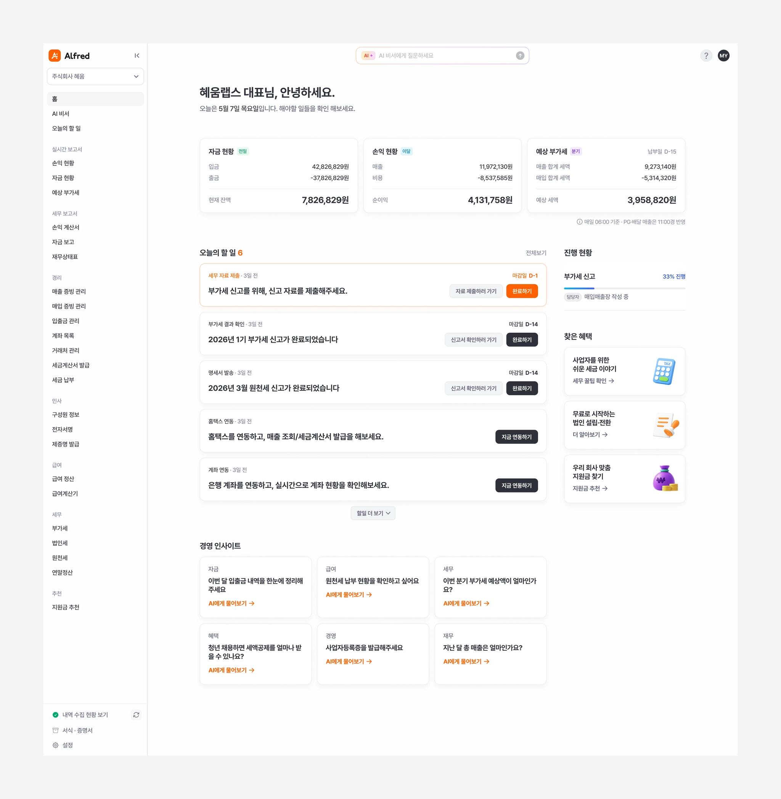
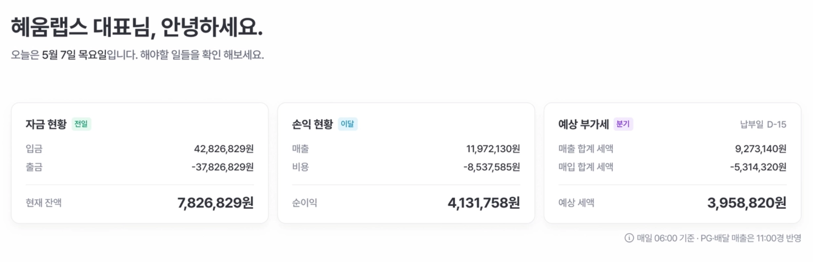
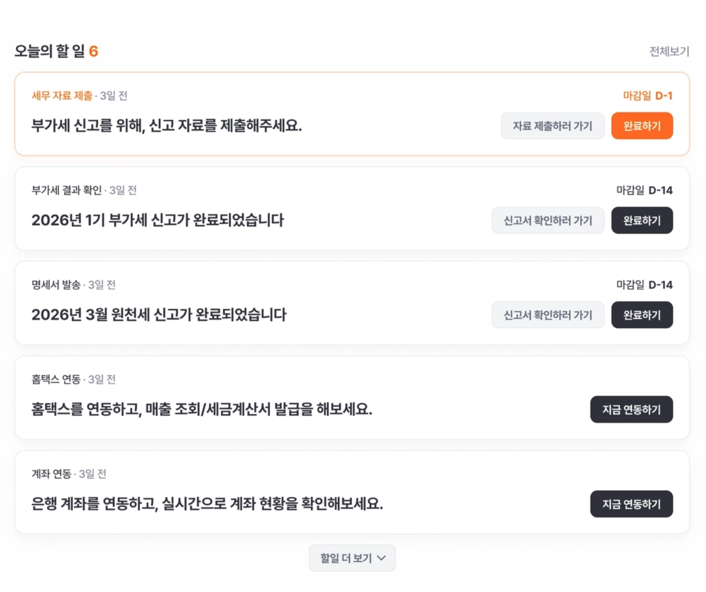
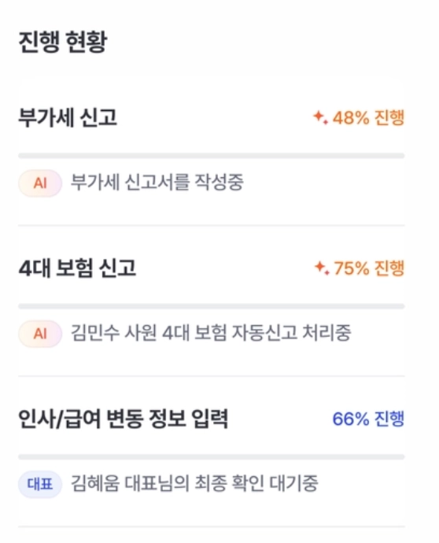
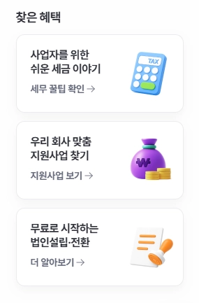
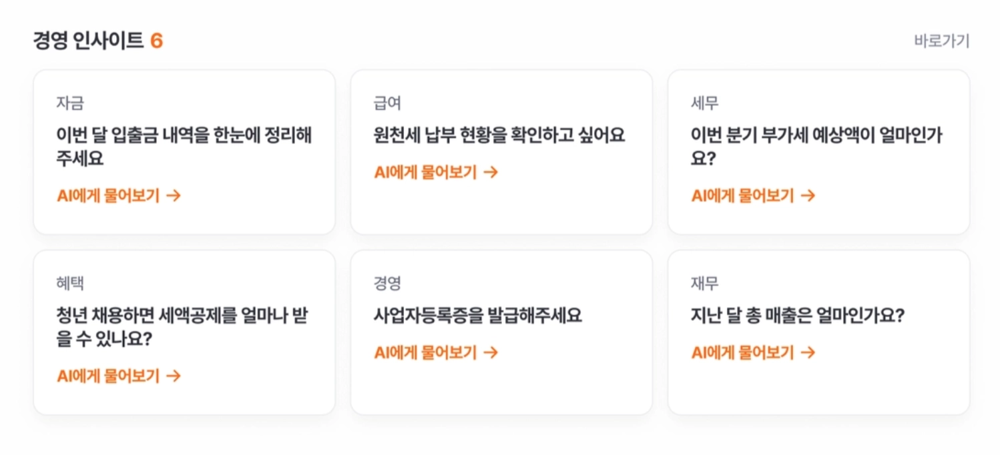

# Alfred Business 홈 화면_Universal Home

> 원문: https://support.alfred.kr/387e8268-560a-8105-9c74-d12effe0a528

> Alfred Business에 로그인하면 가장 먼저 **홈 화면**이 표시됩니다. 홈 화면에서는 현재 사업 운영에 필요한 주요 업무와 정보를 한눈에 확인할 수 있습니다.

**홈 화면에서 할 수 있는 일**

- 주요 현황 확인
- 진행 중인 업무 확인
- 추천 질문으로 AI 비서에게 바로 질문
- 자주 사용하는 기능 바로가기

---

### [Alfred Universal Home 화면 미리 확인하기]

---

### 1. 경영 현황

매일 업데이트되는 자금·손익·예상 부가세 등 사업 운영에 필요한 주요 정보를 카드로 확인할 수 있습니다. 
카드를 누르면 해당 보고서로 이동해 자세한 내역까지 볼 수 있습니다.

> 

### 2. 오늘의 할 일

오늘 날짜를 기준으로 급여, 신고, 경리 관련 확인하거나 처리해야 할 업무가 카드로 표시됩니다. 
카드에서 바로 업무를 처리하거나 필요한 화면으로 이동할 수 있습니다.

> 

### 3. 진행 현황

진행 중인 업무가 지금 어느 단계인지, 진행률은 얼마인지 확인할 수 있습니다.

> 

### 4. 찾은 혜택

사업에 도움이 되는 외부 서비스와 정보를 추천 받아 활용할 수 있습니다.

> 

### 5. 경영 인사이트

자주 묻는 질문이 카드로 모여 있습니다. 카드를 누르면 AI 비서가 바로 답변해 드립니다.

> 
