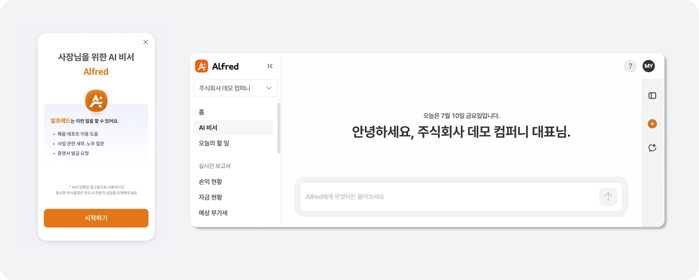
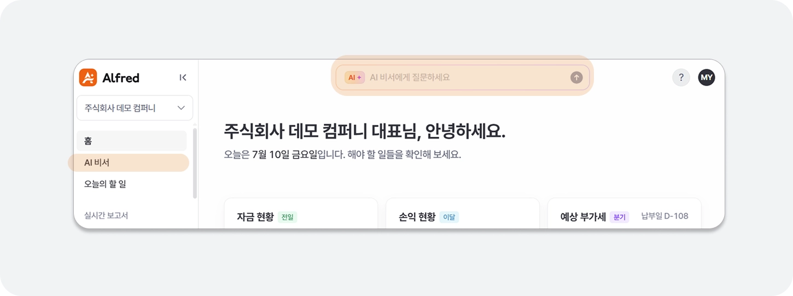
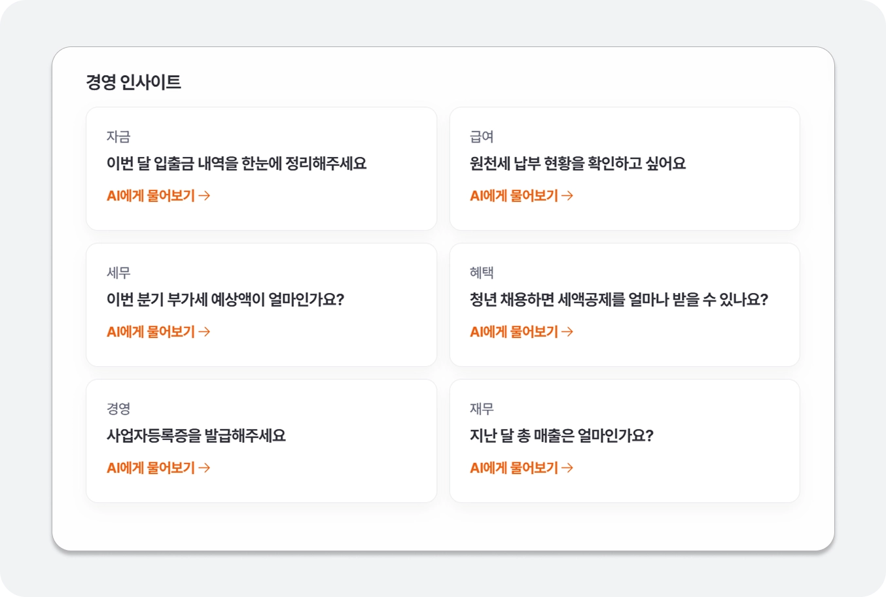

# AI 비서

> 원문: https://support.alfred.kr/6bbe8268-560a-83c8-9c73-81f2c66ccf6e

> **AI 비서는** 대화만으로 업무를 처리하는 Alfred Business의 새로운 진입 방식입니다. 여러 메뉴를 일일이 방문할 필요 없이, 홈 화면의 AI 비서에게 바로 요청하면 재무 정보 확인부터 증명서 발급, 세금계산서 발행까지 처리할 수 있습니다.

**이 메뉴에서 할 수 있는 일**

- 재무 정보(거래·계좌 내역) 확인
- 사업 관련 세무·노무 전문지식 문의
- 증명서 발급 요청
- 세금계산서 발행
- 등록 직원 및 급여 내역 조회

**경로 :** 홈 > AI 비서

**노출 대상:** 전체 (구독에 따라 이용 가능 기능이 다름)

---

### AI 비서 시작하기

홈 화면 상단 또는 좌측 메뉴의 AI 비서에서 대화를 시작할 수 있습니다. 사이드바에서 새 대화를 시작하거나 지난 대화를 다시 볼 수 있으며, 사이드바 열기를 클릭하면 고정됩니다.

---

### 구독별 이용 가능 기능

**무료 고객**

1. 재무 정보 확인 (거래 내역·계좌 내역 요약)
1. 사업 관련 세무·노무 전문지식 문의
1. 세금계산서 발행

**세무 기장 고객**

1. 재무 정보 확인 (거래 내역·계좌 내역 요약)
1. 사업 관련 세무·노무 전문지식 문의
1. 증명서 발급 요청
1. 세금계산서 발행
1. 등록 직원 및 급여 카드 내역 조회

---

### 기능 상세

#### 1. 재무 정보 확인

매일 매출·매입 금액 요약과 예상 수익을 안내받고, 매출·매입 거래 내역과 등록된 계좌의 입출금 내역을 확인할 수 있습니다.

질문 예시

- 작년 3, 4월 세금계산서 매입 금액이 총 얼마인가요?
- 올해 1분기에 신용카드로 결제(매입)한 금액이 얼마인가요?
- 이번 달 입금·출금 각 내역 합계를 계산해 주세요.
- 기업은행 대출 계좌 번호가 무엇인가요?

#### 2. 세무·노무 전문지식 문의

사업과 관련된 세무·노무 질문에 대해 학습된 데이터를 기반으로 답변합니다. 학습하지 않은 내용은 임의로 답변을 생성하지 않습니다. 세금 신고·납부, 서식·증명서, 비용 처리, 인건비 계산, 4대보험 자격요건, 지원금·절세 등 다양한 주제를 다룹니다.

질문 예시

- 비용 처리할 수 있는 물품과 자산으로 잡아야 하는 물품은 어떻게 구분하나요?
- 외국인 근로자도 국민연금에 가입해야 하나요?

#### 3. 증명서 발급

증명서 발급 메뉴에서 발급 가능한 모든 증명서를 AI 비서에게 요청할 수 있습니다. **세무 기장 고객만 이용할 수 있습니다.** 사업자 기초 서류, 결산 증명서, 부가세 관련 증명서, 원천세 증명서를 발급받을 수 있습니다.

요청 예시

- 사업자등록증명 발급해 주세요.
- 납세증명서 발급해 주세요.

#### 4. 세금계산서 발행

등록된 거래처 정보를 기반으로 거래명세서를 작성한 뒤 세금계산서 발행까지 진행할 수 있습니다. 이용을 위해서는 거래처 등록과 홈택스 인증서 연동을 먼저 완료해야 합니다.

요청 예시

- ○○상사에 소프트웨어 100,000원 세금계산서 발행해 주세요. (이후 AI가 거래명세서 작성과 발급에 필요한 추가 정보를 요청하면 입력합니다.)
- (거래명세서가 있을 경우) ○○상사에 거래명세서를 바로 세금계산서로 발행해 주세요.

#### 5. 홈 화면에서 유용한 AI 질문 카드 클릭하여 바로 질문 가능

---

### FAQ. 자주 묻는 질문

**AI 비서는 누구나 쓸 수 있나요?**

네. 다만 구독 상태에 따라 이용 가능한 기능이 다릅니다. 증명서 발급과 직원·급여 조회는 세무 기장 고객만 이용할 수 있습니다.

**AI가 모든 질문에 답하나요?**

학습된 데이터를 기반으로 답변하며, 학습하지 않은 내용은 임의로 답변을 생성하지 않습니다.

**세금계산서 발행이 안 돼요.**

거래처 등록과 홈택스 인증서 연동이 완료되어야 발행할 수 있습니다. 설정 > 연동 정보에서 인증서 연동 상태를 확인해 주세요.
