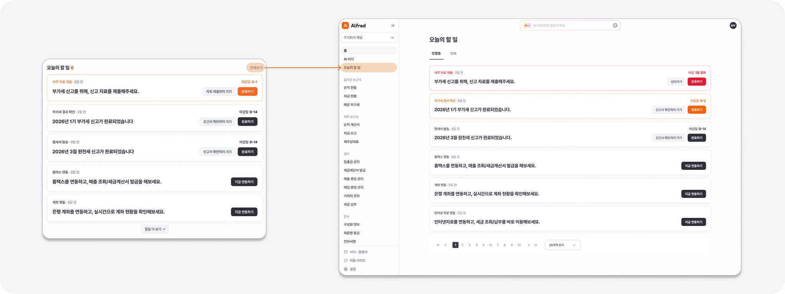

# 오늘의 할 일

> 원문: https://support.alfred.kr/a52e8268-560a-838a-b657-812e23c5b8a1

> **오늘의 할 일**에서는 지금 처리해야 할 업무를 카드 형태로 모아 확인할 수 있습니다. 세무 자료 제출, 신고 결과 확인, 기관 연동 등 놓치기 쉬운 할 일을 한곳에서 관리합니다.

**이 메뉴에서 할 수 있는 일**

- 처리해야 할 할 일 카드 확인 및 바로가기
- 완료했거나 넘어간 할 일 이력 확인

**경로:** 홈 > 오늘의 할 일

**노출 대상:** 전체 (구독 무관)

>

---

### 화면 구성

오늘의 할 일은 **진행중 / 완료** 두 개의 탭으로 구분됩니다.

#### 진행중 탭

아직 처리하지 않은 할 일이 표시됩니다. 홈 화면에 보이는 카드와 동일한 내용이 노출됩니다.

- **정렬 순서** : 마감일 순으로, 가장 긴박한 항목이 최상단에 표시됩니다.
- 각 카드에는 카드 생성일(예: 3일 전), 마감일(예: 마감일 D-14), 바로가기(CTA) 버튼이 표시됩니다.

#### 완료 탭

사용자가 완료 또는 넘어가기 처리한 카드가 모입니다.

- **정렬 순서** : 완료일 순으로, 최근에 완료한 항목이 최상단에 표시됩니다.
- 진행중 카드와 달리 다음과 같이 표시됩니다.
  - 카드 생성일 대신 **완료일**이 표시됩니다. (예: 26.05.22 완료)
  - 마감일 대신 **카드 상태**가 표시됩니다.
    - **완료** : 마감일 내에 정상적으로 완료 처리한 상태
    - **기한 경과** : 마감일 이후에 넘어가기 버튼으로 완료 처리된 상태
  - 바로가기(CTA) 버튼은 비활성화됩니다.

---

### FAQ. 자주 묻는 질문

**할 일 카드는 어디서 오나요?**

세무 자료 제출, 신고 결과 확인, 기관 연동 등 처리가 필요한 업무가 자동으로 카드로 만들어집니다. 홈 화면과 오늘의 할 일 진행중 탭에 동일하게 표시됩니다.

**'완료'와 '기한 경과'는 어떻게 다른가요?**

마감일 안에 완료하면 '완료', 마감일이 지난 뒤 넘어가기로 처리하면 '기한 경과'로 표시됩니다. 둘 다 완료 탭으로 이동합니다.

**완료 탭의 카드는 다시 처리할 수 있나요?**

완료 탭의 카드는 이력 확인용으로, 바로가기 버튼이 비활성화되어 있습니다.
