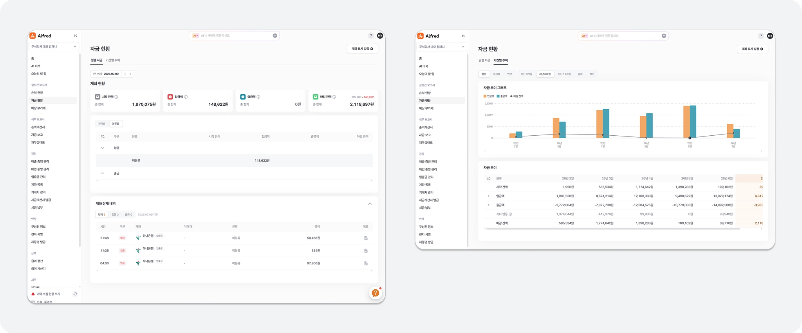

# 자금 현황

> 원문: https://support.alfred.kr/3cbe8268-560a-83b7-a899-81291811f6a8

> **자금 현황**에서는 우리 사업의 자금 흐름과 잔액을 실시간으로 확인할 수 있습니다. 기존의 '자금보고서'가 이번 개편으로 '자금 현황'으로 이름이 바뀌었습니다.

**이 메뉴에서 할 수 있는 일**

- 일별 자금 흐름 확인
- 기간별 자금 추이 확인
- 연동한 은행 계좌 기반 실시간 잔액 확인

**경로:** 실시간 보고서 > 자금 현황

**노출 대상:** 전체 (구독 무관)

---

### 화면 구성

자금 현황은 두 개의 탭으로 이루어져 있습니다.

#### 일별 자금 탭

날짜별 입금·출금·잔액 흐름을 확인합니다.

#### 기간별 추이 탭

선택한 기간 동안의 자금 추이를 그래프와 함께 확인합니다.

---

### 조회 기간 선택

원하는 기간 단위를 선택해 조회할 수 있습니다.

- **일** : 7일 / 30일 / 직접 선택
- **월** : 올해 / 3개월 / 6개월 / 12개월
- **분기** : 올해 / 3년
- **년** : 3년 / 5년

---

### FAQ. 자주 묻는 질문

**자금 현황은 어떤 데이터로 생성되나요?**

연동한 은행 계좌 정보를 바탕으로 생성됩니다.

**언제 업데이트되나요?**

연동된 계좌 데이터를 실시간으로 반영하며, 보통 하루 1회 업데이트됩니다.

**구독하지 않아도 볼 수 있나요?**

네. 자금 현황은 모든 사용자가 조회할 수 있습니다.
