# 제증명 발급

> 원문: https://support.alfred.kr/480e8268-560a-83ac-8ede-817ec3656359

> **제증명 발급**에서는 담당자에게 요청하지 않고 필요한 증명서를 직접 발급받을 수 있습니다.
기존에 '급여 > 구성원 관리 > 제증명발급'에 있던 기능이 이번 개편으로 '인사' 카테고리로 이동했습니다.

**이 메뉴에서 할 수 있는 일**

- 필요한 증명서 직접 요청 : 재직증명서, 경력증명서, 퇴직증명, 취업규칙 표준 템플릿(docx 파일로 다운)
- 발급 완료된 증명서 다운로드

**경로:** 인사 > 제증명 발급

**노출 대상:** 급여 구독 고객

> 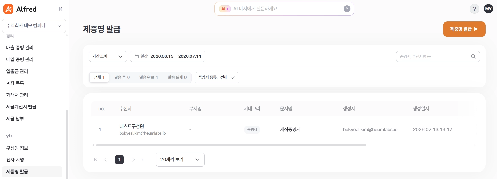

---

제증명 발급을 처음 이용하시는 고객은 아래의 순서에 따라 설정을 마무리해주세요.

### 1. 최초 설정

- **설정 > 전자 서명 · 제증명 관리** 메뉴에 접속합니다.
- **도장 · 사인 관리** 탭에 접속해서 회사에서 사용할 도장 또는 사인을 생성해주세요.

  > 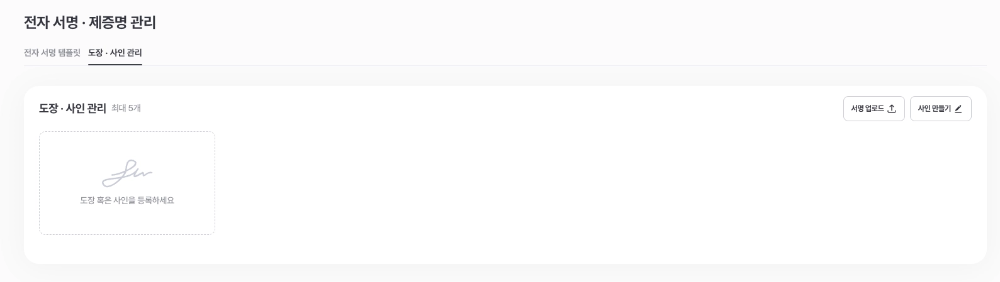

- **전자 서명 템플릿** 탭에 접속하셔서 사용하지 않으실 템플릿의 우측 ‘사용 관리’ 버튼을 클릭해서 비활성화해 주세요.

  > 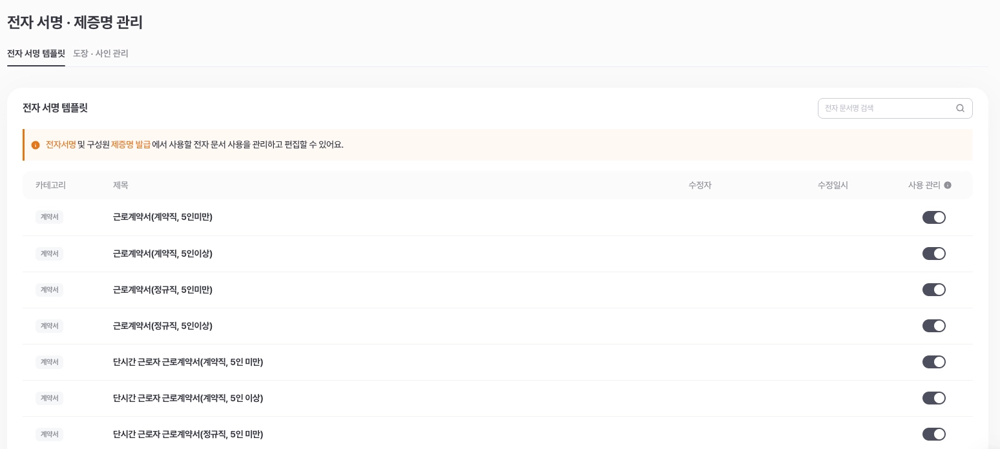

- 사용하실 문서별로 접속해서 사전에 설정이 필요한 내용이 있다면 수정하고 저장해주세요.

  > 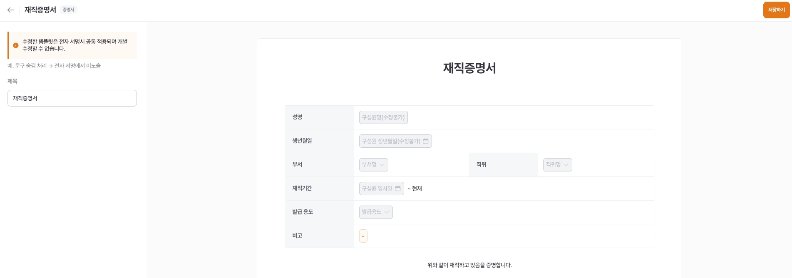

  **문서별로 제일 하단에 대표자 이름옆의 도장·사인은 꼭 등록해서 저장해주세요.** 처음에만 설정해두면, 나중에 전자 서명을 요청할 때마다 도장**·**사인이 자동 저장된 상태로 편하게 이용하실 수 있습니다.

  > 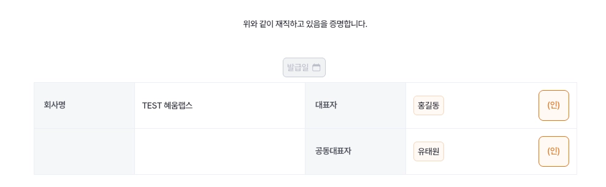

---

### 2. 제증명 발급 메뉴

- **구성원 정보 > 제증명 발급** 메뉴에 접속해주세요.
- 최초로 메뉴에 접속하실 경우 아래와 같은 화면이 뜹니다.

  > 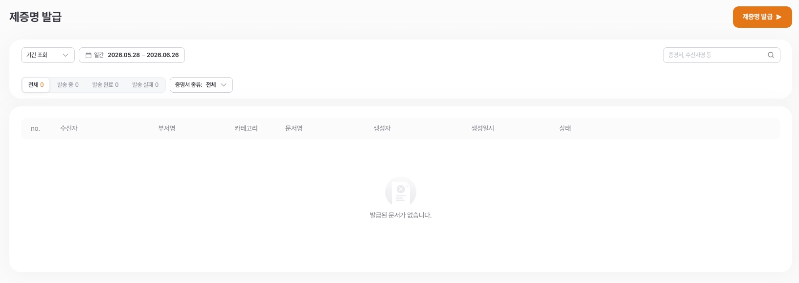

---

### 3. 제증명 발급하기

- 구성원에게 제증명을 발급하시려면, 우측 상단의 ‘**제증명 발급**’ 버튼을 클릭해주세요. 그러면 제증명 발급을 위한 단계가 시작됩니다.
  1. 발급할 증명서 종류를 선택하세요.
  1. 선택한 증명서에 따라서 필수로 입력해야하는 정보를 입력해주세요.

  > 

  > 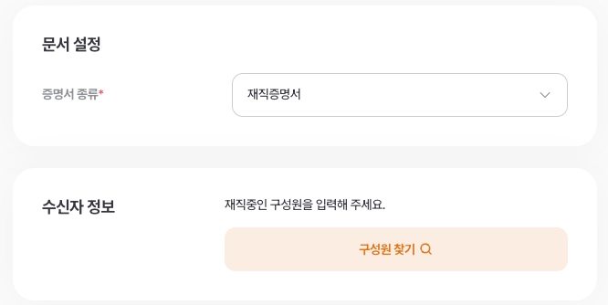
  >
  > 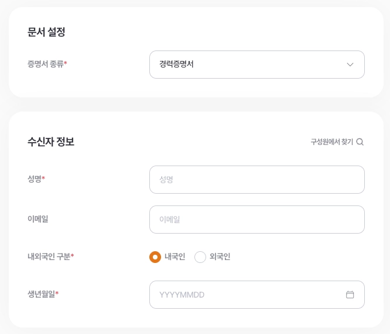
  >
  > 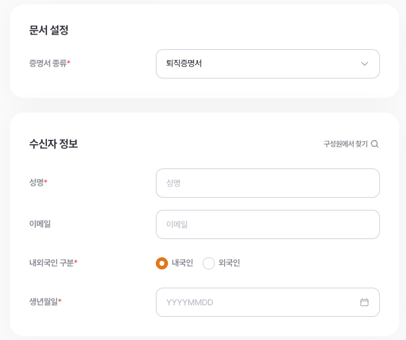

  1. 1단계 문서 설정을 완료하고 [다음] 버튼을 누르면 증명서에 들어갈 내용을 확인하는 화면이 나옵니다. 필수값을 모두 입력하면 증명서 발송이 가능해집니다.

  > 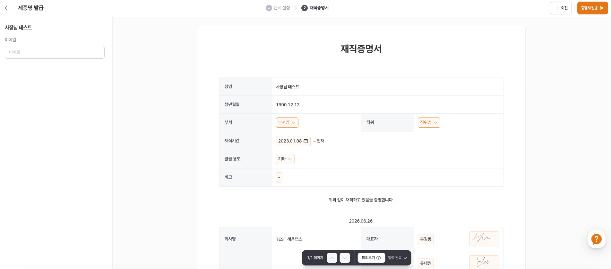

  1. 증명서 발송 버튼을 클릭하면 사전에 입력하신 수신자의 이메일이 채워져 있습니다. 이메일을 입력하지 않으실 경우 증명서를 발급할 수 없으니 꼭 수신자의 이메일을 작성해주세요.

  > 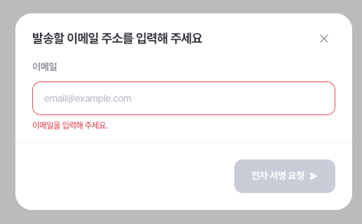

  1. `표준취업규칙`을 선택하시면, 회사의 퇴직금 제도를 선택하고 다음 버튼을 눌러주세요. 퇴직금 유형에 알맞게 작성된 표준 취업 규칙 양식을 제공합니다.

  > 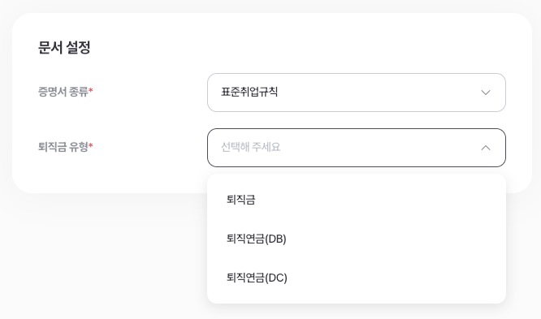

  1. 표준취업규칙에서 회사의 정책에 맞게 입력해야하는 곳을 모두 입력하시면 양식 다운로드 버튼이 활성화됩니다. 파일 형식은 `.docx`으로 제공되오니 참고 부탁드립니다.

  > 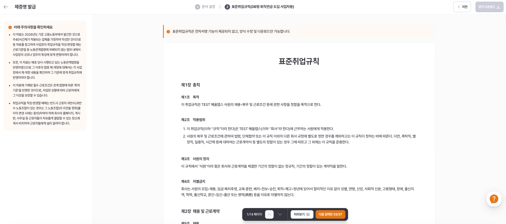
  >
  > 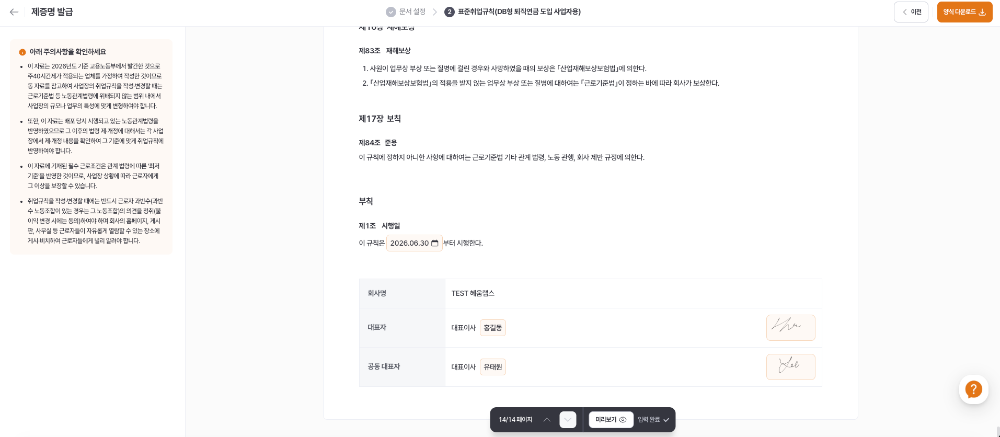

---

### FAQ. 자주 묻는 질문

**증명서 발급에 얼마나 걸리나요?**

요청 후 약 5분 이내에 발급되며, 요청이 많을 경우 최대 30분까지 소요될 수 있습니다.
