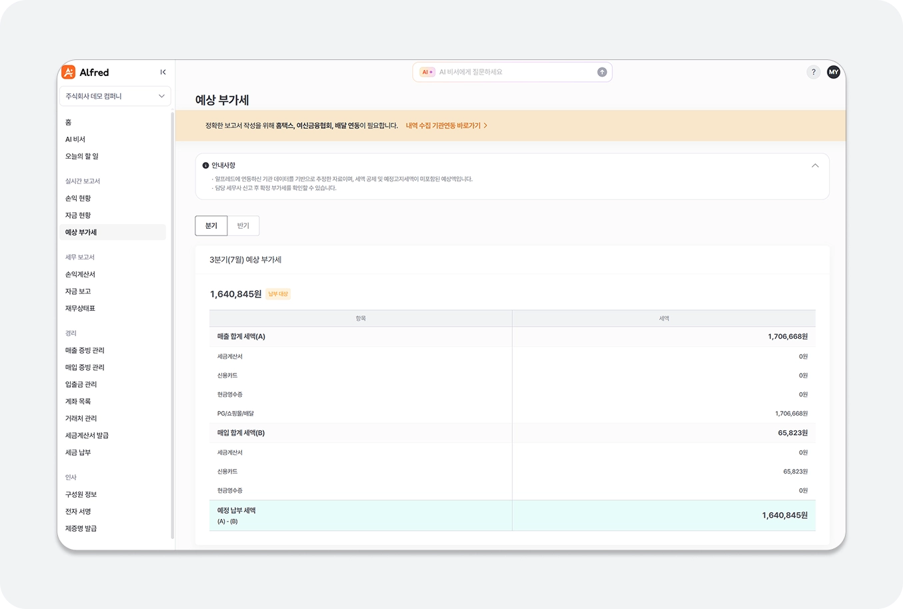
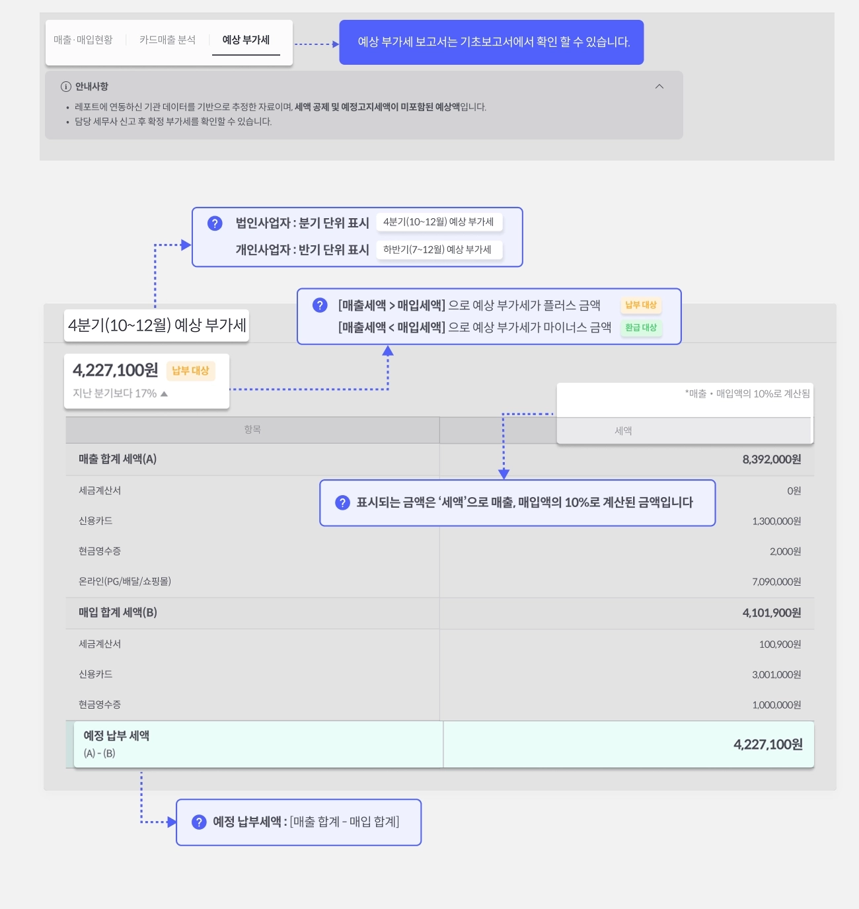
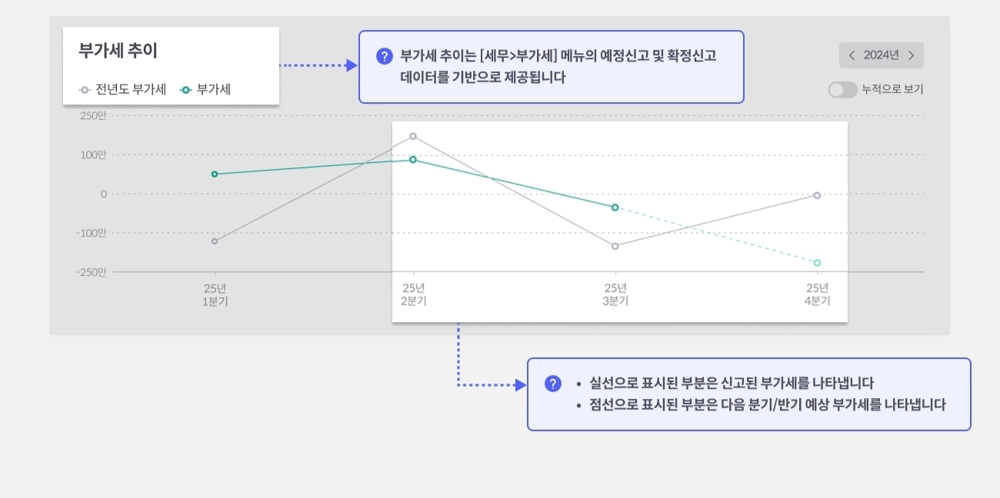
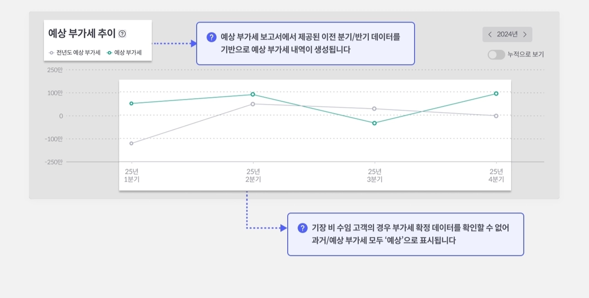

# 예상 부가세

> 원문: https://support.alfred.kr/feee8268-560a-82a9-8988-01c861817a8a

> **예상 부가세**에서는 실시간 매출·매입 데이터가 반영된 예상 세액을 확인할 수 있습니다. 세액 지출 준비, 환급 예상 파악, 부가세 기반 사업 추이 등 다양한 경영·자금 의사 결정에 활용할 수 있습니다.

**이 메뉴에서 할 수 있는 일**

- 이번 분기·반기 예상 부가세 세액 확인
- 환급 예상 여부 확인
- 연도별 부가세 변화 추이 확인

**경로:** 실시간 보고서 > 예상 부가세

**노출 대상:** 전체 (구독 무관)

---

### 화면 구성

#### 예상 부가세

- 법인사업자는 분기 단위, 개인사업자는 반기 단위로 표시됩니다.
- 표시되는 금액은 매출·매입 금액의 10%로 계산된 **세액**입니다.
- 매출세액보다 매입세액이 큰 경우 환급 대상으로 표시됩니다.

> 

#### 부가세 추이

전년도 부가세와 예상 부가세를 그래프로 비교해 연도별 부가세 변화 추이를 확인할 수 있습니다. 구독 상태에 따라 추이 표시에 차이가 있습니다.

- **세무 기장 고객** : 이번 분기·반기 예상 부가세와, 확정 신고된 지난 분기·반기 부가세가 함께 반영됩니다.

> 

**무료 고객** : 예상 부가세에서 계산된 '예상' 데이터가 반영됩니다.

> 

---

### FAQ. 자주 묻는 질문

**(무료 고객) 홈택스, 인터넷 지로를 연동해도 부가세 내역이 반영되지 않나요?**

확정 신고된 부가세 내역 조회를 위해서는 세무법인 혜움이 세무 대리인으로 지정되어야 합니다. 기장을 수임하지 않은 경우 확정 신고된 부가세 내역은 확인할 수 없습니다.

**(세무 기장 고객) 부가세 확정 신고 후에는 세액 공제 내역이 반영되나요?**

네. 부가세 확정 신고에 공제 내역이 포함되어 신고 완료된 경우, 부가세 추이의 지난 분기·반기 데이터에 세액 공제가 반영된 최종 납부 금액이 표시됩니다.

**예상 부가세와 부가세 추이는 언제 업데이트되나요?**

실시간 매출·매입 데이터가 반영됩니다. 분기·반기가 지난 직후 예상 부가세 계산 기간도 함께 변경됩니다. (예: 6월 30일 → 7월 1일이 되면 법인은 3분기, 개인은 하반기 예상 부가세를 표시)

**예상 부가세는 어떻게 사용할 수 있나요?**

연동된 매출·매입 거래 데이터가 있으면 자동으로 생성됩니다. 데이터를 제공받으려면 설정 > 연동 정보에서 매출·매입 데이터가 있는 기관을 연동해야 합니다.
