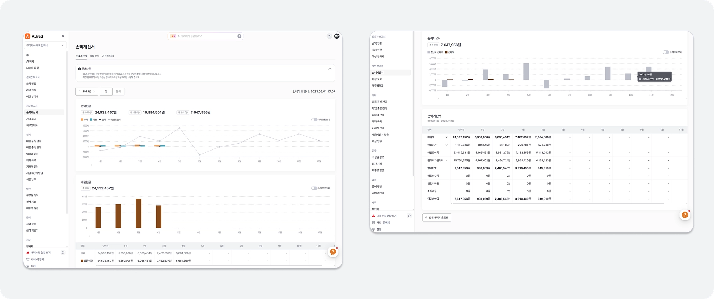
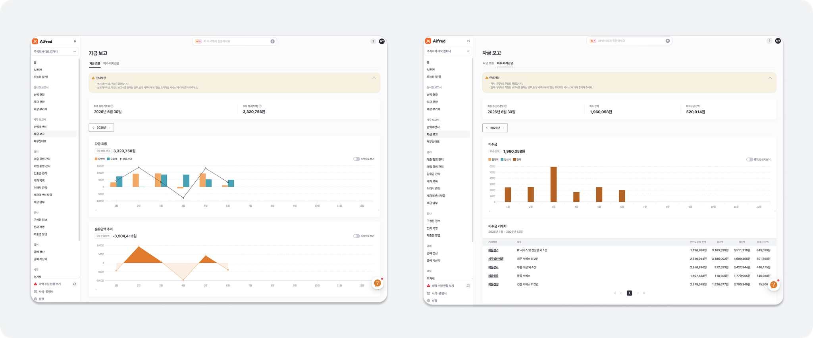
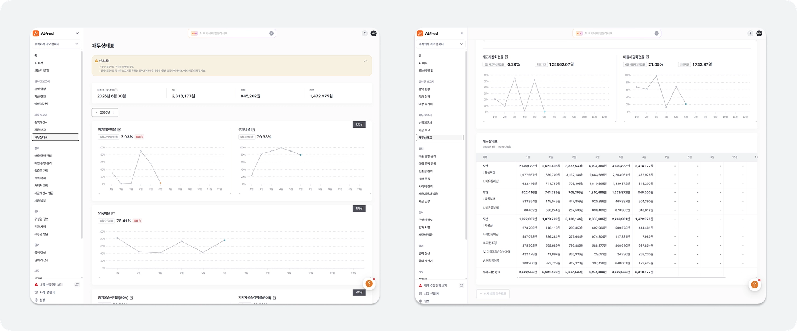

# 세무 보고서

> 원문: https://support.alfred.kr/399e8268-560a-813f-9636-fb289cc61f03

> **세무 보고**서에서는 (가)결산 처리된 세무 데이터를 기반으로 한 정식 재무 보고서를 확인할 수 있습니다. 
**세무 구독 고객**에게만 제공됩니다.

**이 섹션에서 할 수 있는 일**

- 손익계산서·비용·인건비 내역 확인
- 결산 기반 자금 흐름과 미수·미지급금 확인
- 재무상태표 확인
- 각 보고서 엑셀 다운로드

**노출 대상:** 세무 구독 고객

---

### 하위 메뉴

#### 손익계산서

- 손익 요약과 상세, 비용 분석, 인건비 내역을 탭으로 확인하고 다운로드할 수 있습니다.
- [손익계산서 메뉴 자세히 알아보기>>](04-실시간-보고서/01-메뉴-기준-가이드-현황-v.3/README.md)

#### 자금 보고

- 현금성 자산별 자금 흐름과 미수·미지급금을 탭으로 확인합니다.
- [자금 보고 메뉴 자세히 알아보기>>](04-실시간-보고서/01-메뉴-기준-가이드-현황-v.3/README.md)

#### 재무상태표

자산·부채·자본 현황을 확인합니다.

