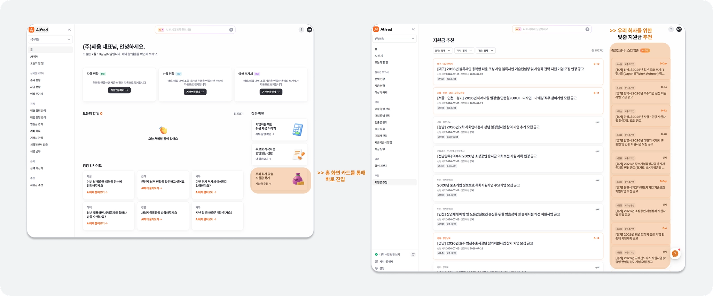

# 지원금 추천

> 원문: https://support.alfred.kr/398e8268-560a-81f9-b6d3-c8273109635b

> **지원금 추천**에서는 신청 가능한 정부·지자체 지원금을 확인하고, 우리 회사에 맞는 지원금을 AI가 골라 추천해 드립니다. 놓치기 쉬운 혜택을 한눈에 확인할 수 있습니다.

**이 메뉴에서 할 수 있는 일**

- 신청 가능한 전체 지원금 공고 확인
- 우리 회사 맞춤 추천 지원금 확인
- 각 지원금의 상세 정보 확인

**경로:** 추천 > 지원금 추천 (홈 화면의 '찾은 혜택' 영역에서도 진입 가능)

**노출 대상:** 전체 (구독 무관)

---

### 화면 구성

지원금 추천 화면은 두 가지 목록으로 이루어져 있습니다.

#### 전체 지원금 (왼쪽)

현재 신청할 수 있는 지원금 공고를 모두 보여줍니다.

#### 맞춤 추천 (오른쪽)

전체 지원금 중 우리 회사에 맞는 지원금만 골라 보여줍니다. 조회 중인 회사의 **업종**과 **지역** 정보에 맞는 지원금이 추천되며, 최대 15개까지 표시됩니다. 업종이 명확히 분류되지 않는 경우에는 특정 업종에 한정하지 않고 추천합니다.

---

### 목록에 표시되는 기준

두 목록 모두 **지금 신청할 수 있는 지원금**만 표시됩니다.

- 신청이 시작된 지원금이 목록에 나타납니다.
- 신청이 마감된 지원금은 목록에서 제외됩니다.
- 상시 모집하는 지원금은 등록된 시점부터 계속 표시됩니다.

**업데이트 주기**

목록은 매일 새벽 4시에 갱신됩니다.

---

### FAQ. 자주 묻는 질문

**전체 지원금과 맞춤 추천은 어떻게 다른가요?**

전체 지원금은 지금 신청할 수 있는 모든 공고를 보여주고, 맞춤 추천은 그중 우리 회사의 업종·지역에 맞는 지원금만 골라 보여줍니다.

**목록은 얼마나 자주 바뀌나요?**

매일 새벽 4시에 갱신됩니다. 새로 신청이 시작된 지원금이 반영되고, 마감된 지원금은 제외됩니다.

**맞춤 추천이 우리 회사와 안 맞는 것 같아요.**

맞춤 추천은 회사 정보의 업종·지역을 기준으로 합니다. 업종이 명확히 분류되지 않으면 폭넓게 추천될 수 있으니, 회사 정보가 정확히 등록되어 있는지 확인해 주세요.

**신청하려던 지원금이 목록에 없어요.**

아직 신청이 시작되지 않았거나 이미 마감된 지원금은 표시되지 않습니다. 신청 기간에 있는 지원금만 목록에 나타납니다.
