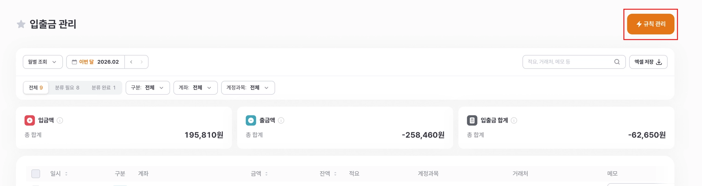
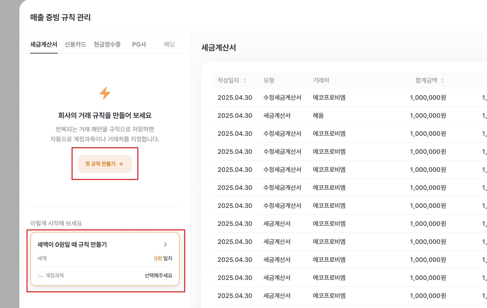
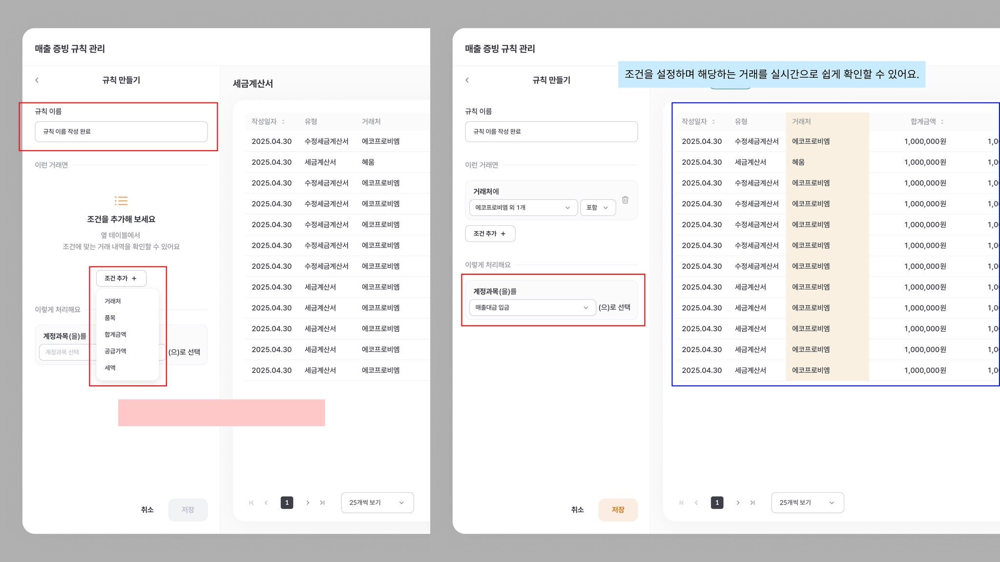
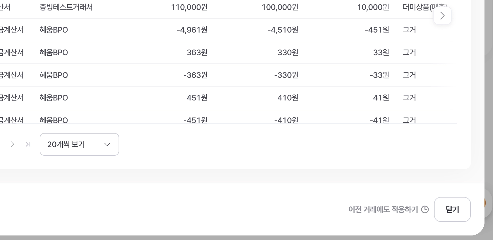
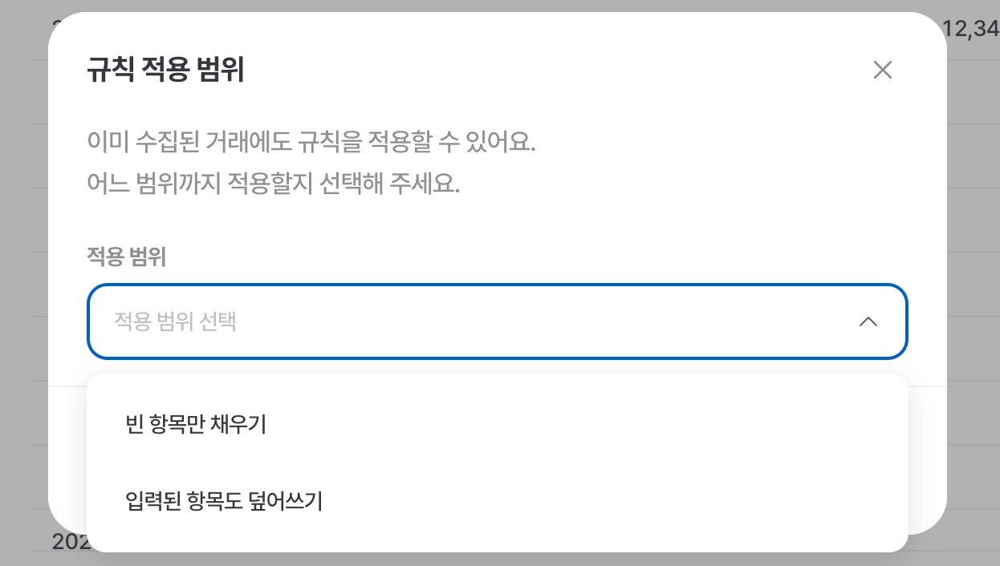
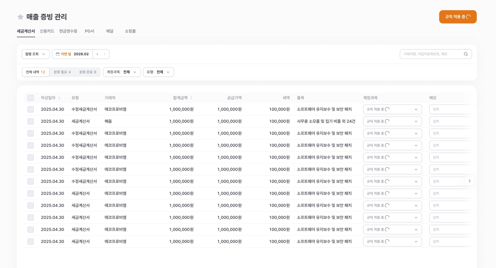
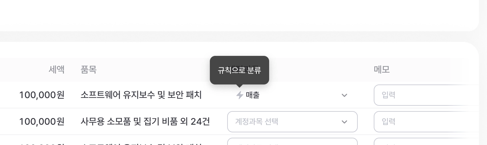
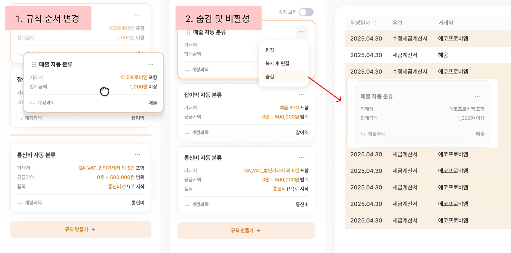

# [경리] 규칙기반 자동분류

> 원문: https://support.alfred.kr/39ce8268-560a-806c-aeb6-f4b83445bed7

우리 회사의 규칙을 설정하여 매번 반복되는 거래의 분류를 한 번에 처리할 수 있습니다.

### 규칙 만들기

규칙 관리 기능은 `[경리] 입출금 관리`, `[경리] 매출 증빙 관리`, `[경리] 매입 증빙 관리` 3개의 메뉴에서 사용할 수 있습니다.

1. 거래 관리 화면 상단의 **규칙 관리**를 선택합니다.

1. **+ 첫 규칙 만들기**를 선택합니다.

1. 규칙 이름·조건·결과(계정과목, 거래처)를 입력합니다.
  - 조건을 입력하는 동안 오른쪽 사전 조회 영역에서 매칭 거래가 즉시 갱신됩니다. 의도한 거래가 잡히는지 확인하면서 조건을 다듬을 수 있습니다.

1. **저장**을 클릭하여 작성한 규칙을 저장합니다.

### 규칙 적용하기(이전 거래)

규칙을 생성하기 이전의 거래에도 생성한 규칙에 따라 자동 분류가 가능합니다.

1. 규칙 관리 화면에서 **이전 거래에도 적용하기**를 클릭합니다.

1. 적용 범위를 선택합니다.
  - **빈 항목만 채우기**: 아직 분류되지 않은 이전 거래에 적용
  - **입력된 항목도 덮어쓰기**: 모든 이전 거래에 적용

1. 이전 거래에도 적용을 선택할 경우 일괄 적용이 진행됩니다.

### 자동 분류 결과 확인하기

- 거래 목록의 분류 컬럼에 표시된 아이콘으로 규칙 자동 분류된 거래를 식별할 수 있습니다.

### 규칙 관리하기

1. 마우스 드래그를 통해 규칙이 적용되는 순서를 변경할 수 있습니다.
1. 숨김 기능을 통해 규칙을 비활성 처리할 수 있습니다.

