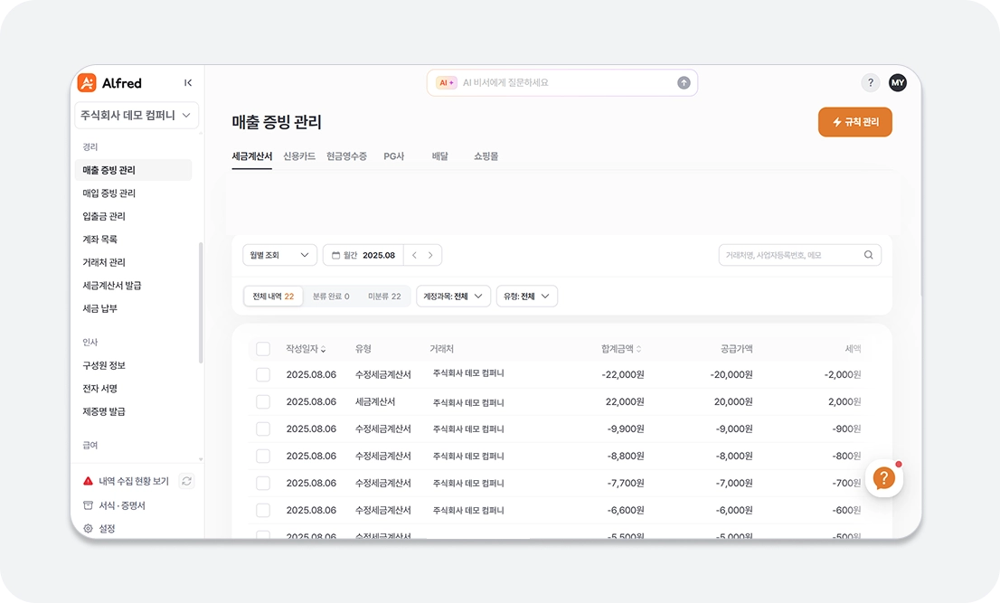
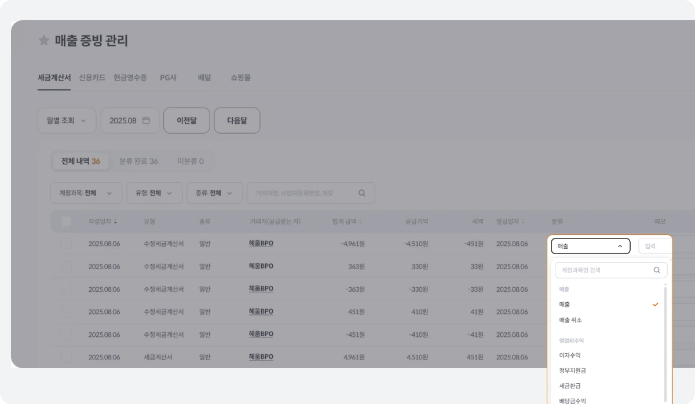

# 매출 증빙 관리

> 원문: https://support.alfred.kr/610e8268-560a-82c5-85c7-011d3e3d80dd

> **매출 증빙 관리**에서는 연동된 매출 내역을 발생 수단별로 확인하고, 증빙을 매칭·분류할 수 있습니다. 발급한 세금계산서를 포함한 매출 증빙 전체를 여기서 관리합니다.

**이 메뉴에서 할 수 있는 일**

- 연동된 매출 내역을 발생 수단별로 확인
- 매출 증빙 내역과 계좌 입출금 내역 매칭 및 분류
- 발급된 세금계산서 포함 매출 증빙 전체 관리

**경로:** 경리 > 매출 증빙 관리

**노출 대상:** 전체 (구독 무관)

---

### 매출 유형

매일 새벽 자동 내역 업데이트 및 수동 내역 업데이트된 매출 내역을 조회하고 관리하는 화면입니다.

연동된 매출은 연동 기관에 따라 아래 내용의 매출 유형을 모두 확인할 수 있습니다.

- **세금계산서** : 홈택스를 통해 수집되는 세금계산서 발급 이력
- **현금영수증** : 홈택스를 통해 수집되는 현금영수증 발급 이력
- **신용카드** : 여신금융협회를 통해 수집되는 오프라인 카드 매출 이력
- **PG** : PG사를 통해 수집되는 온라인 카드 매출 이력(`나이스페이먼츠, 토스페이먼츠, 이니시스, 토스페이(간편), 네이버페이(결제), 유플러스(구 토스), 엑심베이, 헥토파이낸셜, KSNET`)
- **쇼핑몰 매출** : `올라`를 통해 수집되는 쿠팡, 스마트스토어 쇼핑몰 매출 이력
- **배달** : 배달앱을 통해 수집된 각 배달앱 매출 이력(`배달의 민족, 쿠팡이츠, 요기요`)

> 조회하고 싶으신 매출 유형에 따라 **‘설정 > 내역 수집 기관 연동 메뉴’**에서 기관을 연동해주세요!

수동으로 매출 내역의 **계정과목을 설정**하거나 **자주 사용하는 규칙 설정**을 통해 매출 내역을 관리할 수 있습니다.

- **개별 분류** : 각 매출 항목의 분류가 ‘계정과목 선택’ 상태일 경우 직접 계정과목을 선택 가능합니다.
  (선택 이후 변경 가능)

  

- **규칙기반 자동분류** : 우리 회사의 규칙을 설정하여 매번 반복되는 거래의 분류를 한 번에 처리할 수 있습니다.
  - 매출 내역 왼쪽 상단 `[규칙 관리`] 버튼 클릭
  - [규칙기반 자동분류 기능 자세히 알아보기 >>](01-경리-규칙기반-자동분류.md)

---

### FAQ. 자주 묻는 질문

**매출 내역은 어떻게 수집되나요?**

연동한 외부 기관(홈택스, 카드사, 쇼핑몰, PG사, 배달 등)에서 받아온 매출 데이터가 자동으로 수집됩니다.

**언제 업데이트 되나요?**

연동된 데이터를 반영하며, 매일 새벽에 **전일자 데이터**가 1회 업데이트 됩니다.

## 하위 페이지

- [[경리] 규칙기반 자동분류](01-경리-규칙기반-자동분류.md)
