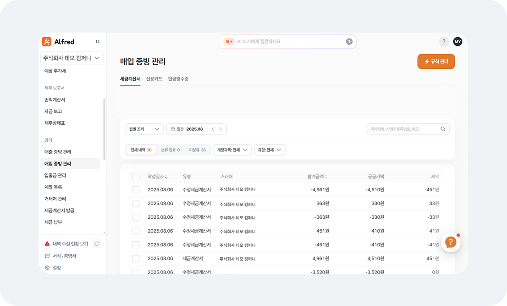
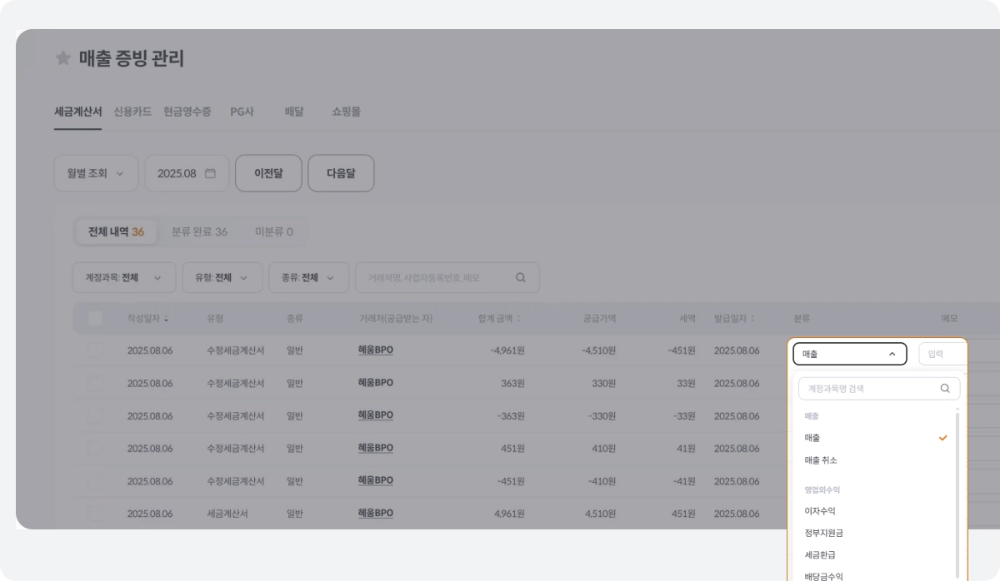

# 매입 증빙 관리

> 원문: https://support.alfred.kr/305e8268-560a-82ce-beb3-0153034f45f2

> **매입 증빙 관리**에서는 지출에 대한 매입 내역을 발생 수단별로 확인하고, 증빙을 매칭·분류할 수 있습니다.

**이 메뉴에서 할 수 있는 일**

- 연동된 매입 내역을 발생 수단별로 확인
- 매입 증빙 내역과 계좌 입출금 내역 매칭 및 분류
- 유형별 매입 증빙 전체 관리

**경로:** 경리 > 매입 증빙 관리

**노출 대상:** 전체 (구독 무관)

---

### 매입 유형

연동된 매입은 발생 수단에 따라 아래 유형으로 확인할 수 있습니다.

- **세금계산서** : 홈택스를 통해 수집되는 세금계산서 발급 이력
- **신용카드** : 여신금융협회를 통해 수집되는 오프라인 카드 사용 내역
- **현금영수증** : 홈택스를 통해 수집되는 현금영수증 발급 이력

> 조회하고 싶으신 매입 유형에 따라 **‘설정 > 내역 수집 기관 연동 메뉴’**에서 기관을 연동해 주세요!

수동으로 매입 내역의 **계정과목을 설정**하거나 **자주 사용하는 규칙 설정**을 통해 매입 내역을 관리할 수 있습니다.

- **개별 분류** : 각 매입 항목의 분류가 ‘계정과목 선택’ 상태일 경우 직접 계정과목을 선택 가능합니다.
  (선택 이후 변경 가능)

- **규칙기반 자동분류** : 우리 회사의 규칙을 설정하여 매번 반복되는 거래의 분류를 한 번에 처리할 수 있습니다.
  - 매입 내역 왼쪽 상단 **`[규칙 관리]`** 버튼 클릭
  - [규칙기반 자동분류 기능 자세히 알아보기 >>](01-매출-증빙-관리/01-경리-규칙기반-자동분류.md)

---

### FAQ. 자주 묻는 질문

**매입 내역은 어떻게 수집되나요?**

연동한 외부 기관(홈택스, 카드사 등)에서 받아온 매입 데이터가 자동으로 수집됩니다.

**언제 업데이트되나요?**

연동된 데이터를 반영하며, 보통 하루 1회 업데이트됩니다.
