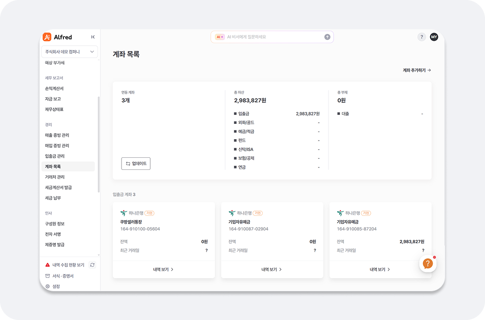

# 계좌 목록

> 원문: https://support.alfred.kr/063e8268-560a-827a-818d-812f197970cc

> **계좌 목록**에서는 연동한 전체 계좌의 요약 정보를 한눈에 확인할 수 있습니다.

**이 메뉴에서 할 수 있는 일**

- 연동한 전체 계좌의 요약 정보 확인
- 계좌별 잔액, 최근 거래일, 만기일 등 주요 정보 확인
- 계좌 추가 및 외화 계좌 잔액·환율 확인

**경로:** 경리 > 계좌 목록

**노출 대상:** 전체 (구독 무관)

> 조회하고 싶으신 계좌를 **‘설정 > 내역 수집 기관 연동 메뉴’**에서 은행/계좌 연동을 먼저 진행해 주세요!

---

### 화면 구성

**1. 계좌 요약 정보**

연동한 전체 계좌의 잔액, 최근 거래일, 만기일 등 주요 정보를 확인할 수 있습니다. 
입출금 계좌·외화 계좌는 `내역 보기` 버튼으로 해당 계좌의 상세 거래 내역 화면으로 바로 이동할 수 있습니다.

**2. 계좌 추가**

계좌를 1개 이상 등록하면 나타나는 `계좌 추가하기` 버튼으로 계좌를 추가할 수 있습니다.

**3. 외화 계좌**

외화별 계좌 잔액과 적용 환율, 외화 입출금 거래 금액을 확인할 수 있습니다.

---

### FAQ. 자주 묻는 질문

**계좌 내역은 언제 업데이트되나요?**

매일 새벽에 전체 계좌 거래 내역을 불러오므로 전날까지 연동한 계좌 내역을 확인할 수 있습니다. 바로 확인하려면 새로고침 버튼을 사용할 수 있으며, 10분 간격으로 다시 시도할 수 있습니다.
