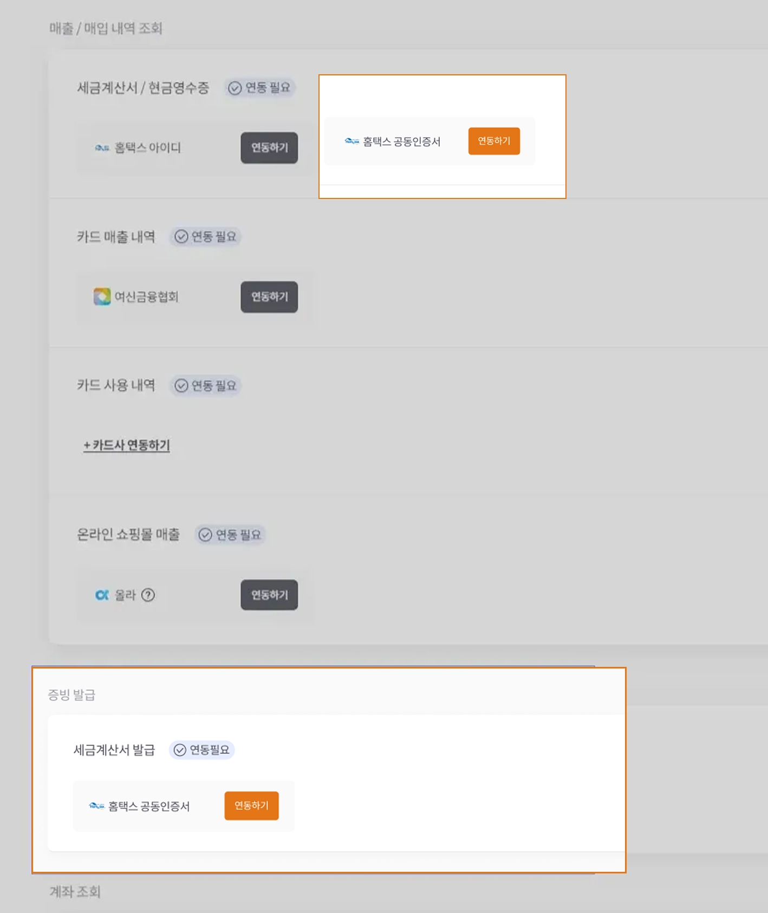
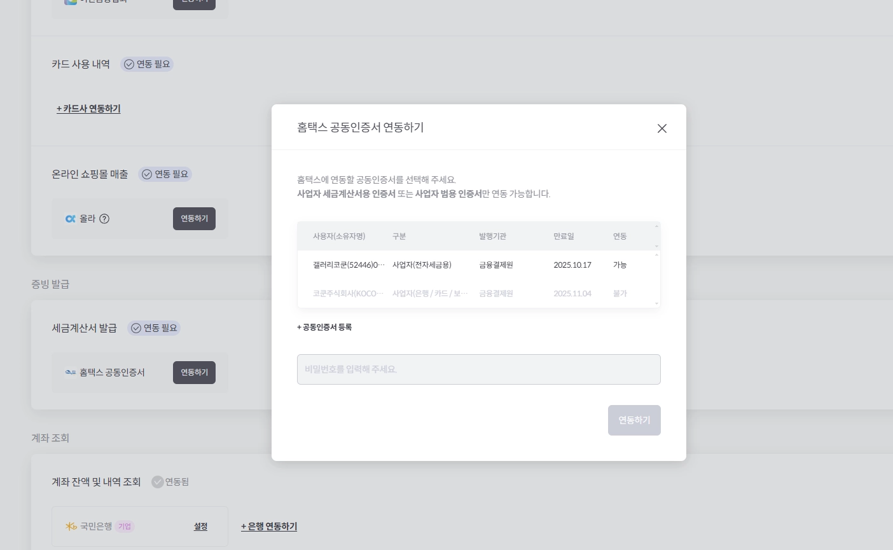
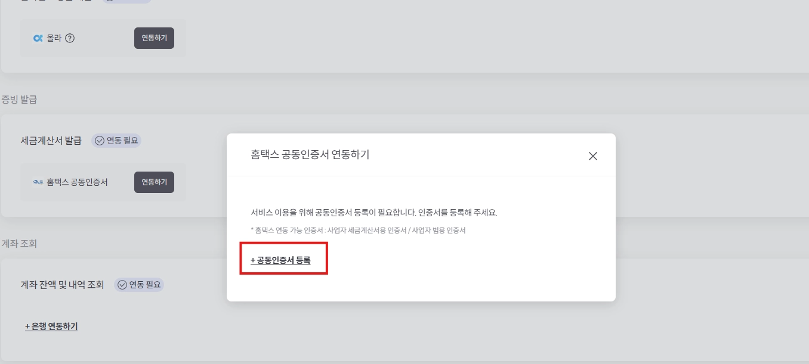
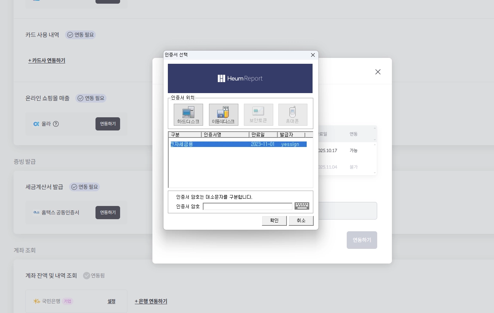
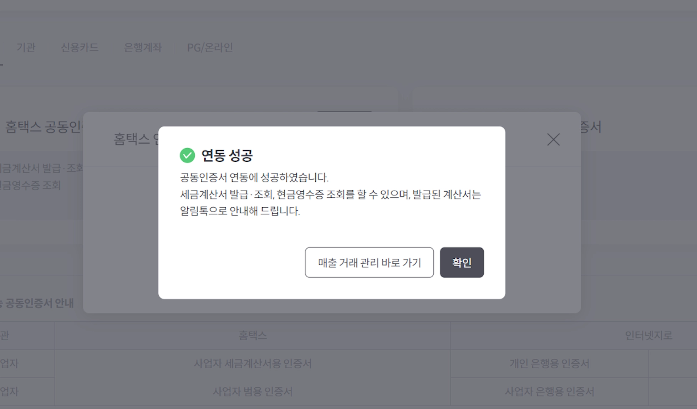

# 공동인증서 연동 가이드

> 원문: https://support.alfred.kr/1d9e8268-560a-820c-817d-01d3685968b9

> - 알프레드에서 세금계산서 발행은 거래명세서를 등록 후 등록한 거래명세서를 기반으로 세금계산서 발행이 이루어집니다.
>
> - 세금계산서 발행을 위해서는 홈택스 인증서 연동되어야 합니다. 아래 인증서를 사용하여 연동해주세요
>   - 사업자 범용 공동인증서
>
>   - 사업자 전자세금용 공동인증서

## [공통] 홈택스 인증서 연동하기

---

1. **설정 > 내역 수집 기관 연동** > **증빙 발급**의 **세금계산서 발급** > **홈택스 연동**을 선택합니다.

> 단, 이미 매출/매입 내역조회의 홈택스 공동인증서 연동을 진행하셨을경우, 세금계산서 발급을 위한 인증서 연동도 자동 완료 됩니다. (추가 진행 불필요)

2. **이미 알프레드에 등록된 공동인증서가 있으신 경우**

- 전자세금계산서를 발급 하실 때 사용하시는 **공동인증서를 선택**합니다. 공동인증서 비밀번호를 입력하고 연동하기를 선택합니다.
- 연동이 가능한 인증서는 **`가능`**이라는 문구가 노출됩니다.

  

**3. 알프레드에 등록된 공동인증서가 없으신 경우**

- 홈택스 공동인증서 연동하기 버튼 클릭  공동인증서 등록 버튼을 선택합니다.

  

- 위 버튼을 선택 시 공동인증서 등록 프로그램이 실행됩니다. 범용 혹은 전자세금계산서 발급이 가능한 공동인증서를 선택합니다. 비밀번호를 입력 후 확인을 선택합니다.

  

4. 등록이 정상적으로 성공되면 아래와 같은 화면이 발생합니다.

## FAQ

---

**거래명세서를 필수로 작성해야 하나요?**

- 네 거래명세서 작성은 세금계산서 정보입력단계에 해당됩니다. 거래명세서/세금계산서가 별도가 아니므로 세금계산서 작성 단계 중 하나로 보시면 됩니다.

**거래명세서 등록을 위해서 무엇이 필요한가요?**

- 공급받으시는 분의 상호명, 대표자명 사업자 번호 혹은 주민등록번호를 알아야 합니다.

**위수탁 거래명세서는 작성이 불가능한가요?**

- 현재 제공되지 않는 기능으로 추후에 제공될 예정입니다.

**세금계산서 수정 발행이 가능한가요?**

- 현재는 세금계산서 수정 발행기능은 제공되지 않습니다. 향후 발급된 거래명세서도 수정가능한 기능을 제공할 예정입니다.

**세금계산서 발급 전 수정이 불가능한가요?**

- 발급 전 수정은 해당 거래명세서를 수정하시면 수정된 내용이 세금계산서 발급 미리보기 화면에 반영됩니다.

**발급한 세금계산서가 조회되지 않습니다.**

- 우 상단 거래명세서 등록 버튼 **옆에 내역업데이트 버튼을 눌러**주세요. 해결되지 않는다면 고객 센터에 문의 부탁드립니다.

**이전에 발급한 세금계산서가 조회되지 않습니다.**

- 발급한 시점이 이전 년도에 포함된다면 조회되지 않습니다. 현재는 레포트에 홈택스 인증서를 등록한 당해년도의 세금계산서만 조회됩니다. (eg. 2023년 1월에 인증서 등록 시 2023년 발급된 세금계산서만 조회 가능)
