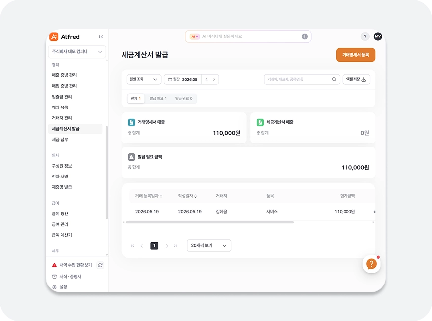
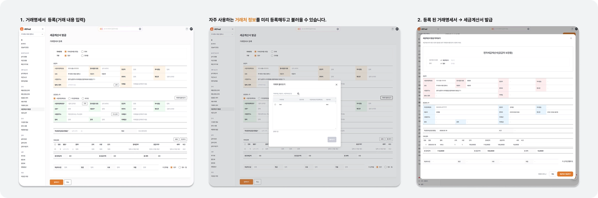

# 세금계산서 발급

> 원문: https://support.alfred.kr/0bee8268-560a-8340-9c64-019a9ea23ed1

> **세금계산서 발급**에서는 거래명세서를 등록하고, 이를 기반으로 세금계산서를 발급할 수 있습니다.

**이 메뉴에서 할 수 있는 일**

- 거래명세서 등록
- 등록한 거래명세서 기반 세금계산서 발급
- 발급 내역 조회

**경로:** 경리 > 세금계산서 발급

**노출 대상:** 전체 (구독 무관)

> 세금계산서 발급을 위해서는 홈택스 인증서 연동이 필요합니다. 
Alfred Business에서 세금계산서를 직접 발급하시고 싶으신 경우, 먼저 **설정 > 내역 수집 기관 연동 > 증빙 발급**에서 공동인증서를 등록해 주세요!  
**>>**[공동인증서 등록 방법 자세히 보기](01-공동인증서-연동-가이드.md)
단, 이미 매출/매입 내역 조회의 홈택스 공동인증서 연동을 진행하셨을 경우, 세금계산서 발급을 위한 인증서 연동도 자동 완료됩니다. (추가 진행 불필요)

---

### 발급 절차

세금계산서는 거래명세서를 먼저 등록한 뒤, 등록한 명세서를 기반으로 발급됩니다.

**1. 거래명세서 등록**

공급받는 분의 상호명, 대표자명, 사업자번호(또는 주민등록번호)를 입력해 거래명세서를 등록합니다. 거래명세서 작성은 세금계산서 정보 입력 단계에 해당하며, 별도 문서가 아닙니다.

**2. 세금계산서 발급**

등록한 거래명세서를 기반으로 세금계산서를 발급합니다.

> 자주 사용하는 거래처 정보를 미리 **[거래처 관리]**에서 등록해두고, 정보를 불러와서 거래명세서 등록 및 세금계산서 발급을 할 수 있습니다.

---

### FAQ. 자주 묻는 질문

**거래명세서를 꼭 작성해야 하나요?**

네. 거래명세서 작성은 세금계산서 정보 입력 단계에 해당하므로, 세금계산서 작성 과정의 일부입니다.

**발급 전 수정이 가능한가요?**

발급 전에는 해당 거래명세서를 수정하면 수정 내용이 발급 미리보기 화면에 반영됩니다. 다만 발급 후 수정 발행 기능은 현재 제공되지 않습니다.

**이전에 발급한 세금계산서가 조회되지 않습니다.**

홈택스 인증서를 등록한 당해 연도의 세금계산서만 조회됩니다. 이전 연도에 발급한 건은 조회되지 않습니다.

## 하위 페이지

- [공동인증서 연동 가이드](01-공동인증서-연동-가이드.md)
