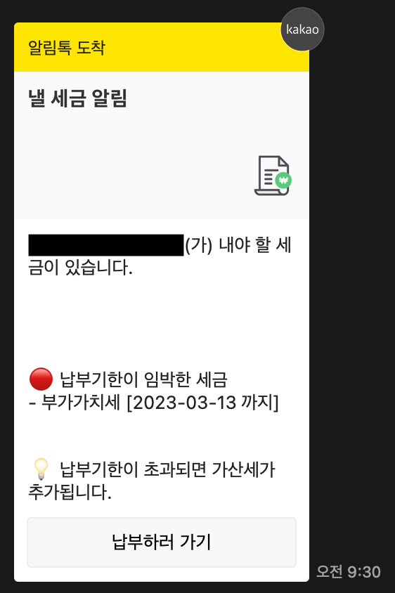
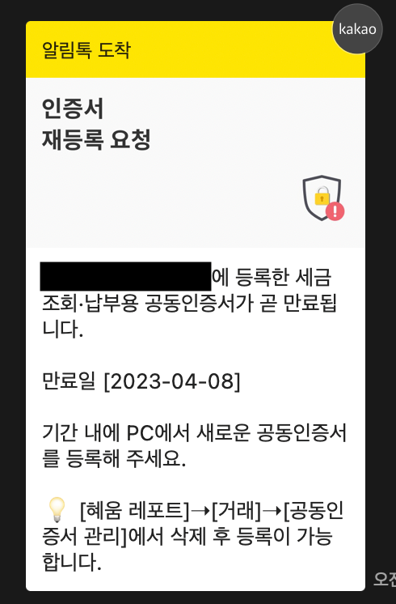
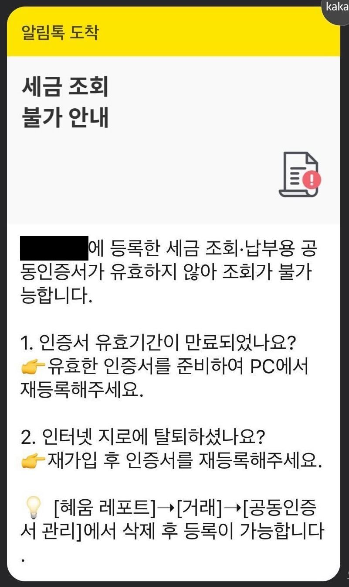

# 낼 세금 알림 안내

> 원문: https://support.alfred.kr/39de8268-560a-80a8-a263-cfb17bd971fa

## FAQ

---

#### 언제 발송되나요?

- 평일 오전 09:30에 납부기한이 임박한 세금이 있을 시 발송됩니다.
  - 납부기한이 임박한 세금은 납부일이 D-3일에서 ~ 당일까지인 세금을 말합니다.

#### 수신을 거부하거나 수신 받을 대상을 지정할 수 있나요?

- 기장 담당자에게 수신 거부 요청을 하시면됩니다.
- 기장 담당자에게 수신 받으실 분(고객님 회사의 구성원)을 요청하시면 됩니다.

#### 세금을 납부하라고 알림이 두 번 발송되었어요. 이 경우는 무엇인가요?

- 원천세, 법인세 경우 기장 담당자가 `납부 마감 알림`을 발송합니다.
- 이 경우 `납부 마감 알림(기장 담당자 발송)` + `낼 세금 알림(세금납부 자동 발송)`으로 2번 알림을 받으실 수 있습니다. 납부 전에 기장 담당자에게 확인 후 납부하시면 됩니다.

#### 모든 회사에게 전부 발송되나요?

- `혜움 레포트 >금융기관 연동` 에서 인터넷 지로 연동을 완료한 회사만 알림을 받을 수 있습니다.

#### 조회 실패했다는 알림을 받았어요. 이 경우는 무엇인가요?

- 등록된 공동인증서로 정상적인 조회가 불가능하다는 안내입니다.
- 고객님이 등록하신 공동인증서가 만료되었거나 인터넷지로를 탈퇴했을 시 발생합니다. (최초 1회)
  - 만료 시 레포트에서 유효한 공동인증서 재등록해주세요. [공동인증서 재등록 안내](https://support.alfred.kr/122e8268-560a-81cd-bc23-ef5d52320e70)
  - 인터넷지로 탈퇴 시 [인터넷지로](https://www.giro.or.kr/index.do)에 재가입 후 레포트에서 공동인증서를 재등록해주세요.

---

### 알림 목록

## 세금 납부 알림

- 납부기한이 3일 이내인 세금 항목을 알림으로 받을 수 있습니다.

## 인증서 만료 알림

- 등록한 인증서의 만료일자가 30일 남았을 때 알림을 받을 수 있습니다.

## 세금조회 불가 알림

- 등록된 공동인증서로 세금 조회가 불가능할때 최초 1회 발송됩니다.
