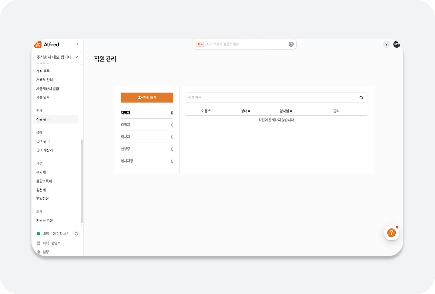
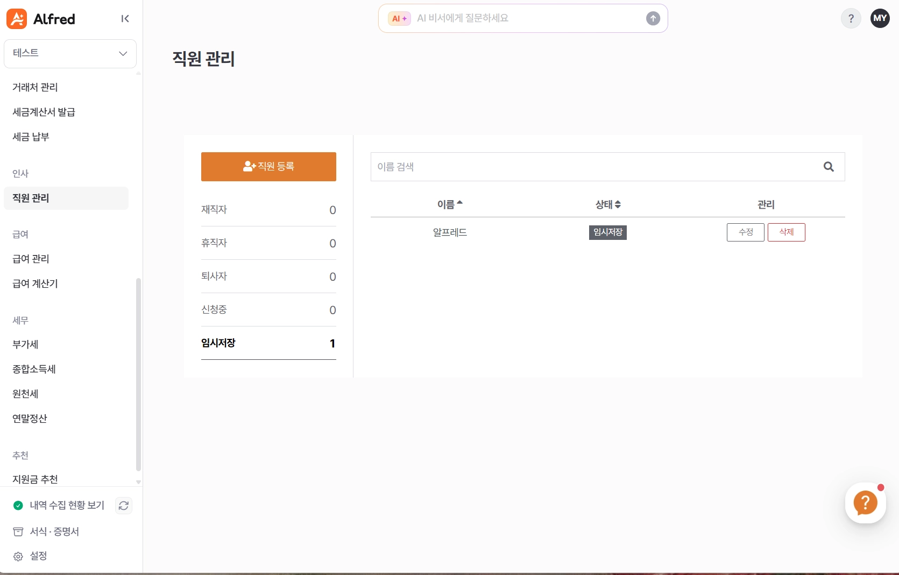
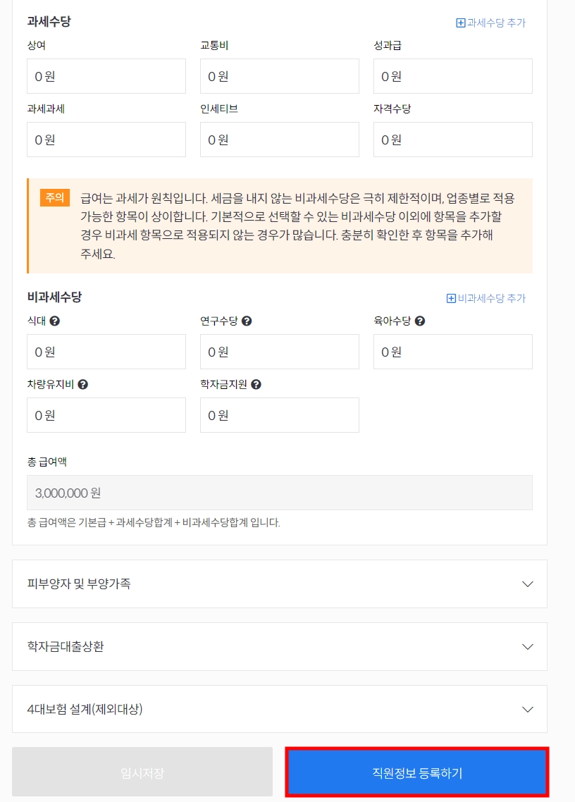

# 직원 관리

> 원문: https://support.alfred.kr/e9be8268-560a-8286-a472-01f4e2ae443b

> **직원 관리**에서는 직원 정보를 등록하고 관리할 수 있습니다. 기존에 '세무 > 인사 > 직원관리'에 있던 기능이 이번 개편으로 '인사' 카테고리로 이동했습니다.

**이 메뉴에서 할 수 있는 일**

- 직원 정보 등록 및 관리
- 직원 상세 정보 확인 및 수정

**경로:** 인사 > 직원 관리

**노출 대상:** 세무 구독 고객

> 급여 구독 고객에게는 이 메뉴 대신 신규 메뉴인 '구성원 정보'가 노출됩니다. 직원 관리는 향후 구성원 정보로 통합될 예정입니다.

---

### 직원 등록하기

> 혜움에 처음 가입했을 때, 직원 정보를 자동으로 등록해 드립니다.
다만, 혜움에 전달해 주신 ERP(더존, 세무사랑)에 직원 정보가 등록되어 있어야 합니다.

### 1. 직원 목록 확인

등록되어있는 직원들의 목록을 볼 수 있습니다.  직원의 `수정` 버튼 클릭하시면 해당 직원의 상세 정보를 확인하실 수 있습니다.

> 처음 가입 시, 전달한 ERP(더존, 세무사랑)에 직원 정보가 등록되어 있으면, 임시저장 목록에서 조회됩니다.

> 

1. 필수 정보를 추가로 입력한 후 `직원정보 등록하기` 를 눌러 주세요. 직원 정보가 등록됩니다.

각 직원의 상세 정보를 확인하고 필수 정보를 입력한 뒤 등록합니다. 등록이 필요 없는 직원은  `삭제` 버튼을 선택하여 삭제할 수 있습니다.

> 

---

### FAQ. 자주 묻는 질문

**직원 정보는 자동으로 등록되나요?**

처음 가입 시 전달한 ERP(더존, 세무사랑)에 직원 정보가 등록되어 있으면 자동으로 등록됩니다. 이후 필수 정보를 추가로 입력해 등록을 완료할 수 있습니다.
