# [급여] 급여 관리 -  추가 급여 생성 및 입력(업데이트)

> 원문: https://support.alfred.kr/39de8268-560a-80c1-97d2-d5484b07acb6

## FAQ

---

#### 추가 급여 입력은 무엇인가요?

- 계산중 혹은 완료된 급여 외에 추가로 계산이 필요한 급여카드를 입력할 수 있는 기능입니다.
  - 추가 계산이 필요한 급여는 **이전에 입력한 급여를 수정하는 것이 아닌 추가할 때** 사용됩니다.
- 일용 소득, 사업 소득, 기타 소득자의 급여를 입력하고 계산 후 급여대장을 제공받을 수 있습니다.

#### 신규 입사자, 중도 퇴사자, 직원 지급액 변동의 경우도 지원해주나요?

- 아닙니다. **추가 급여카드는 일용, 사업, 기타 소득만 지원**합니다.
- 신규 입사자, 중도 퇴사자는 담당자에게 연락을 통해 계산중 혹은 완료된 급여를 해제 후 재입력이 필요합니다.

#### 추가 급여카드가 생성되지 않습니다.

- `입력가능` 상태의 급여카드가 있는 경우 생성되지 않습니다.
- 원천세가 신고된 경우, 혹은 마감일 5일 전 부터는 추가 급여카드 생성이 불가합니다.

#### 추가 급여카드를 삭제하고 싶습니다.

- 계산 요청 전에 가능합니다. 계산 요청 후 삭제는 담당자에게 연락을 취해 `입력가능` 상태로 변경한 후 직접 삭제하셔야 합니다.
- `입력가능` 상태의 추가 급여카드에 진입 후, 우측 하단에 `이 급여카드 삭제` 텍스트 버튼을 누르시면 삭제됩니다.

#### 계산 완료된 추가 급여 카드는 어디에서 보나요?

- `완료` 상태의 카드에서 볼 수 있습니다. 동일한 귀속월에 속한 경우 묶여져서 보입니다.(귀속년월 순으로 보기가 체크해제 시 별도로 노출됩니다.)

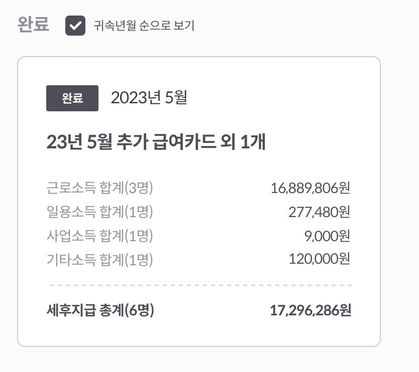

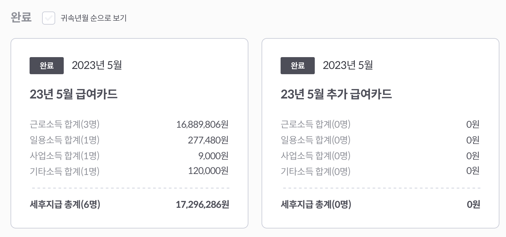

## 추가 급여 카드 생성 및 입력

---

1. 추가 급여 대상이 속하는 동일한 귀속월 카드를 선택합니다. (`계산중` 혹은 `완료` 카드 중에 선택)
- 생성하려는 급여카드는 해당 급여 원천세 신고 마감일 -5일 전까지만 생성할 수 있습니다.
- 예) 8월 XX일 입력 마감 → 8월 XX일 급여 지급 → 9월 10일 원천세 신고: 8월 5일까지 생성 및 계산요청 가능
  - 예시로 8월 XX일에 1번 카드에 들어가면 `추가 급여카드 생성` 버튼이 노출되고. 2번 카드에 들어갈 시 노출되지 않습니다.

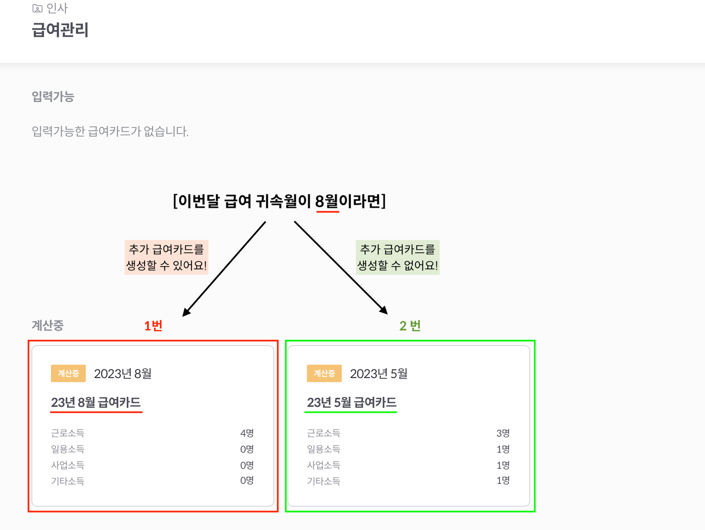

2. 추가 급여 대상이 되는 귀속월의 **계산중, 완료 급여카드에 들어가** 아래와 같이 **`급여카드 추가`** 버튼을 선택합니다.

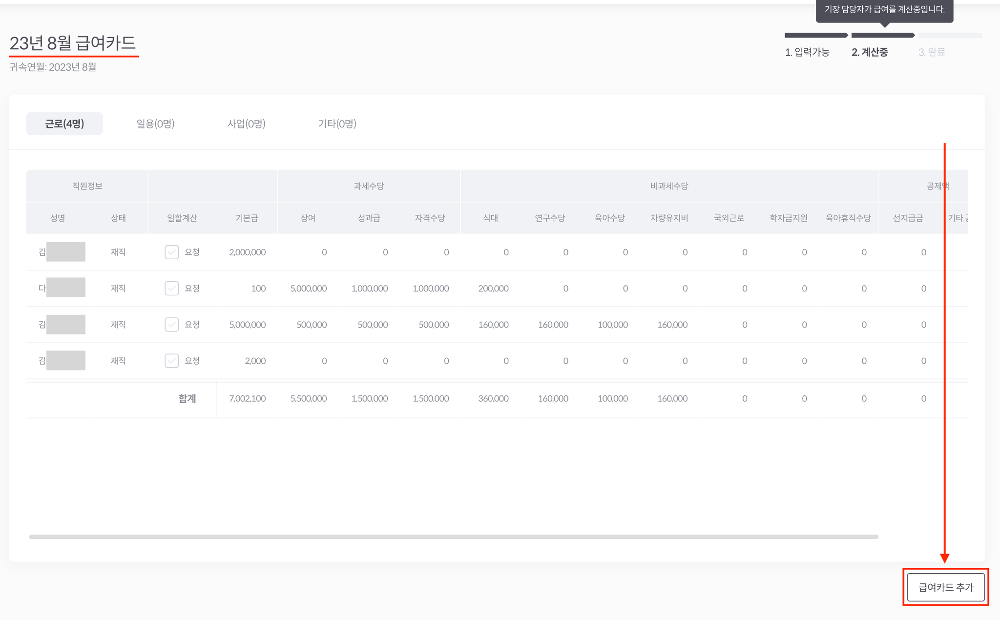

3. 노출되는 팝업에서 `급여카드 추가` 버튼을 선택합니다.

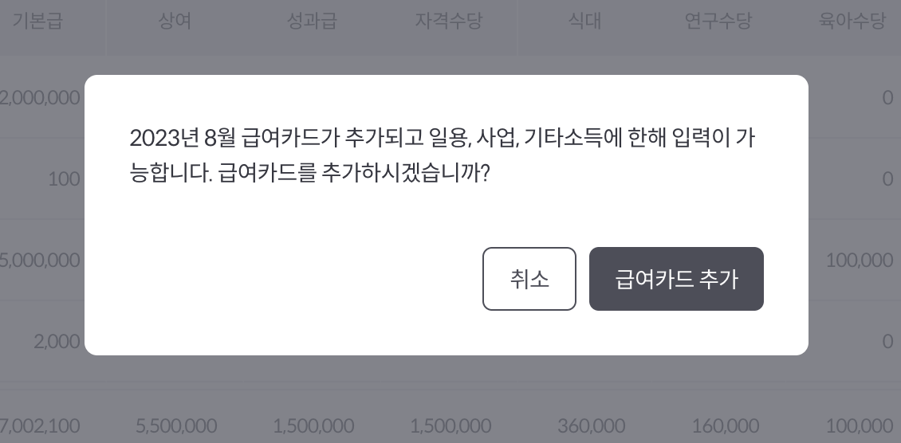

4. 급여 리스트 화면으로 이동되며 추가 급여카드가 노출됩니다.

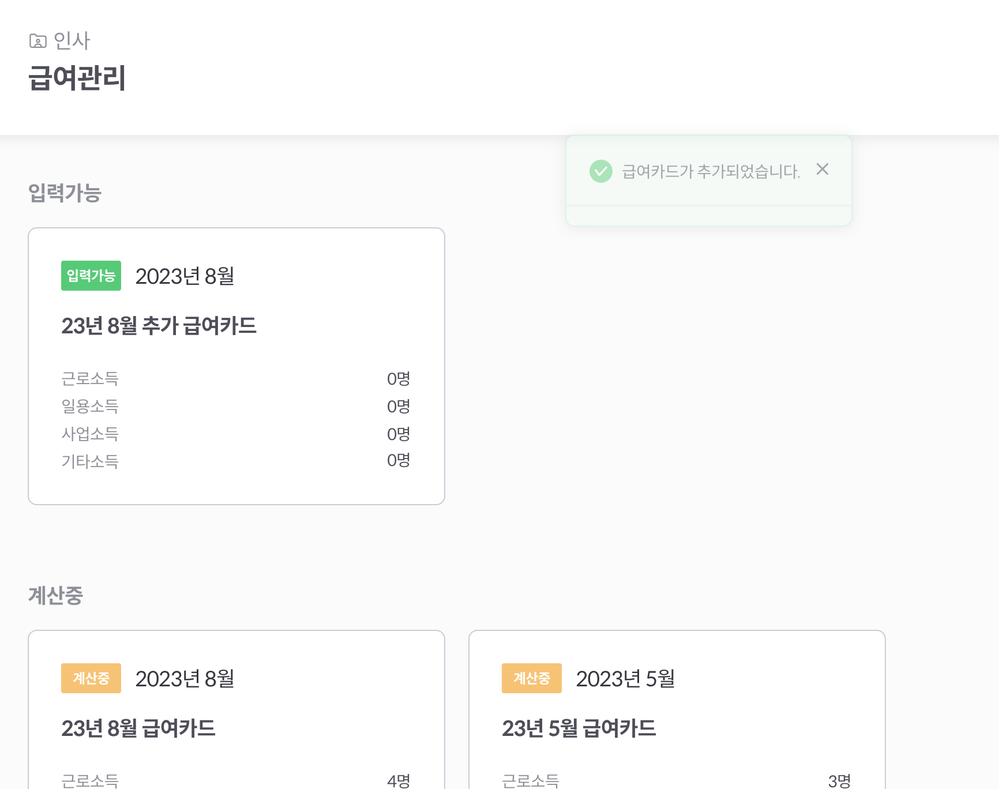

5. 근로소득자를 제외한 일용, 사업, 기타 소득자의 정보를 입력합니다. 계산 필요 시 우측 아래 `계산 요청 버튼`을 선택합니다.

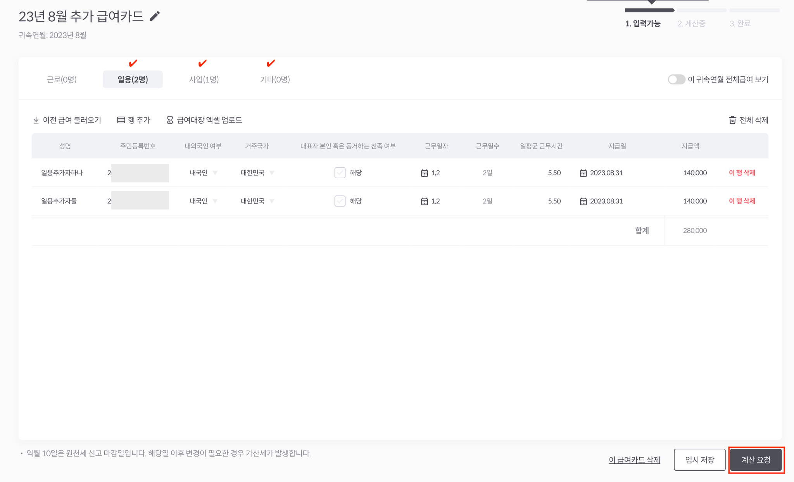

6. 노출되는 팝업에서 `계산 요청 버튼`을 선택합니다.

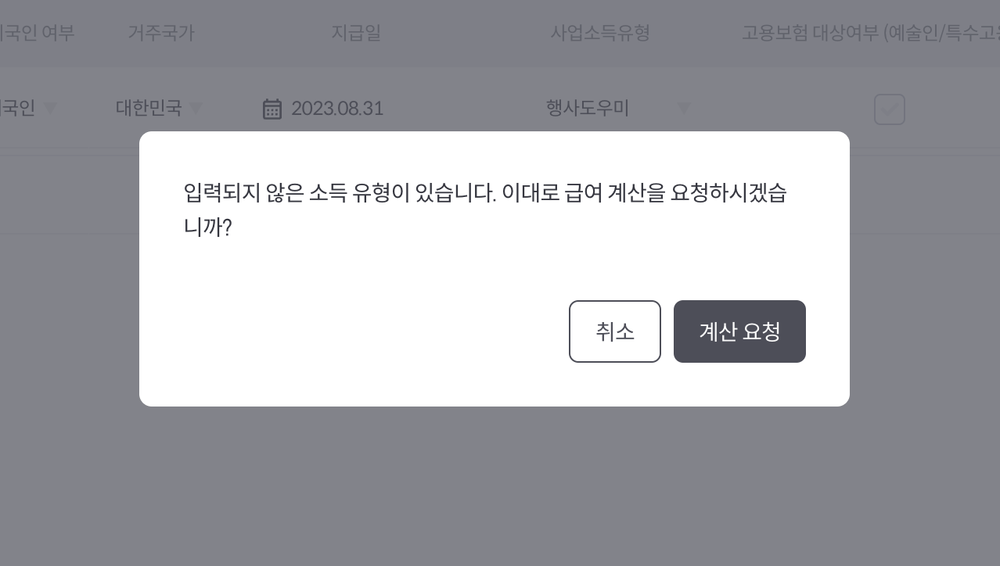

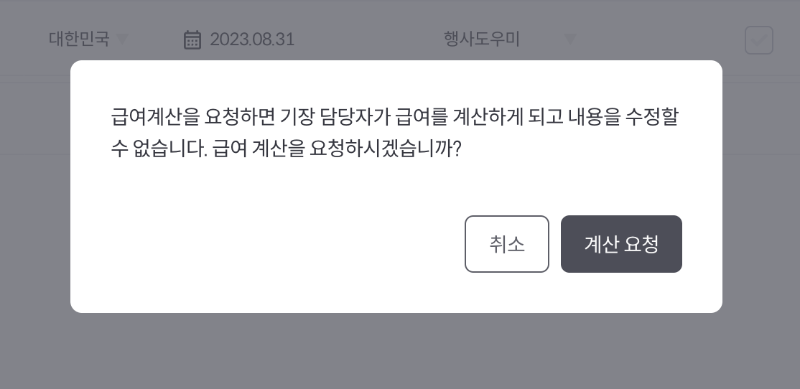

7. 계산중 상태로 해당 카드가 노출됩니다.

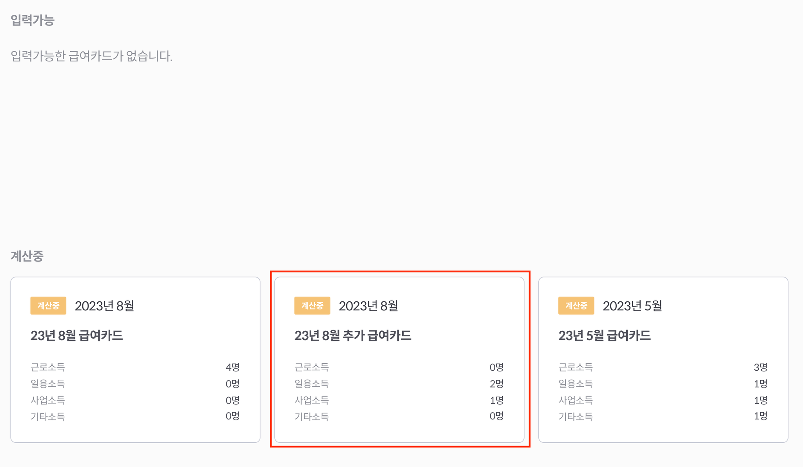

8. 담당자가 확인 후 계산이 완료된 추가 급여 카드는 완료 항목에 노출됩니다.

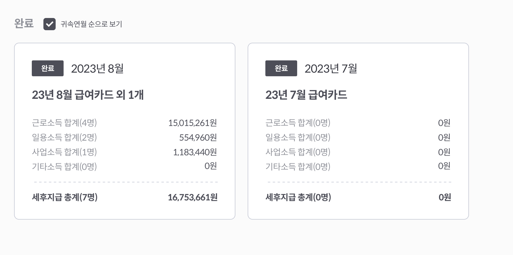
