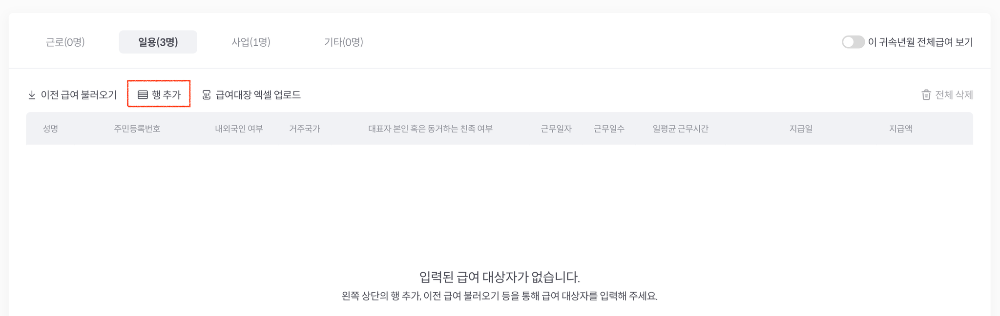
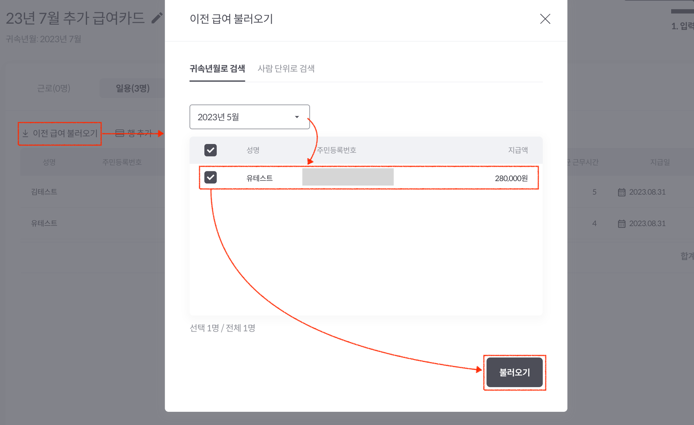
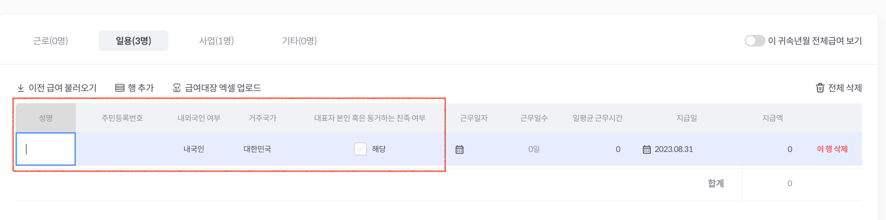
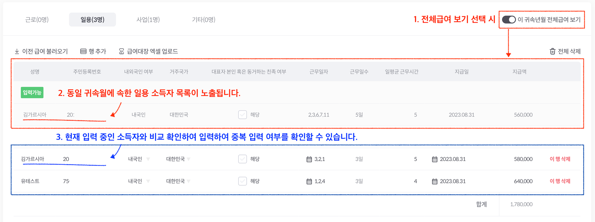
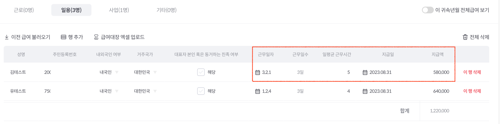
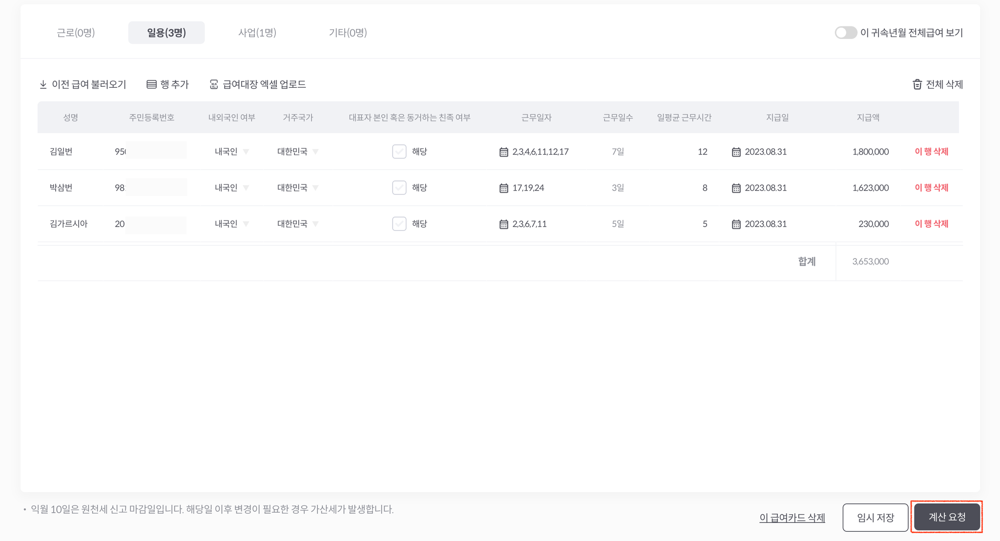

# [급여] 급여 관리 - 일용 소득 입력

> 원문: https://support.alfred.kr/39de8268-560a-8029-8a8a-ed14f232b77c

## FAQ

---

#### 엑셀로 입력이 가능한가요?

- 입력 화면에서 복사 붙여 넣기 기능을 제공합니다.
- 일용 탭 아래 `급여대장 엑셀 업로드` 버튼을 선택 하면 엑셀 파일을 업로드 할 수 있습니다.
- 

  

- 엑셀 파일은 지정된 양식만 업로드가 가능하며, 팝업 창에서 **급여입력 양식 다운로드** 혹은 아래 양식을 다운로드 하시면 됩니다.
  혜움_급여입력_양식.xlsx 25.8KB

## 일용 소득 입력하기

---

1. 입력가능 상태의 급여카드를 선택합니다.

2. 일용 탭에서 `행 추가` 버튼으로 입력 행을 생성합니다.

> 

3. 추가된 행에 근로자 **성명, 주민등록번호**을 입력합니다. 이어서 **내외국인 여부, 거주지국을 확인**합니다.

- 대표자 본인이거나 친족인 경우 “대표자 본인 혹은 동거하는 친족 여부” 체크박스를 선택합니다.

> 

4. **근무일자를 선택**하여 근무일수를 확인, **일평균 근무시간** 및 **지급일, 지급액을 입력**합니다.

- 근무일자는 귀속월에 포함되는 날짜만 선택할 수 있습니다.

5. 입력을 완료하시고 `계산 요청` 버튼을 선택하면 계산 요청을 하실 수 있습니다.

