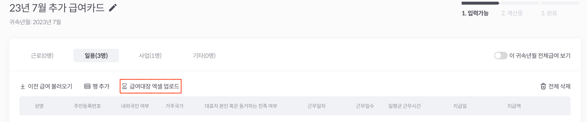
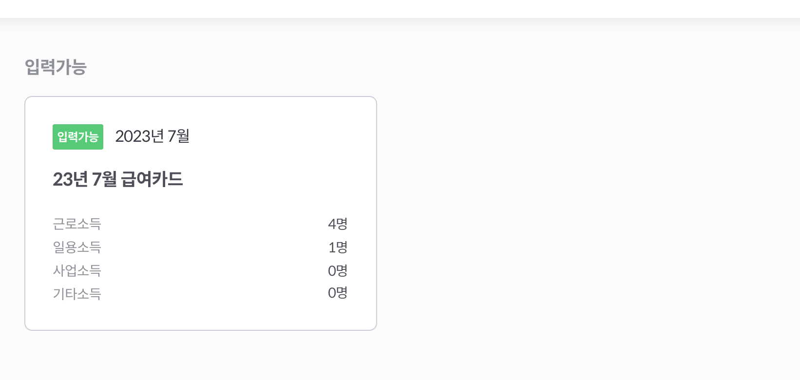
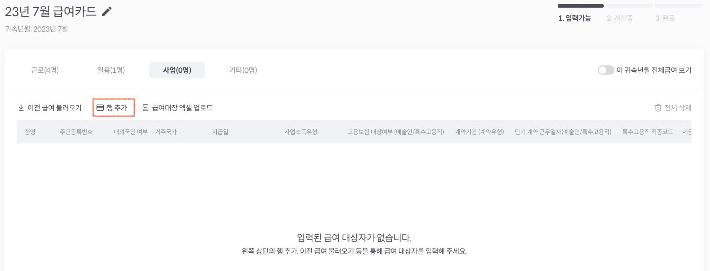
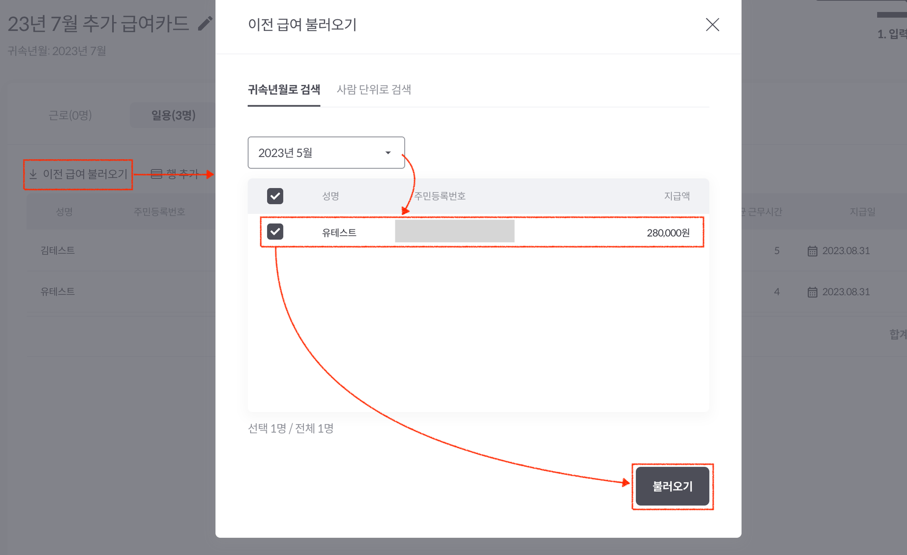
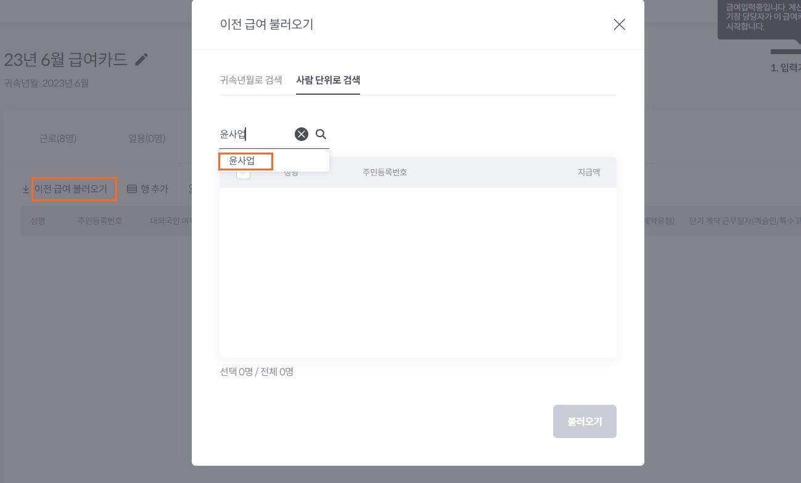
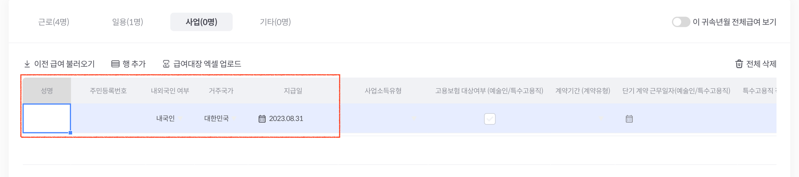
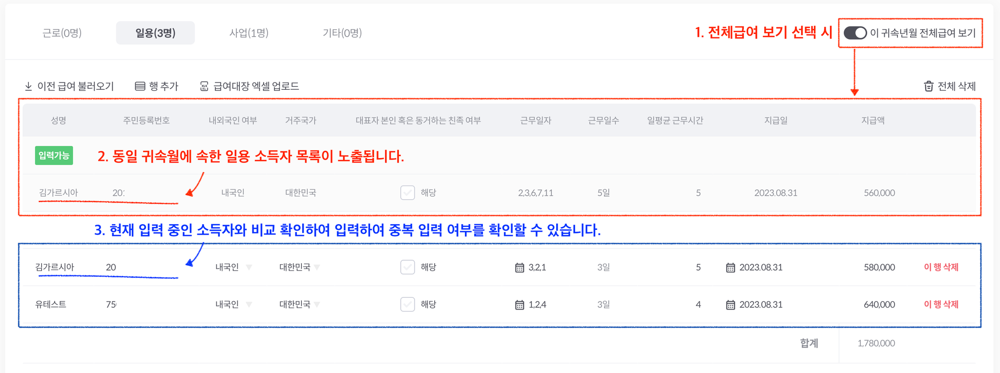
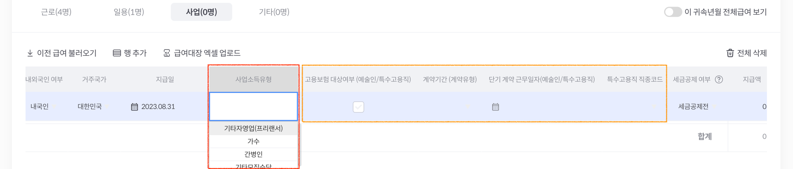
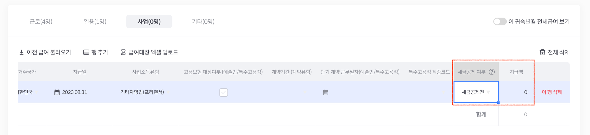
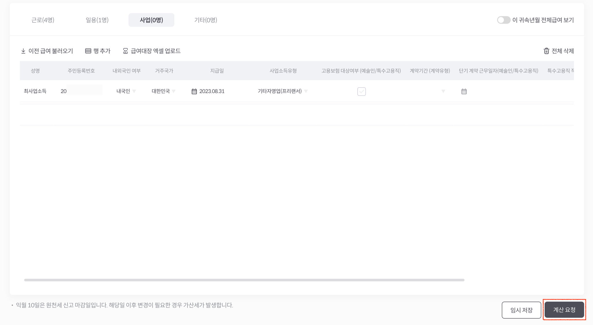

# [급여] 급여 관리 - 사업 소득 입력

> 원문: https://support.alfred.kr/39de8268-560a-808c-ae91-cf49920c8efb

## FAQ

---

#### 엑셀로 입력이 가능한가요?

- 입력 화면에서 복사 붙여 넣기 기능을 제공합니다.
- 탭 아래 `급여대장 엑셀 업로드` 버튼을 선택 하면 엑셀 파일을 업로드 할 수 있습니다.
- 

  

- 엑셀 파일은 지정된 양식만 업로드가 가능하며, 팝업 창에서 **급여입력 양식 다운로드** 혹은 아래 양식을 다운로드 하시면 됩니다.
  혜움_급여입력_양식.xlsx 25.8KB

## 사업 소득 입력하기

---

1. 입력가능 상태의 급여카드를 선택합니다.

2. 사업 탭에서**`행 추가`** 버튼으로 입력 행을 생성합니다.

> 
>
> 

3. 추가된 행에 근로자 **성명, 주민등록번호를 입력**합니다. 이어서 **내외국인 여부, 거주지국, 지급일**을 확인합니다.

> 

4. **사업소득 유형**을 선택합니다. 그리고 유형에 따른 추가 항목(주황색 박스 영역)을 입력합니다.

- 추가 항목은 **사업소득 유형이예술인/특수고용직경우** 입력이 필요합니다.
- 추가 항목은 **고용보험 대상여부**, **계약기간(계약유형)**, **단기 계약 근무일자(예술인/특수고용직)**, **특수고영 직종코드**가 있습니다.

- **추가 항목 안내**

5. **세금공제 여부**와 **지급액**을 입력합니다.

- 세금공제여부와 지급액

6. 입력을 완료하시고 `계산 요청` 버튼을 선택하면 계산 요청을 하실 수 있습니다.

