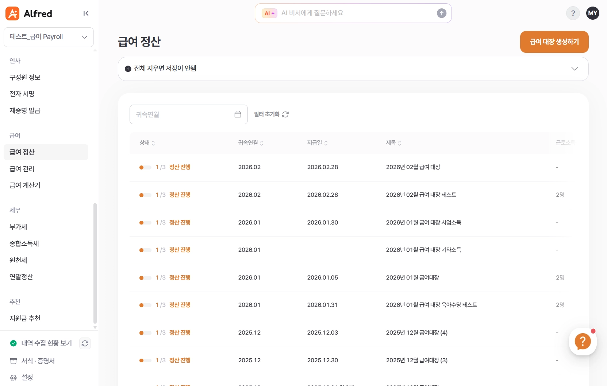
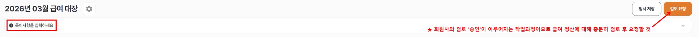
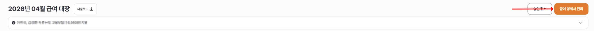
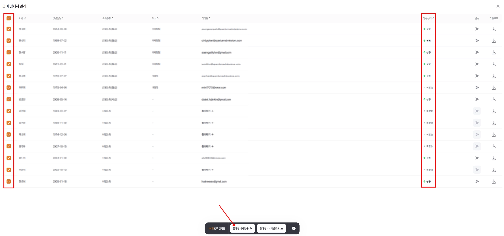

# 급여 정산

> 원문: https://support.alfred.kr/da9e8268-560a-83b4-9a7e-01f5db88ddb5

> **급여 정산**에서는 급여대장을 작성하고 계산을 요청해 급여를 마감할 수 있습니다.

**이 메뉴에서 할 수 있는 일**

- 급여 입력 및 계산 요청
- 급여 계산 결과 및 마감 확인
- 급여 지급

**경로:** 급여 > 급여 정산

**노출 대상:** 급여 구독 고객

> 

---

### 급여 정산 단계

급여 정산은 다음 단계로 이루어집니다.

- **급여 입력** : 기본급 및 각종 수당을 입력하고 계산을 요청하는 단계
- **급여 계산중** : 입력된 급여 내역을 확인해 공제액을 계산하는 단계
- **급여 마감** : 계산이 완료되어 급여 지급과 명세서 발송이 가능한 단계

---

### 1. 급여 입력

귀속월을 확인해 해당 급여를 선택합니다. `입력가능` 태그가 있는 급여만 입력할 수 있습니다. 각 소득(근로·일용·사업·기타)의 인적사항과 급여사항을 입력하고, 필요 시 임시 저장할 수 있습니다.

### 2. 검토 요청

급여 입력이 완료되면 `검토 요청` 버튼을 누릅니다. 근로·일용·사업·기타 소득을 모두 입력한 후 요청해 주세요. 검토 요청 후에는 입력한 급여를 수정할 수 없으며, 수정이 필요하면 담당자에게 요청해야 합니다.

### 3. 급여 확정

계산이 완료되면 해당 월의 급여대장을 선택해 상세 내역을 확인합니다. 마감된 급여대장은 `완료` 태그로 확인할 수 있으며, 차인지급액을 확인한 후 급여를 지급합니다.

**(1) 급여 확정(정산)**

급여 확정은 다음 절차에 따라 진행합니다.

**당월 특이사항 반영  임시저장  내부 검토 및 확정  검토요청  (회원사 대표 또는 담당자) 승인  정산 완료**

- 수정 사항이나 추가 반영 사항이 발생한 경우, **[반려]** 기능을 통해 재정산을 진행한 후 **[검토 요청]**을 다시 진행

> 급여 정산 화면 상단의 **'특이사항'** 항목을 활용하여 해당 월의 주요 이슈를 입력하여 관리 기록을 남길 수 있으며, 회원사 대표님에게도 공유할 수 있습니다.
>
> 

**(2) 급여 명세서 발송**

급여 명세서는 다음 절차에 따라 진행합니다.

**급여대장  급여명세서 관리  근로자 전체 선택  급여명세서 발송**

- 급여 이체 완료 여부 확인 후 진행

> **참고화면**
>
> 
>
> 
>
> 급여 이체 전 명세서가 먼저 발송되지 않도록 **회원사에서 발송 시점을 직접 관리**해 주시기 바랍니다.

---

### FAQ. 자주 묻는 질문

**계산 요청 후 급여를 수정할 수 있나요?**

계산 요청 후에는 입력한 급여를 수정할 수 없습니다. 수정이 필요하면 담당자에게 요청해 주세요.
