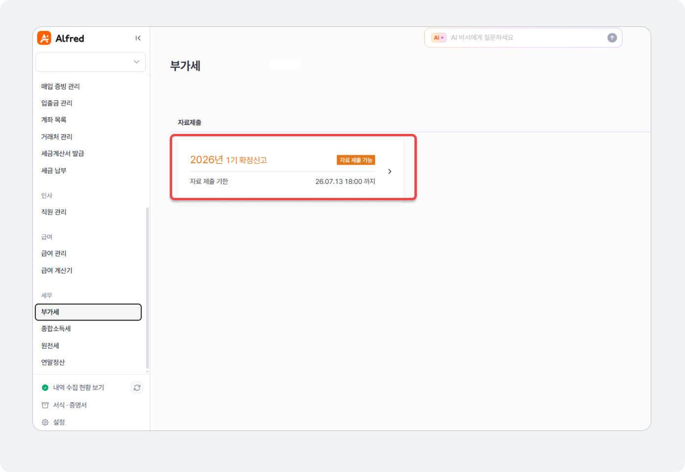
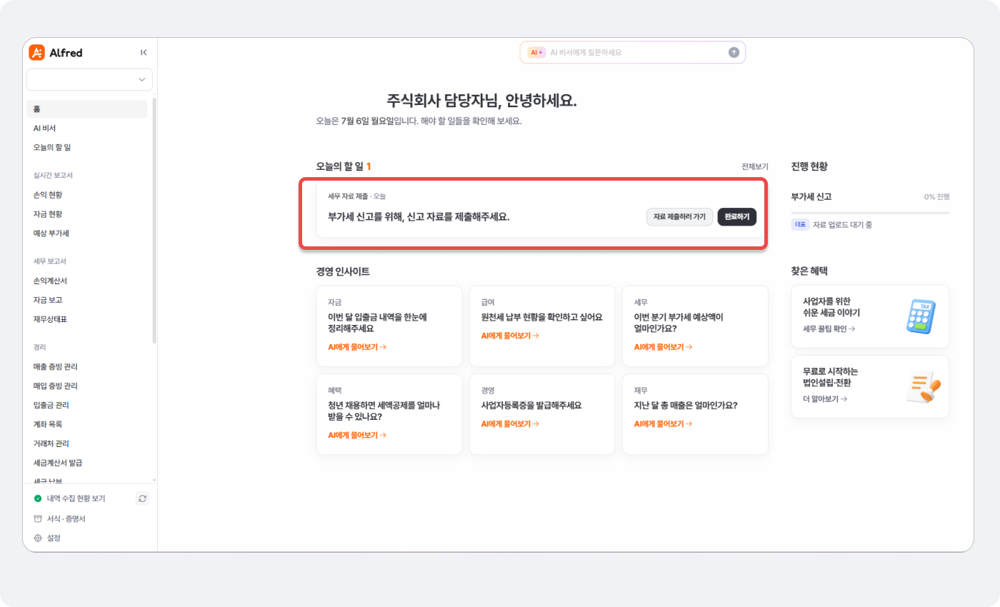
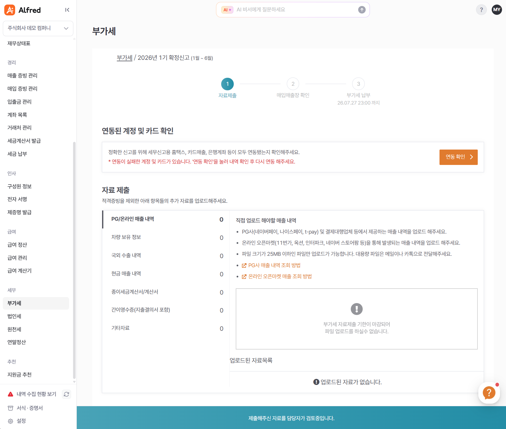
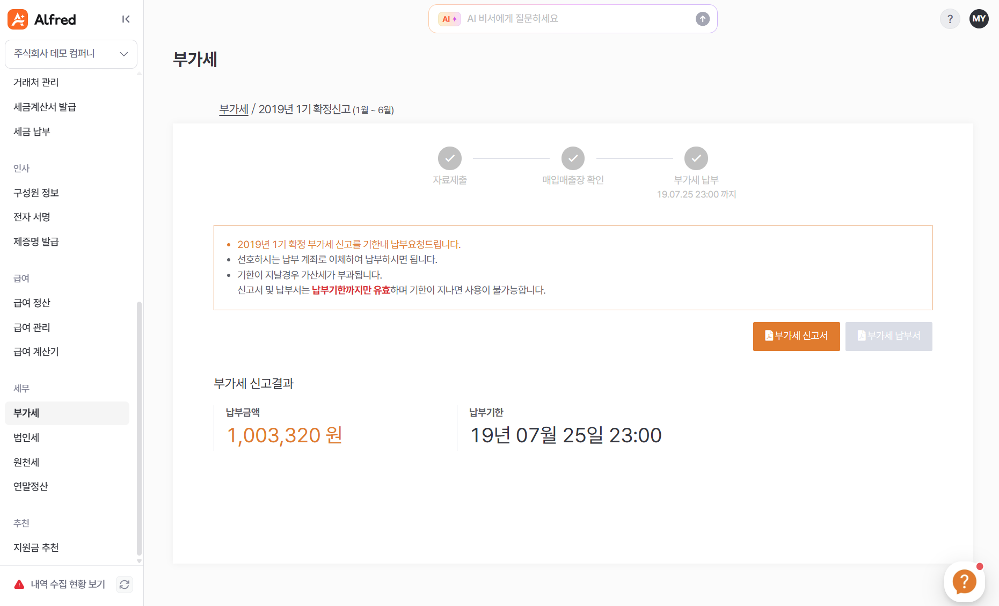

# 부가세

> 원문: https://support.alfred.kr/ef6e8268-560a-82b2-8b8a-8104e7037507

> **부가세**에서는 부가가치세 신고 일정과 제출 자료를 확인하고, 신고에 필요한 자료를 제출할 수 있습니다. 부가세 신고 진행 현황을 확인하고, 직접 납부할 수 있습니다.

**이 메뉴에서 할 수 있는 일**

- 부가세 신고 자료 확인 및 제출
- 신고 진행 현황 확인

**경로:** 세무 > 부가세

**노출 대상:** 세무 구독 고객 (사업자 유형 무관 공통 제공)

---

### 신고 자료 안내

#### 부가세 자료 제출 안내

- 자료제출 요청을 발송하면 고객 Alfred Business 홈에 부가세 자료제출 필요가 `오늘의 할 일`로 표시됩니다.

#### 부가세 자료 제출

매출·매입의 전자세금계산서·계산서, 현금영수증은 수임 동의를 통해 홈택스 데이터를 자동으로 수집합니다. 
카드 정보 등 거래 내역 연동에 등록된 정보도 자동으로 처리됩니다. 이를 제외한 아래 자료는 별도 제출이 필요합니다.

- PG사·온라인 매출 내역
- 국외 수출 자료 (외화 계좌 거래 내역)
- 당월분 종이 세금계산서·종이 계산서
- 당월분 간이영수증
- 당월 말 재고금액
- 예·적금 계좌, 펀드 계좌

> 

#### 부가세 신고서/납부서 확인 및 납부

부가세 신고 진행 상황을 조회할 수 있고, 신고가 완료되면 신고서 및 납부서(납부 정보) 확인이 가능합니다.

해당 내용으로 부가세 납부 진행해 주시면 됩니다.

> 

---

### FAQ. 자주 묻는 질문

**어떤 자료가 자동으로 수집되나요?**

매출·매입의 전자세금계산서·계산서와 현금영수증은 수임 동의를 통해 홈택스에서 자동 수집되며, 연동된 카드 정보 등도 자동 처리됩니다. 그 외 자료는 별도 제출이 필요합니다.
