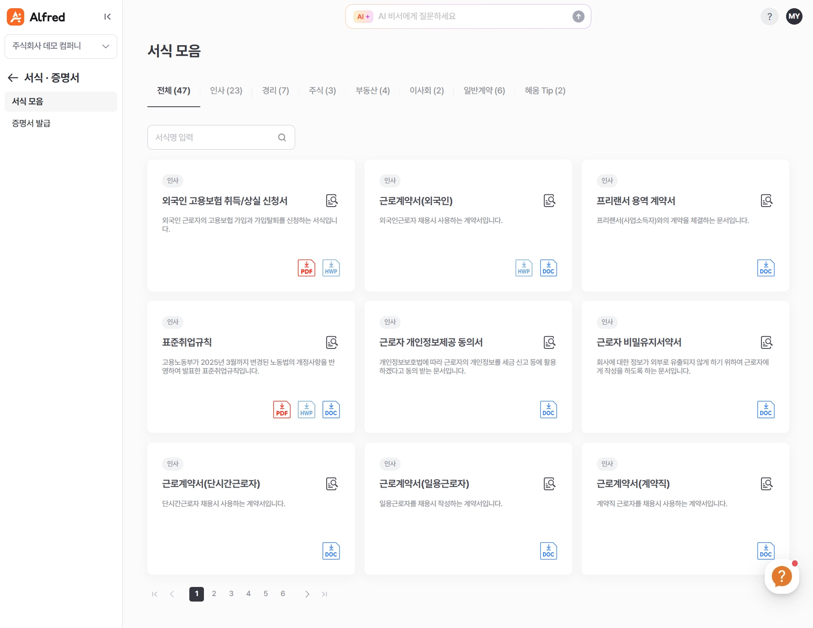

# 서식 모음

> 원문: https://support.alfred.kr/959e8268-560a-839a-afc8-01999fa87ca7

> **서식 모음**에서는 사업 운영에 필요한 각종 무료 서식을 내려받을 수 있습니다. 기존에 'Home > 서식/증명서'에 있던 기능이 이번 개편으로 하단 서식·증명서 영역으로 이동했습니다.

**이 메뉴에서 할 수 있는 일**

- 사업 운영에 필요한 무료 서식 조회 및 다운로드

**경로:** 서식·증명서 > 서식 모음

**노출 대상:** 전체 (구독 무관)

---

### 서식 이용하기

서식 리스트에서 필요한 서식을 찾아 바로 내려받을 수 있습니다.

> 

### 다운로드 가능한 서식

- [서식 리스트](01-서식-리스트.md)
- [경력증명서](02-경력증명서.md) — 기업에 재직 중이거나 퇴직한 후, 해당 회사에서 경력사항을 증명하는 문서입니다. · 인사
- [근로계약서-건설일용근로자](03-근로계약서-건설일용근로자.md) — 건설일용근로자 채용시 사용하는 계약서입니다. · 인사
- [근로계약서-단시간근로자](04-근로계약서-단시간근로자.md) — 단시간근로자 채용시 사용하는 계약서입니다. · 인사
- [근로계약서-연소근로자](05-근로계약서-연소근로자.md) — 연소근로자(18세 미만) 채용시 사용하는 계약서입니다. · 인사
- [근로계약서-외국인근로자](06-근로계약서-외국인근로자.md) — 외국인근로자 채용시 사용하는 계약서입니다. · 인사
- [근로계약서-정규직근로자](07-근로계약서-정규직근로자.md) — 일반적인 근로소득자 채용시 사용하는 계약서입니다. · 인사
- [법인대표자 무보수 확인서](08-법인대표자-무보수-확인서.md) — 국민건강보험공단에 제출하는 법인대표자의 무보수 확인서 입니다. · 인사
- [비거주자 제한세율 적용신청서](09-비거주자-제한세율-적용신청서.md) — 국내 원천소득이 있는 비거주자가 각 국가와 체결된 조세조약에 따른 제한세율을 적용 받고자 하는 경우 작성하는 신청서입니다. · 인사
- [비밀유지서약서](10-비밀유지서약서.md) — 회사에 대한 정보가 외부로 유출되지 않게 하기 위하여 근로자에게 작성을 하도록 하는 문서입니다. · 인사
- [사직서](11-사직서.md) — 근로자가 사직 의사를 전달하기 위해 작성하는 문서입니다. · 인사
- [재직증명서](12-재직증명서.md) — 회사에서 근로자의 근로기간, 직책 등의 재직사항을 증명하여 발급하는 문서입니다. · 인사
- [퇴직증명서](13-퇴직증명서.md) — 근로소득자의 퇴직 사실을 증명하는 문서입니다. · 인사
- [표준취업규칙](14-표준취업규칙.md) — 고용노동부가 2019년 3월까지 변경된 노동법의 개정사항을 반영하여 발표한 표준취업규칙입니다. · 인사
- [프리랜서 계약서](15-프리랜서-계약서.md) — 프리랜서(사업소득자)와의 계약을 체결하는 문서입니다. · 인사
- [해고통지서](16-해고통지서.md) — 직원에게 해고 사실을 서면으로 통지하기 위한 문서입니다. 5인 이상 기업에서는 해고 시 반드시 서면으로 통지해야 합니다. · 인사
- [해촉증명서](17-해촉증명서.md) — 과납했던 보험료를 반환 받기 위해 작성하는 문서입니다 · 인사
- [휴직원](18-휴직원.md) — 근로소득자가 사정에 의하여 휴직하고자 할 때에 사용하는 문서입니다. · 인사
- [거래명세서](19-거래명세서.md) — 거래처 간 거래를 하고 그에 따른 상세한 명세 내역을 기록하는 문서입니다. 거래명세서는 세무 상 증빙자료로 이용될 수 없으며, 세금계산서와 함께 발행하여야 합니다. · 경리
- [기타매출](20-기타매출.md) — 세금계산서/계산서/신용카드/현금영수증 외의 매출내역들에 대하여 기입하는 서식입니다. · 경리
- [세금계산서](21-세금계산서.md) — 부가가치세법 시행규칙 [별지 제14호서식] 세금계산서 [시행 2022. 1. 1.] [기획재정부령 제846호, 2021. 3. 16., 일부개정] · 경리
- [월별거래명세](22-월별거래명세.md) — 판매대행업을 하는 경우 매 분기 관련 명세를 국세청(홈택스)에 제출할 때 사용하는 문서입니다. · 경리
- [지출결의서(경비처리용)](23-지출결의서-경비처리용.md) — 사업용카드 외의 카드로 사업관련한 지출을 하였으나, 부가세 공제 대상이 아니거나 또는 현금으로 사업관련 지출을 하였을 시에 작성하는 서식입니다. · 경리
- [지출결의서(부가세공제용)](24-지출결의서-부가세공제용.md) — 사업용카드 외의 카드로 사업관련하여 지출한 내역을 부가세 신고 시 세액공제받기 위한 목적으로 작성하는 서식입니다. · 경리
- [차량운행일지](25-차량운행일지.md) — 차량의 행선지 및 주요사항을 일자별로 기록하는 문서입니다. · 경리
- [무상임대차계약서](26-무상임대차계약서.md) — 임차인이 임대인으로부터 임대료 없이 무상으로 빌려서 사용하기로 할 때에 작성하는 문서입니다. · 부동산
- [부동산임대차계약서](27-부동산임대차계약서.md) — 임차인이 임대인으로부터 해당 부동산을 일정한 기간동안 임대하는 대가로 차임을 지불할 것을 약정할 때에 작성하는 문서입니다. · 부동산
- [전대계약서](28-전대계약서.md) — 목적물을 다시 제3자에게 사용, 수익하게 할 것을 약정하는 서식입니다. · 부동산
- [전대동의서](29-전대동의서.md) — 목적물을 다시 제3자에게 빌려주는 것을 동의함을 증명하는 서식입니다. · 부동산
- [주식양수도계약서](30-주식양수도계약서.md) — 보유한 주식에 대한 권리를 이전 권리자가 새로운 권리자에게 양수/양도 한다는 내용을 작성하는 계약 문서입니다. · 주식
- [주식증여계약서](31-주식증여계약서.md) — 증여자가 수증자에게 증여하는 것을 약정하며 그에 관한 권리 및 의무를 기록하는 문서입니다. · 주식
- [주주명부](32-주주명부.md) — 주주 및 주권에 관한 사항을 명확히 하기 위하여 작성하는 서식입니다. · 주식
- [이사회의사록-대표이사무보수](33-이사회의사록-대표이사무보수.md) — 법인의 대표이사 급여를 무보수로 처리할 시에 사대보험 공단에 제출해야 하는 서류 중 하나로, 대표이사 무보수에 대한 사항이 이사회를 통해 결정되었다는 내용을 기재하는 서식입니다. · 이사회
- [이사회의사록-지점설치](34-이사회의사록-지점설치.md) — 지점 설치에 대한 사항이 이사회를 통해 결정 되었다는 내용을 기재하는 서식입니다. · 이사회
- [금전소비대차계약서](35-금전소비대차계약서.md) — 일반적인 금전소비대차 거래시 작성하는 계약서 입니다. 특수관계자와의 거래시 당좌대출 이자율 확인하여 작성하시기 바랍니다. · 일반계약
- [동업계약서](36-동업계약서.md) — 동업자 간 사업 운영에 따른 계약 의무 사항을 작성하는 문서입니다. · 일반계약
- [무상차입금계약서](37-무상차입금계약서.md) — 외부에서 자금을 차입하고 명시된 차입기간동안 이자를 무상으로 계약할 때에 작성하는 문서입니다. · 일반계약
- [사업양수도계약서](38-사업양수도계약서.md) — 회사의 사업에 관한 권리와 의무를 이전 권리자가 새로운 권리자에게 양수/양도 한다는 내용으로 작성하는 계약 문서입니다. · 일반계약
- [위임장](39-위임장.md) — 위임자가 위임 받는 자에게 업무 처리를 위탁하여 업무를 대행하게 할 때에 작성하는 서식입니다. · 일반계약
- [차용증](40-차용증.md) — 돈이나 물건을 빌린 것을 증명하기 위하여 빌린 시기, 빌린 내용 등을 기록하여 채무인과 채권자 사이에 작성하는 문서입니다. · 일반계약

---

### FAQ. 자주 묻는 질문

**서식은 누구나 이용할 수 있나요?**

네. 서식 모음은 구독과 무관하게 모든 사용자가 이용할 수 있습니다.

## 하위 페이지

- [서식 리스트](01-서식-리스트.md)
- [경력증명서](02-경력증명서.md)
- [근로계약서-건설일용근로자](03-근로계약서-건설일용근로자.md)
- [근로계약서-단시간근로자](04-근로계약서-단시간근로자.md)
- [근로계약서-연소근로자](05-근로계약서-연소근로자.md)
- [근로계약서-외국인근로자](06-근로계약서-외국인근로자.md)
- [근로계약서-정규직근로자](07-근로계약서-정규직근로자.md)
- [법인대표자 무보수 확인서](08-법인대표자-무보수-확인서.md)
- [비거주자 제한세율 적용신청서](09-비거주자-제한세율-적용신청서.md)
- [비밀유지서약서](10-비밀유지서약서.md)
- [사직서](11-사직서.md)
- [재직증명서](12-재직증명서.md)
- [퇴직증명서](13-퇴직증명서.md)
- [표준취업규칙](14-표준취업규칙.md)
- [프리랜서 계약서](15-프리랜서-계약서.md)
- [해고통지서](16-해고통지서.md)
- [해촉증명서](17-해촉증명서.md)
- [휴직원](18-휴직원.md)
- [거래명세서](19-거래명세서.md)
- [기타매출](20-기타매출.md)
- [세금계산서](21-세금계산서.md)
- [월별거래명세](22-월별거래명세.md)
- [지출결의서(경비처리용)](23-지출결의서-경비처리용.md)
- [지출결의서(부가세공제용)](24-지출결의서-부가세공제용.md)
- [차량운행일지](25-차량운행일지.md)
- [무상임대차계약서](26-무상임대차계약서.md)
- [부동산임대차계약서](27-부동산임대차계약서.md)
- [전대계약서](28-전대계약서.md)
- [전대동의서](29-전대동의서.md)
- [주식양수도계약서](30-주식양수도계약서.md)
- [주식증여계약서](31-주식증여계약서.md)
- [주주명부](32-주주명부.md)
- [이사회의사록-대표이사무보수](33-이사회의사록-대표이사무보수.md)
- [이사회의사록-지점설치](34-이사회의사록-지점설치.md)
- [금전소비대차계약서](35-금전소비대차계약서.md)
- [동업계약서](36-동업계약서.md)
- [무상차입금계약서](37-무상차입금계약서.md)
- [사업양수도계약서](38-사업양수도계약서.md)
- [위임장](39-위임장.md)
- [차용증](40-차용증.md)
