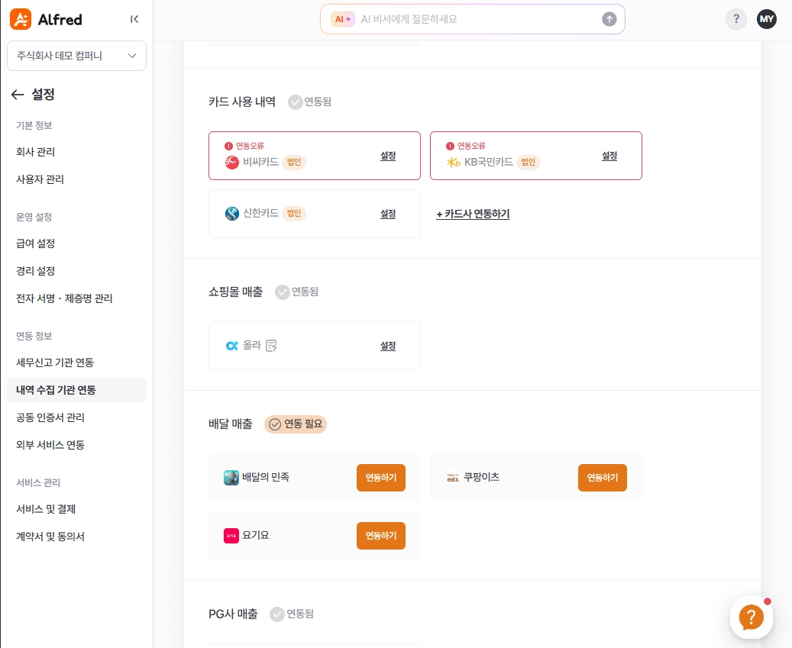
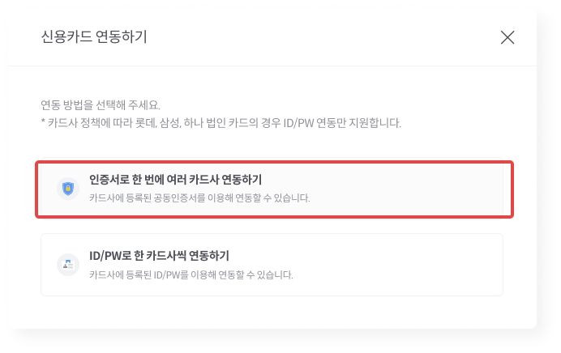
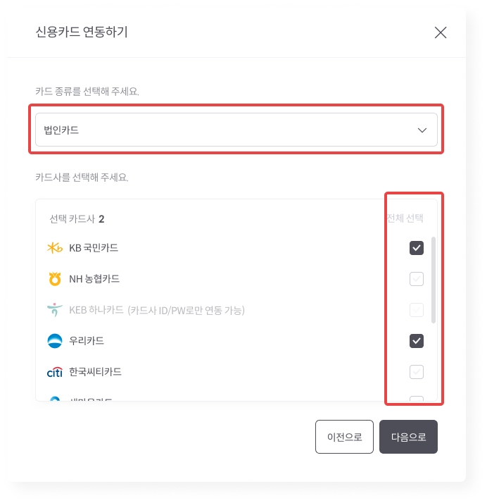
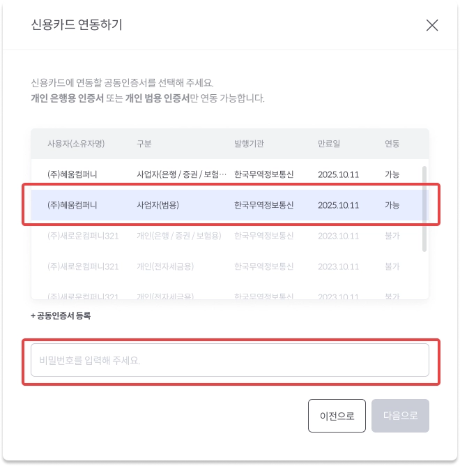
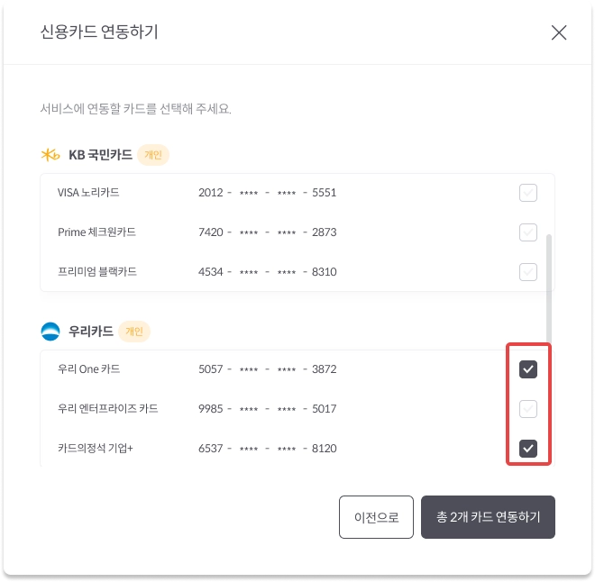
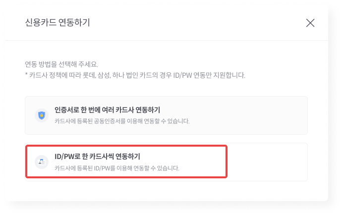
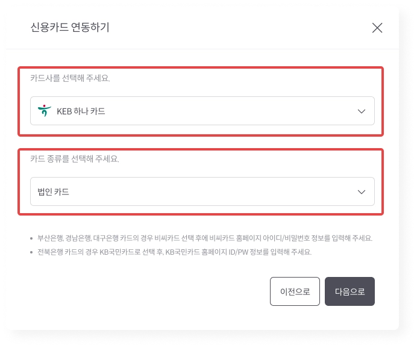
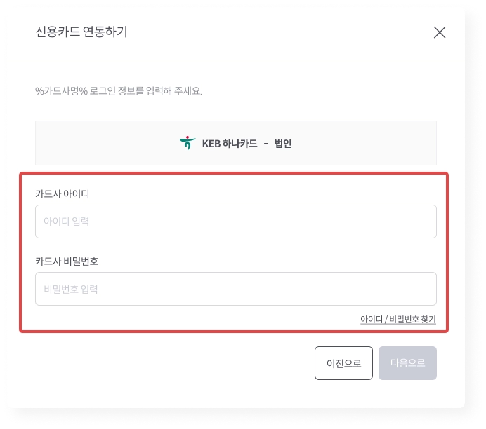
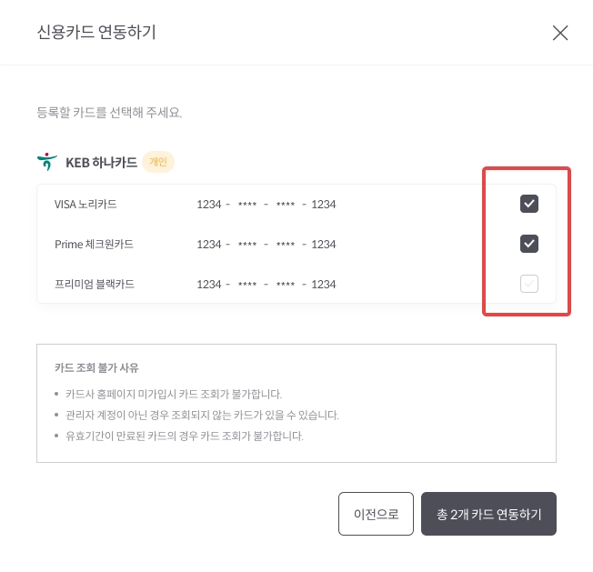

# [연동] 신용카드 연동하기

> 원문: https://support.alfred.kr/39ee8268-560a-8057-b7aa-d3393db5aedd

#### 신용카드 연동하기 (인증서)

---

1. **설정 > 내역 수집 기관 연동 > 카드 사용 내역의`카드사 연동하기`를 클릭하세요**

> 

1. **이어서 나오는 선택창에서`인증서로 한번에 여러 카드 연동하기`버튼을 클릭하세요.**

  

1. **`법인/개인 카드선택`후`연동하려는 카드를 체크한`뒤 다음으로 넘어갑니다.**

  

1. **연동하고자 하는 인증서를 선택하고,`비밀번호를 입력`후 다음으로 넘어갑니다.**
  (연동하려는 인증서는, 해당 카드사에 이미 등록되어있는 인증서야합니다)

  

1. **카드사별로`연동하려는 카드를 체크`후 연동을 완료합니다.**

  

---

## 신용카드 연동하기 (ID/PW)

> **하나/롯데/삼성 법인 카드**의 경우에는 인증서 연동을 지원하지 않기 때문에 ID/PW 기반으로만 연동할 수 있습니다.

1. **레포트 기관연동 > 카드사용내역의`카드사 연동하기`를 클릭하세요**

  

1. **이어서 나오는 선택창에서`ID/PW로 한 카드사씩 연동하기`버튼을 클릭하세요.**

  

1. **연동하려는 카드사와`개인/법인 카드여부를 선택`후 다음으로 넘어갑니다**

  

1. **연동하려는`카드사의  ID/PW를 입력`후 다음으로 넘어갑니다**

  

1. **카드사에 등록된카드 중`연동하려는 카드를 선택`후`연동하기`를 클릭하면 연동이 완료됩니다.**

  

- **다른 카드사의 카드를 연동하려는경우 다시 설정 > 내역 수집 기관 연동 > 카드사용내역의`카드사 연동하기`를 클릭하여 진행할 수 있습니다.**
