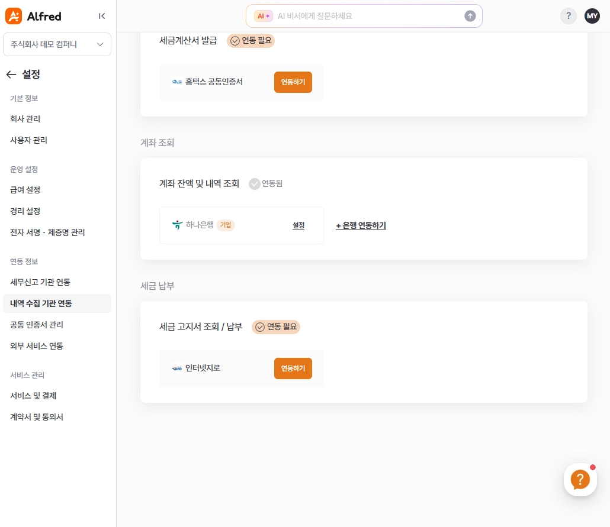
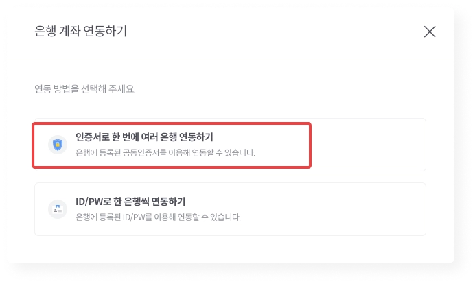
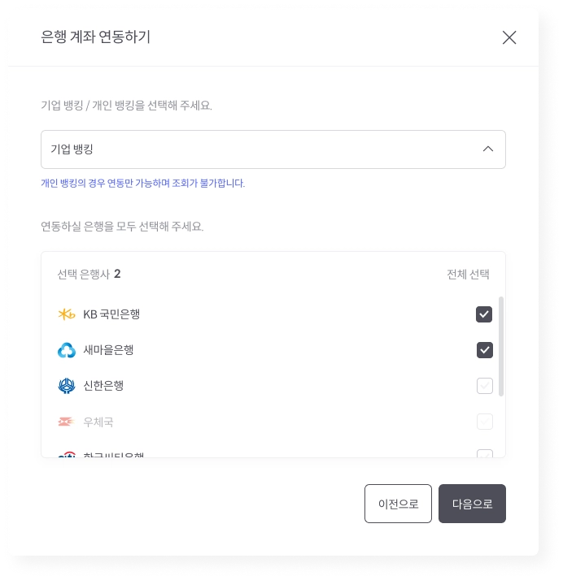
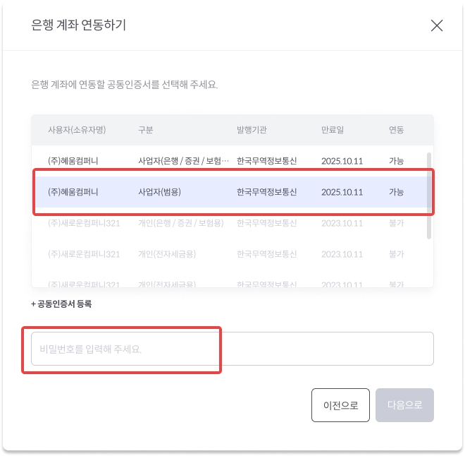
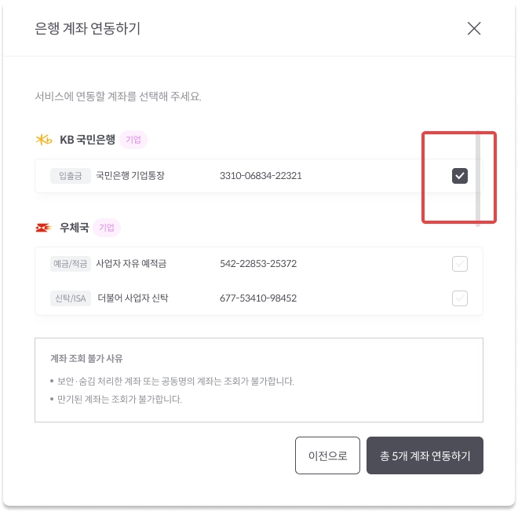
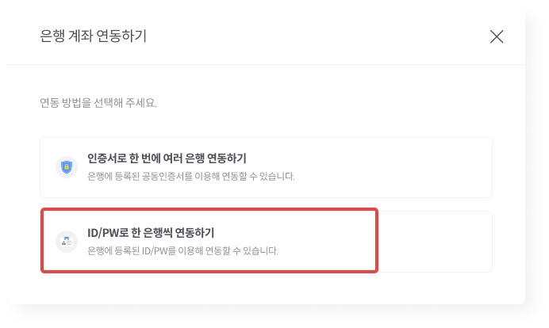
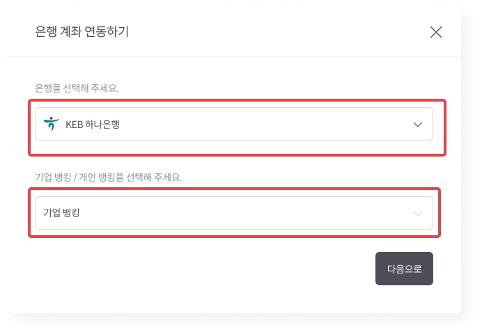
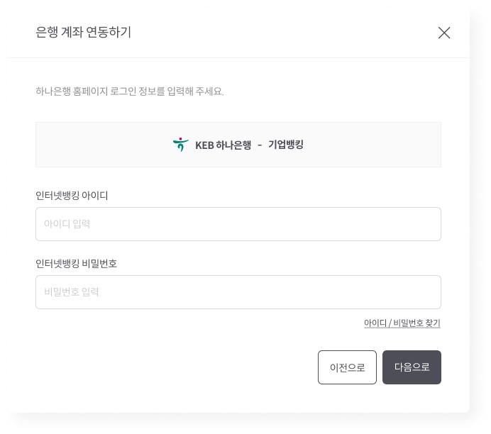
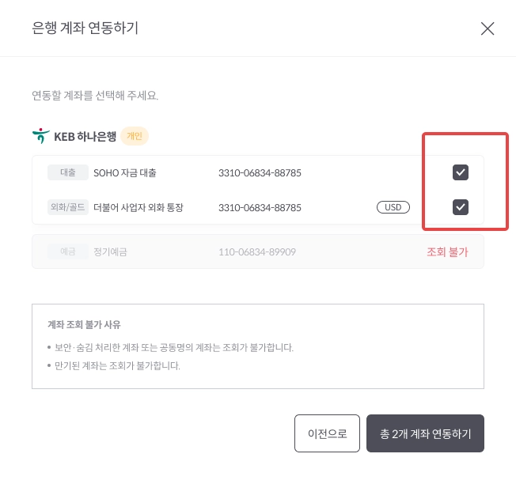

# [연동] 은행계좌 연동하기

> 원문: https://support.alfred.kr/39ee8268-560a-8057-9261-e62539d26171

### 은행계좌 인증서 연동하기

> **연동을 성공하면, 바로 [경리 >** [입출금 관리](https://report.heumtax.com/bank/accounts)**] 메뉴에 내역이 연동됩니다.**

---

1. **설정 > 내역 수집 기관 연동 > 계좌 조회의`은행 연동하기`를 클릭하세요**

> 

1. **이어서 나오는 선택창에서`인증서로 한번에 여러 은행 연동하기`버튼을 클릭하세요.**

  

1. **`기업/개인 뱅킹선택`후`연동하려는 은행들을 체크한`뒤 다음으로 넘어갑니다.**

  

1. **연동하고자 하는 인증서를 선택하고,`비밀번호를 입력`후 다음으로 넘어갑니다.**
  (연동하려는 인증서는, 해당 은행에 이미 등록되어있는 인증서야합니다)

  

1. **은행별로`연동하려는 계좌를 체크`후 연동을 완료합니다.**

  

---

## 은행계좌 연동하기 (ID/PW)

---

1. **레포트 기관연동 > 계좌조회의`은행 연동하기`를 클릭하세요**

  

1. **이어서 나오는 선택창에서`ID/PW로 한 카드사씩 연동하기`버튼을 클릭하세요.**

  

1. **연동하려는 은행과`개인/기업 계좌여부를 선택`후 다음으로 넘어갑니다**

  

1. **연동하려는`은행의 인터뱅킹 ID/PW를 입력`후 다음으로 넘어갑니다**

> **신한은행의 경우 인터넷뱅킹 계정이 아닌, 간편 계좌 조회용 계정정보를 입력해야 합니다.**

1. **해당 은행에 등록된계좌 중`연동하려는 계좌를 선택`후`연동하기`를 클릭하면 연동이 완료됩니다.**

  

*등록 후 **1일**이 지나야 확인이 가능합니다.
