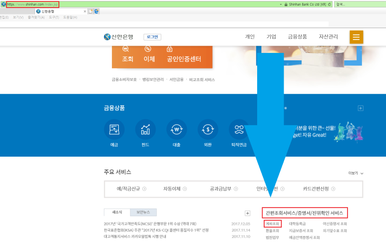
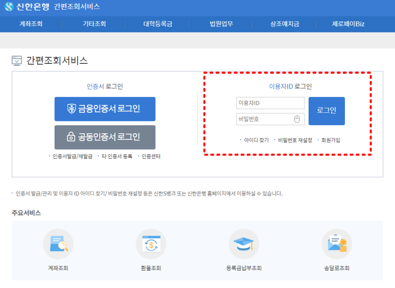
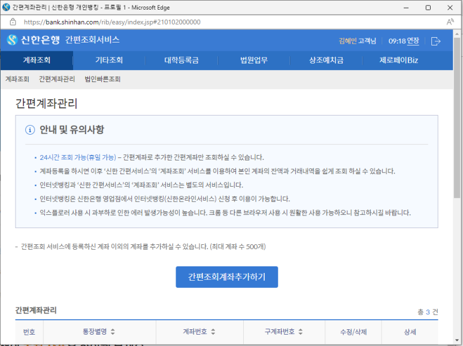
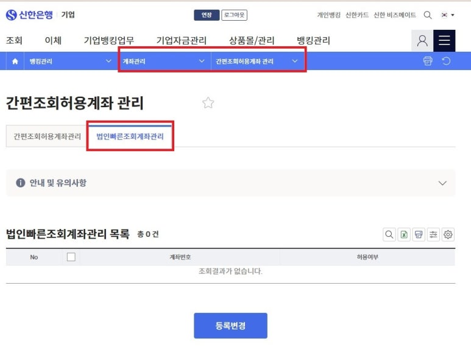
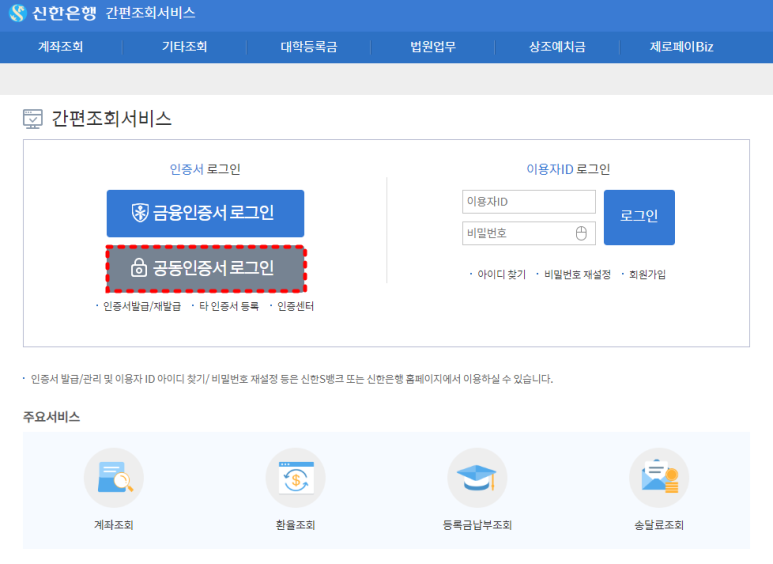

# 신한은행

> 원문: https://support.alfred.kr/ed1e8268-560a-82c7-a706-81fb5c371de8

#### 1. 신한은행 홈페이지 접속하기

(신한은행 홈페이지 회원가입을 하셔야 합니다.)

**1. 신한은행 홈페이지(**[http://www.shinhan.com](http://www.shinhan.com/)**)에 접속**

**2.우측 하단의 간편서비스 -> 계좌조회 클릭**

#### 2. 법인사업자의 경우 (이용자 ID로그인)

1. 기업 인터넷 뱅킹 > 인증서로 로그인

2. 뱅킹관리> 계좌관리 >  간편조회허용계좌 관리 > 법인 빠른 조회 계좌 관리

3. 등록변경 버튼을 클릭하여 계좌 등록

4. 하단에 등록 변경하기 눌러 설정 완료

계좌조회 - 간편계좌관리 - 간편조회계좌 추가하기

---

#### 3. 개인사업자의 경우

**4. 간편조회계좌추가하기를 눌러 추가하기**

#### 4. 세무신고용 정보관리 ([바로가기](https://report.heumtax.com/integrate/tax))에 연동하기
