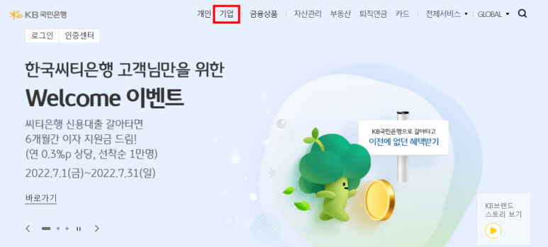
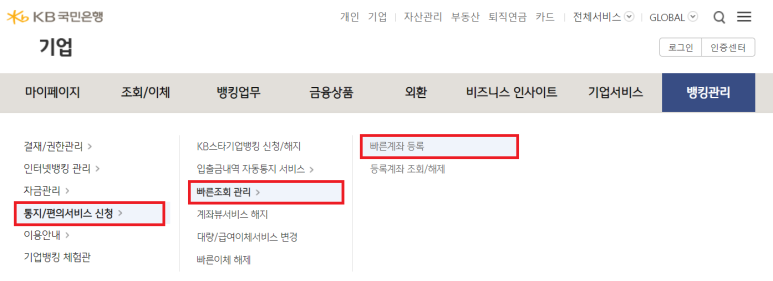
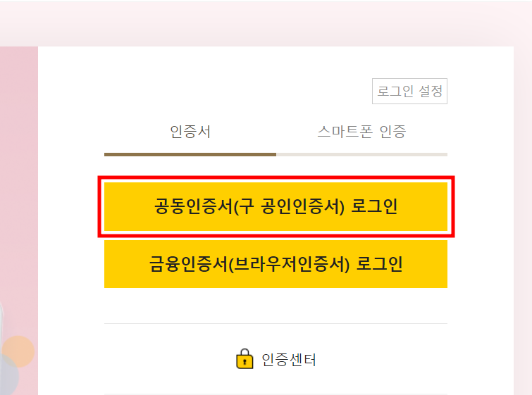
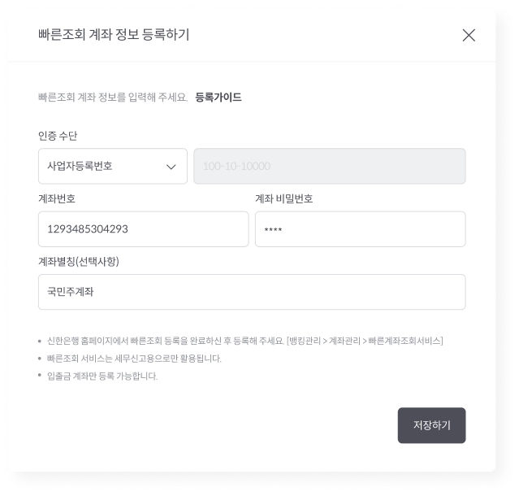
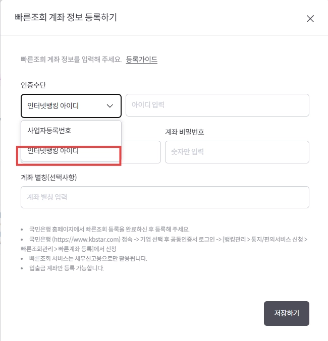

# 국민은행

> 원문: https://support.alfred.kr/be3e8268-560a-835d-b788-8128fc22958b

1. 국민은행 홈페이지([http://www.kbstar.com](http://www.kbstar.com/))에 접속

2. 기업 클릭

3. 뱅킹관리 -> 통지/편의서비스 신청 -> 빠른조회 관리 -> 빠른계좌 등록

4. 공동인증서(구 공인인증서) 로그인 하여 빠른조회 등록

5. 빠른조회 등록하여 세무신고용 정보관리 ([바로가기](https://report.heumtax.com/integrate/tax)) 에서 연동하기

- 개인사업자이신 경우는 인터넷 뱅킹 아이디를 인증수단으로 하여 연동해주세요

