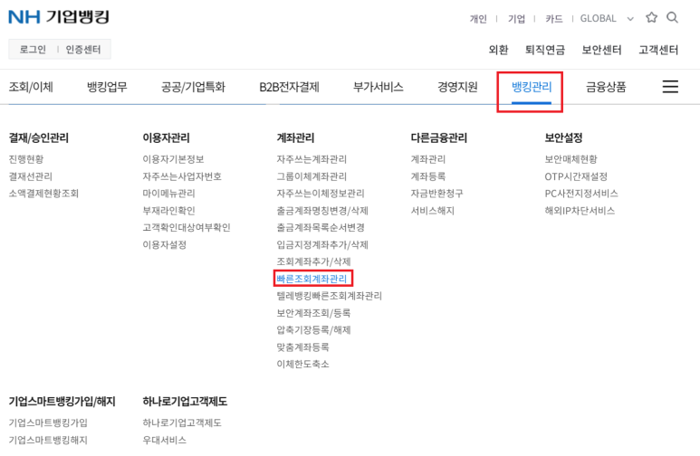
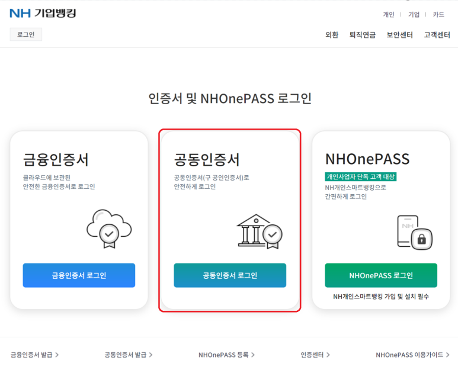

# 농협중앙회

> 원문: https://support.alfred.kr/94ae8268-560a-833d-a0be-8117413df6e9

> **개인사업자의 경우 빠른계좌 연동이 제한됩니다. 별도로 기장 담당자께 빠른조회 계좌 정보를 
공유하여 주시면 감사하겠습니다.**

**1. 농협 기업뱅킹 홈페이지(**[http://ibz.nonghyup.com](http://ibz.nonghyup.com/)**)에 접속**

**2. 기업인터넷뱅킹 -> 뱅킹관리 -> 빠른조회계좌관리 클릭**

**3. 공동인증서 (구 공인인증서) 로그인하여 빠른조회 등록**

**4. 세무신고용 정보관리 (**[바로가기](https://report.heumtax.com/integrate/tax)**)에 연동하기**
