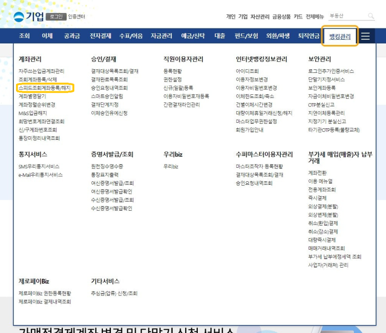
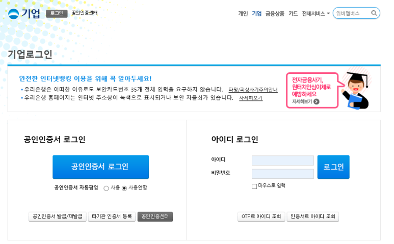
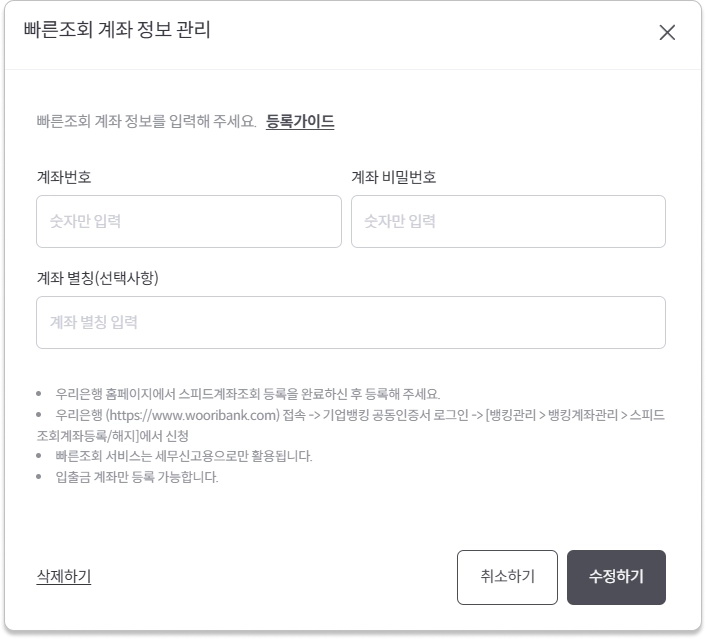

# 우리은행

> 원문: https://support.alfred.kr/d0de8268-560a-8235-9488-01dfeadc239f

1. 우리은행 기업 홈페이지([https://sbiz.wooribank.com/biz/Dream?withyou=bz](https://sbiz.wooribank.com/biz/Dream?withyou=bz))에 접속

2. 뱅킹관리 -> 뱅킹계좌관리 -> 계좌등록/삭제 -> 스피드조회계좌등록/해지 클릭

3. 공동인증서 (구 공인인증서) 로그인하여 스피드조회계좌 등록

4. 세무신고용 정보관리 ([바로가기](https://report.heumtax.com/integrate/tax))에 연동하기

