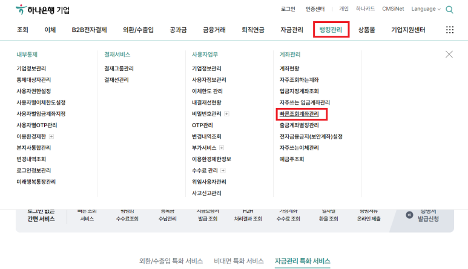
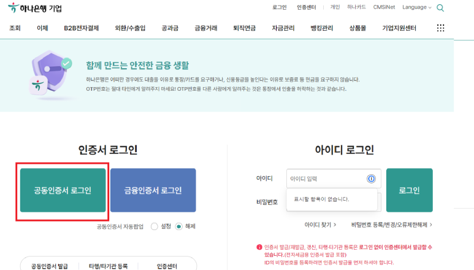
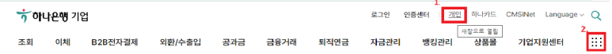
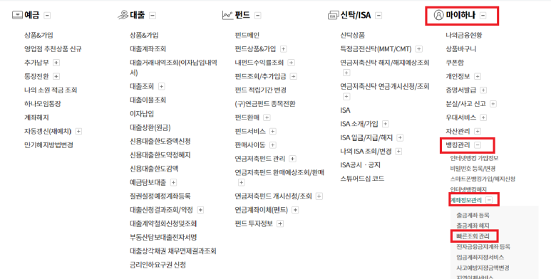
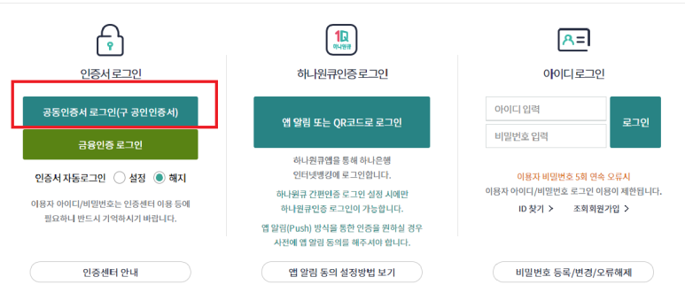

# 하나은행(구 외환)

> 원문: https://support.alfred.kr/35ee8268-560a-8257-8a7a-01ebadff175f

1. **기업계좌 등록**
1. 하나은행기업 홈페이지([http://biz.kebhana.com/](http://biz.kebhana.com/))에 접속

2. 뱅킹관리 -> 빠른조회계좌관리 클릭

3. 공동인증서 (구 공인인증서)로 로그인하여 등록

4. 세무신고용 정보관리 ([바로가기](https://report.heumtax.com/integrate/tax))에 연동하기

**2. 개인계좌 등록**

1. 하나은행기업 홈페이지([http://biz.kebhana.com/](http://biz.kebhana.com/))에 접속 > 개인 클릭 > 메뉴바 클릭

2. 마이하나 > 뱅킹관리 > 계좌정보관리 > 빠른조회 관리

3. 공동인증서 (구 공인인증서)로 로그인하여 등록

4. 세무신고용 정보관리 ([바로가기](https://report.heumtax.com/integrate/tax))에 연동하기
