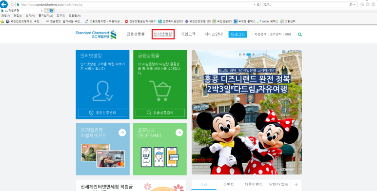
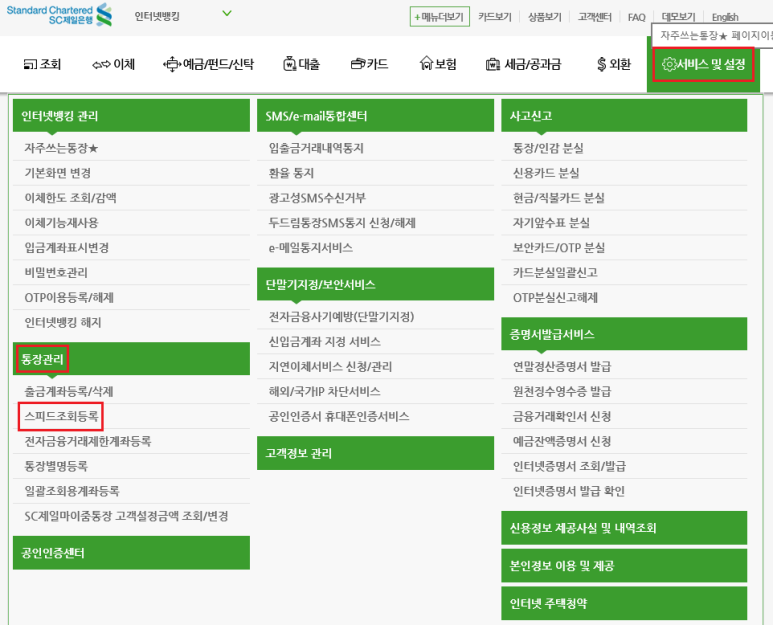
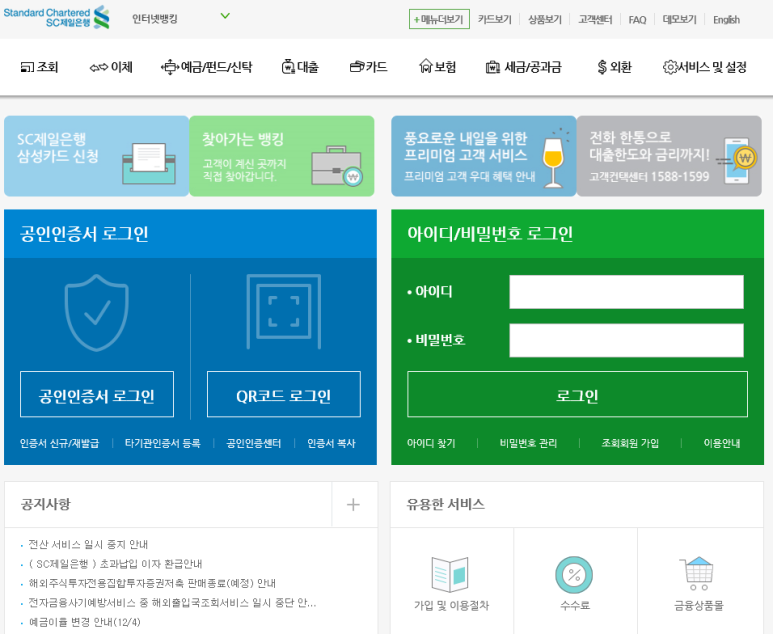

# SC제일은행

> 원문: https://support.alfred.kr/465e8268-560a-83d8-b8b3-81f91b635a7d

1. 한국스탠다드차타드은행 홈페이지

([www.standardchartered.co.kr](http://www.standardchartered.co.kr/)) 접속

2. 인터넷뱅킹 클릭

3. 서비스 및 설정 -> 통장관리 -> 스피드조회등록 클릭

4. 공동인증서 (구 공인인증서) 로그인하여 스피드조회 등록

4. 세무신고용 정보관리 ([바로가기](https://report.heumtax.com/integrate/tax))에 연동하기
