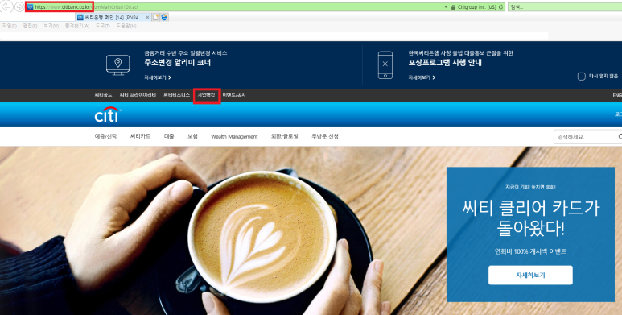
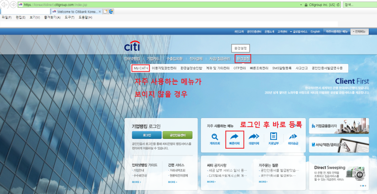
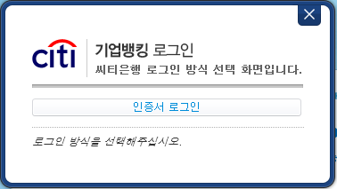

# 씨티은행

> 원문: https://support.alfred.kr/4bfe8268-560a-833f-bffc-8180b0d691c8

1. 씨티은행 홈페이지([www.citibank.co.kr](http://www.citibank.co.kr/))에 접속

2. 기업뱅킹으로 접속

3. 씨티은행기업페이지에서 환경설정 -> My CATi ->빠른조회서비스

OR 자주 사용하는 메뉴의 빠른이체 클릭하여 로그인 후 등록

4. 로그인하여 빠른조회서비스 등록

4. 세무신고용 정보관리 ([바로가기](https://report.heumtax.com/integrate/tax))에 연동하기
