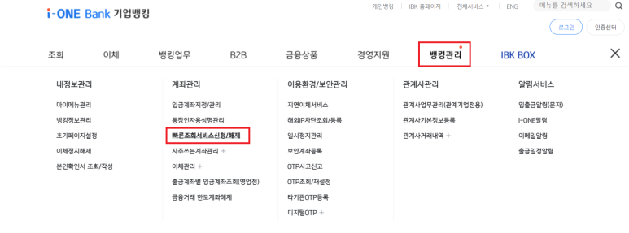
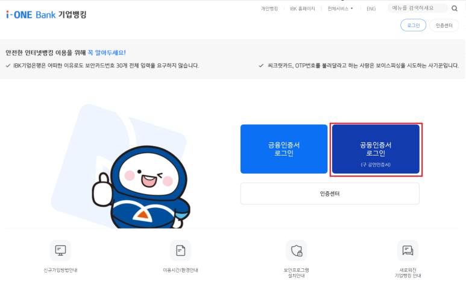

# 기업은행

> 원문: https://support.alfred.kr/38be8268-560a-82c1-be96-8148670aadb8

1. 기업은행 기업인터넷뱅킹 홈페이지([https://kiup.ibk.co.kr](https://kiup.ibk.co.kr/))에 접속

2. 뱅킹관리 -> 계좌관리 -> 빠른조회서비스신청/해제 클릭

3. 공동인증서 (구 공인인증서) 로그인하여 빠른조회서비스 등록

4. 세무신고용 정보관리 ([바로가기](https://report.heumtax.com/integrate/tax))에 연동하기
