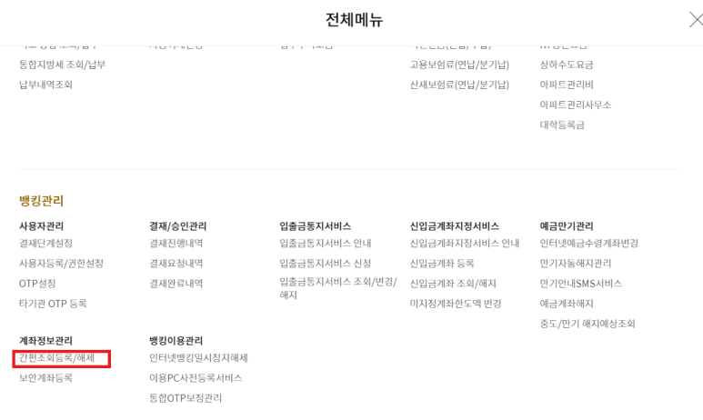

# 우체국

> 원문: https://support.alfred.kr/ba7e8268-560a-8300-a228-8175e542111e

1. 우체국 예금보험 홈페이지([www.epostbank.go.kr](http://www.epostbank.go.kr/))에 접속 / 기업 - 우측 상단 탭 클릭

2. 전체메뉴 > 뱅킹관리 > 계좌정보관리 > 간편조회등록/해제

3. 세무신고용 정보관리 ([바로가기](https://report.heumtax.com/integrate/tax))에 연동하기
