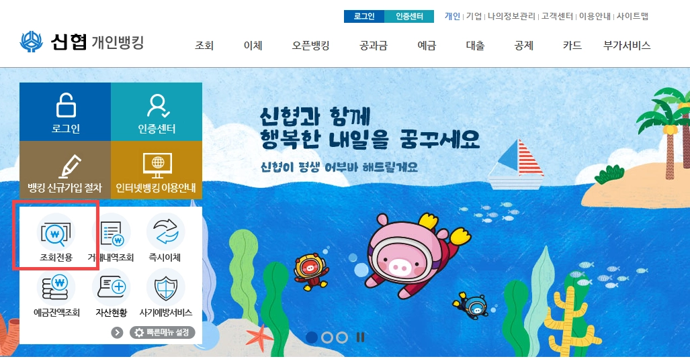
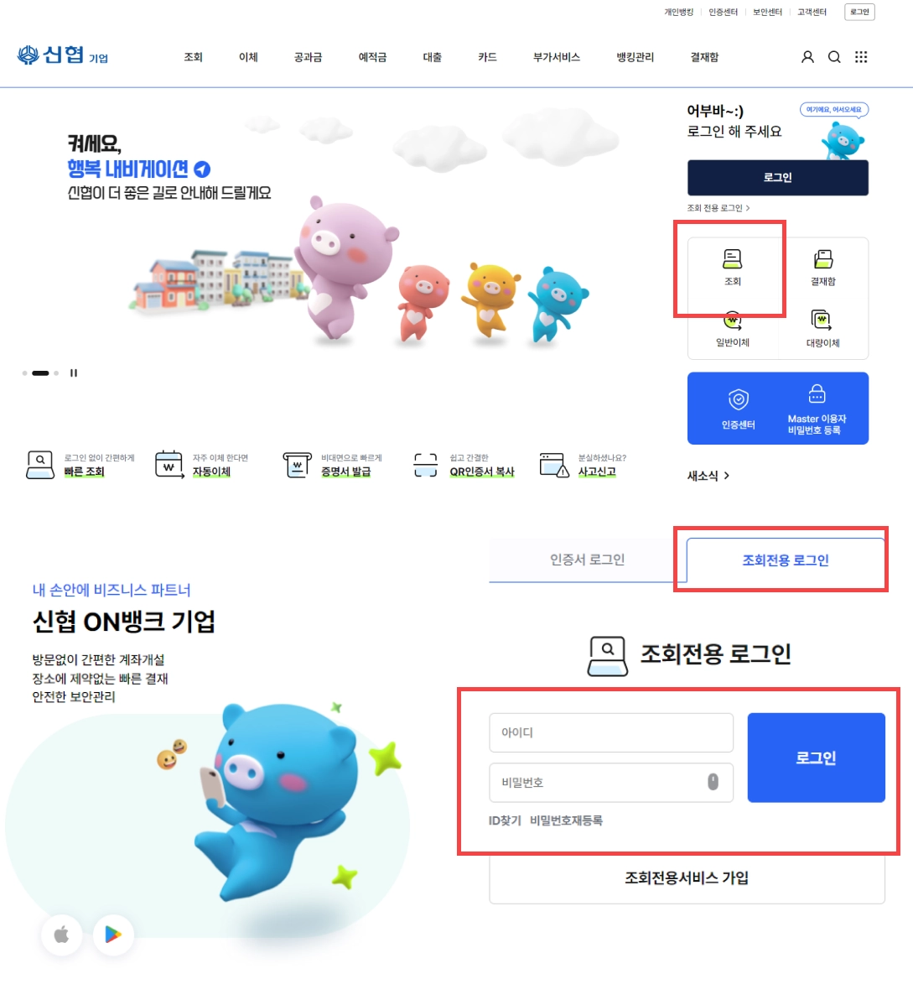

# 신협은행

> 원문: https://support.alfred.kr/d52e8268-560a-82e6-aa83-01cfee606364

**기업뱅킹**

1. 신협 홈페이지([http://openbank.cu.co.kr/](http://openbank.cu.co.kr/))에 접속

2. 좌측중앙[조회전용 > 조회전용서비스 > 신규 > 계좌등록/해지]에서 등록

완료 후 세무신고용 정보관리 ([바로가기](https://report.heumtax.com/integrate/tax))에 연동하기
