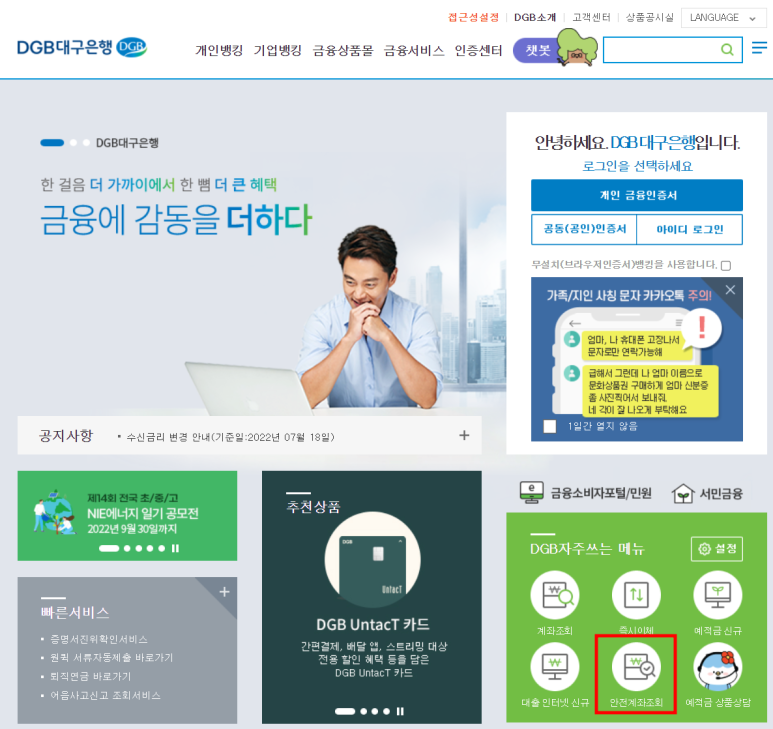
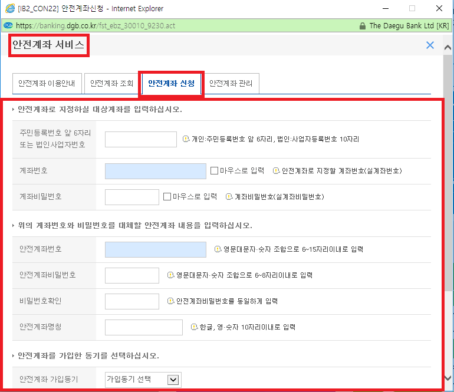
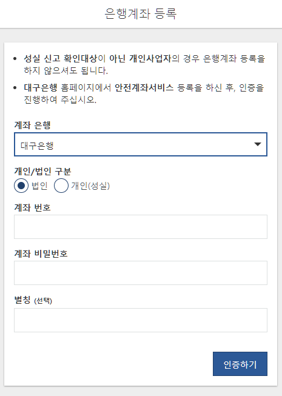

# 대구은행

> 원문: https://support.alfred.kr/a8ae8268-560a-8365-b54c-01e9eabdfd40

1. 대구은행 홈페이지([www.dgb.co.kr](http://www.dgb.co.kr/)) 접속

2. 우측하단 안전계좌조회 클릭

3. 안전계좌 신청 클릭하여 안전계좌 등록

4. 안전계좌등록 확인 후 혜움레포트([https://report.heumtax.com/finance-account/bank](https://report.heumtax.com/finance-account/bank))에 인증하기

