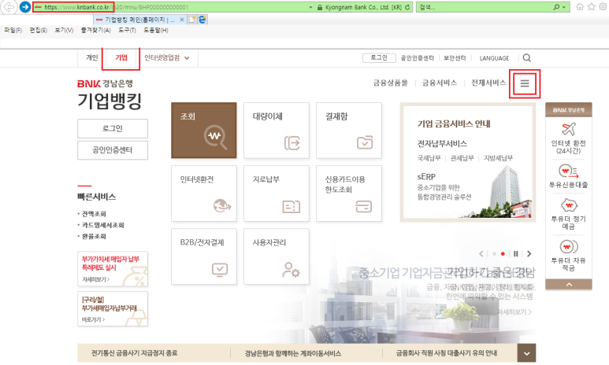
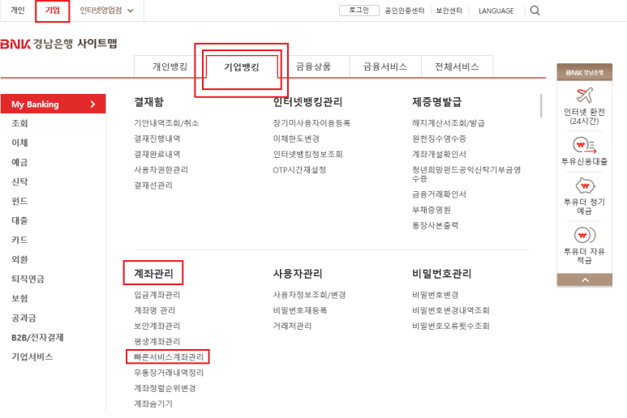
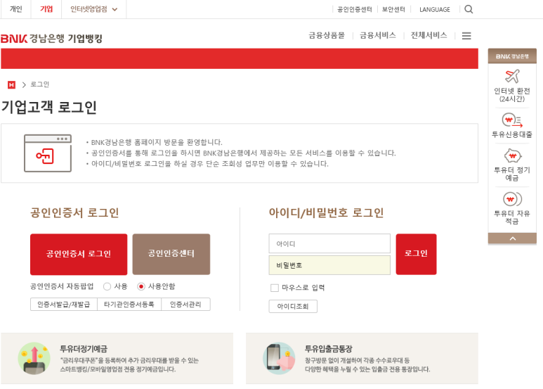
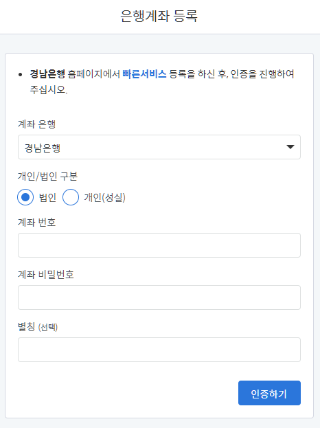

# 경남은행

> 원문: https://support.alfred.kr/63be8268-560a-82e7-973b-81680062295f

1. 경남은행 홈페이지([www.knbank.co.kr](http://www.knbank.co.kr/))에 접속

2. 전체 매뉴 -> 기업뱅킹 -> 계좌관리 -> 빠른서비스계좌관리 클릭

3. 공동인증서 ( 구 공인인증서)  로그인하여 빠른서비스 등록

4. 빠른서비스 등록하여 혜움레포트( [https://report.heumtax.com/finance-account/bank](https://report.heumtax.com/finance-account/bank)) 에 인증하기

