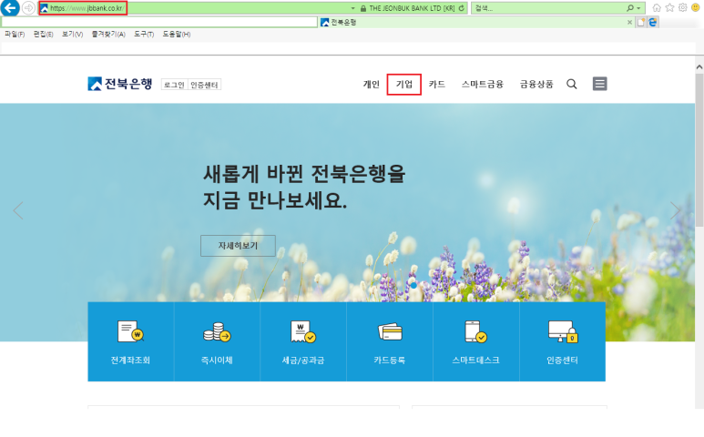
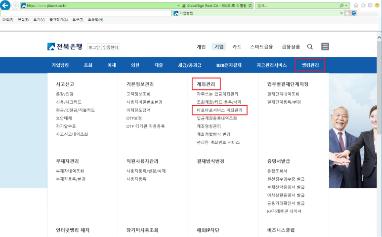
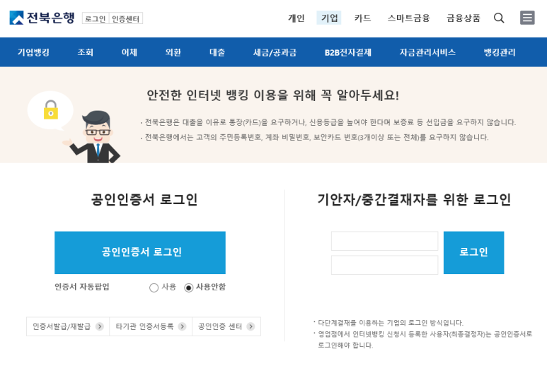
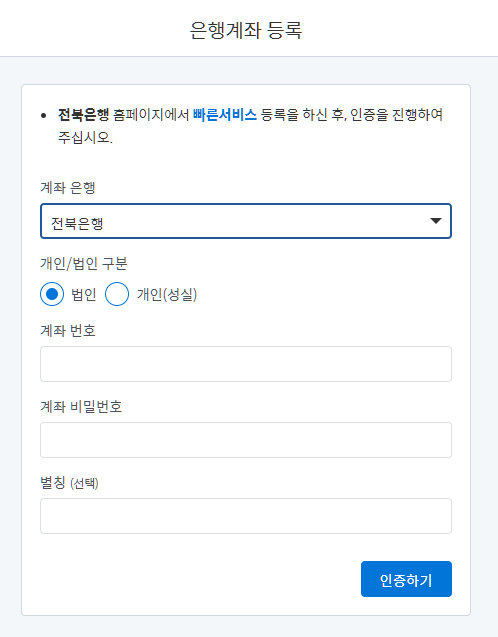

# 전북은행

> 원문: https://support.alfred.kr/197e8268-560a-837e-8fe1-815c64844731

1. 전북은행 홈페이지([www.jbbank.co.kr](http://www.jbbank.co.kr/))에 접속

2. 전북은행 기업페이지로 접속

3. 뱅킹관리 -> 계좌관리 -> 바로바로서비스 계좌관리 클릭

4. 공동인증서 ( 구 공인인증서)를 통하여 로그인

5. 바로바로서비스 등록하여 혜움레포트[https://report.heumtax.com/finance-account/bank](https://report.heumtax.com/finance-account/bank)) 에 인증하기

