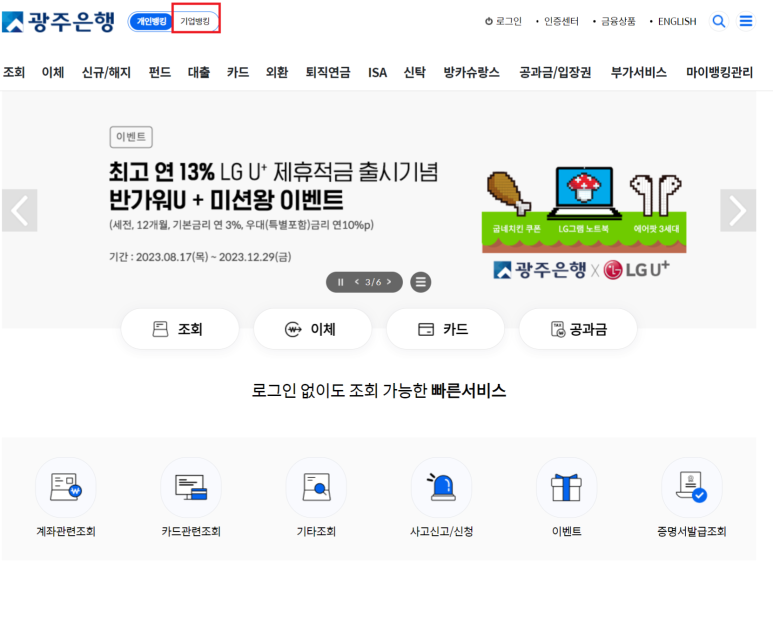
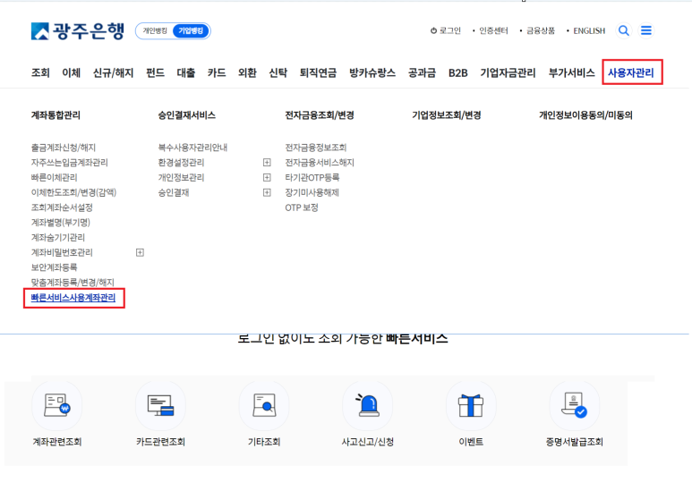
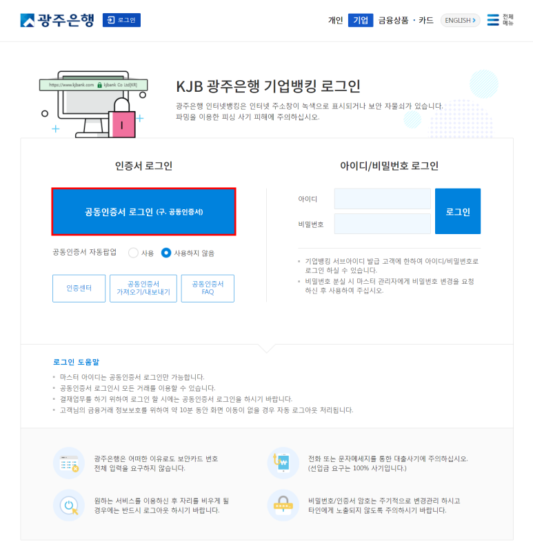

# 광주은행

> 원문: https://support.alfred.kr/495e8268-560a-839d-8bb7-01c01f55626c

1. 광주은행 홈페이지([www.kjbank.com](http://www.kjbank.com/))에 접속 해 주세요.

2. 오른쪽 상단의 **기업**을 클릭 해 주세요.

3. 사용자관리 > **빠른서비스사용계좌관리**를 눌러주세요.

4. 공동인증서 (구 공동인증서) 로그인하여 빠른조회서비스 등록

#### 4. 세무신고용 정보관리 ([바로가기](https://report.heumtax.com/integrate/tax))에 연동하기
