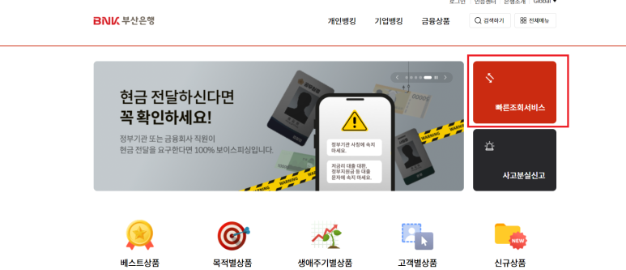
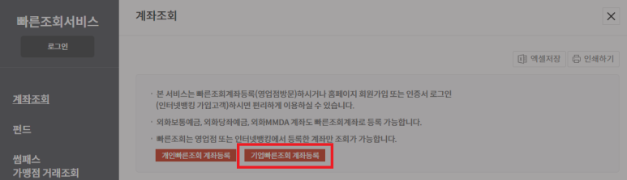
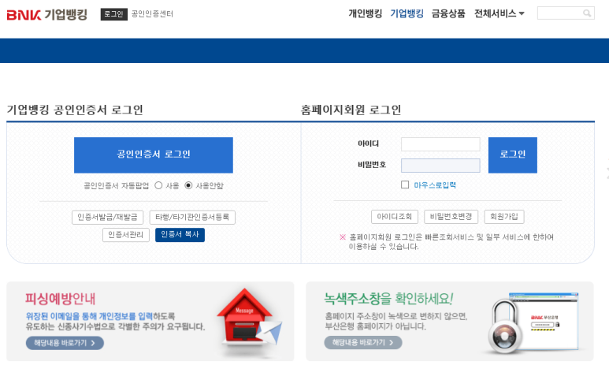
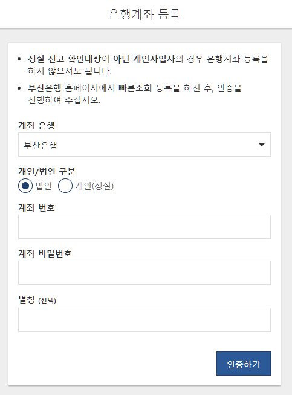

# 부산은행

> 원문: https://support.alfred.kr/2d4e8268-560a-8210-917c-81d187e4b3e0

1. 부산은행 홈페이지([www.busanbank.co.kr](http://www.busanbank.co.kr/))에 접속

2. 빠른조회서비스

3. 기업빠른조회 계좌등록

4. 공동인증서 ( 구 공인인증서) 로그인하여 계좌등록하기

5. 빠른서비스 등록하여 혜움레포트([https://report.heumtax.com/finance-account/bank](https://report.heumtax.com/finance-account/bank))에 인증하기

