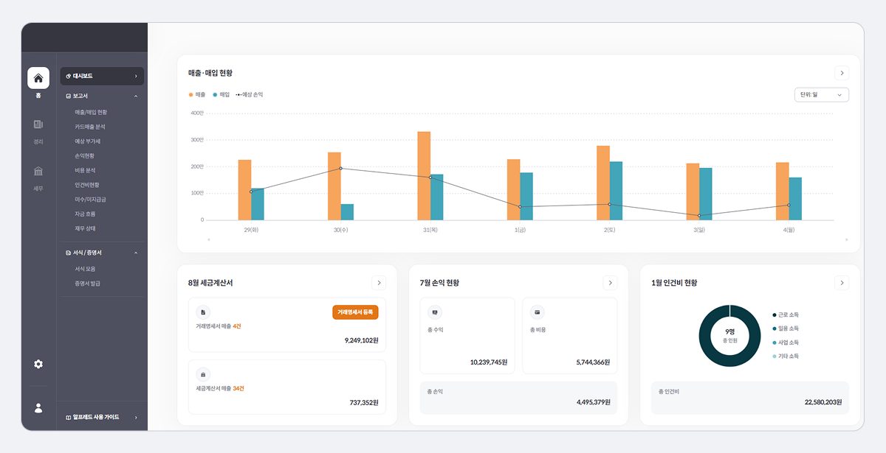
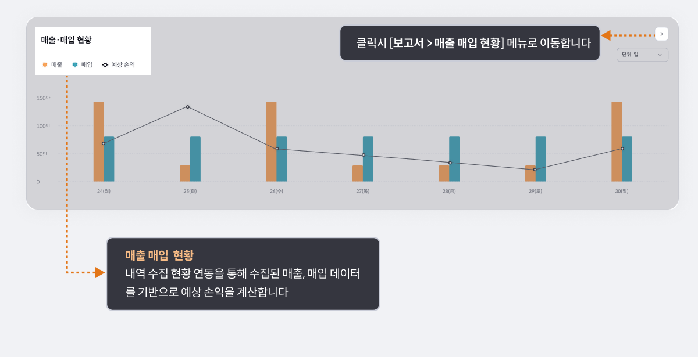
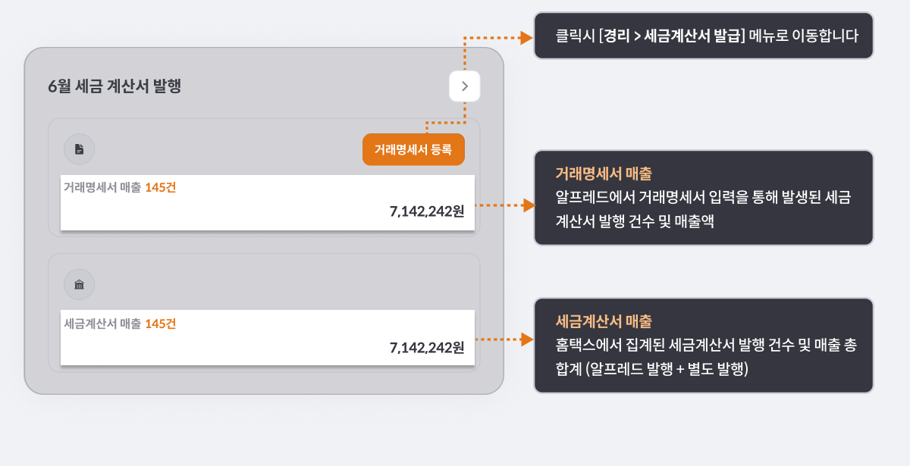
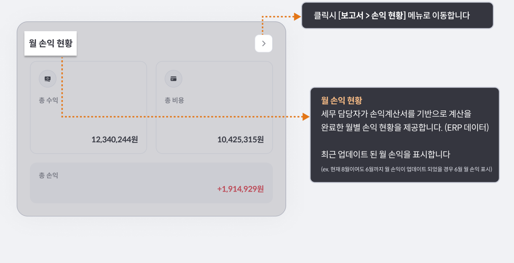
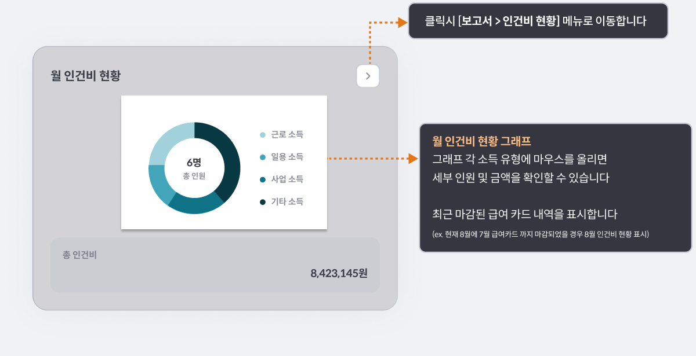
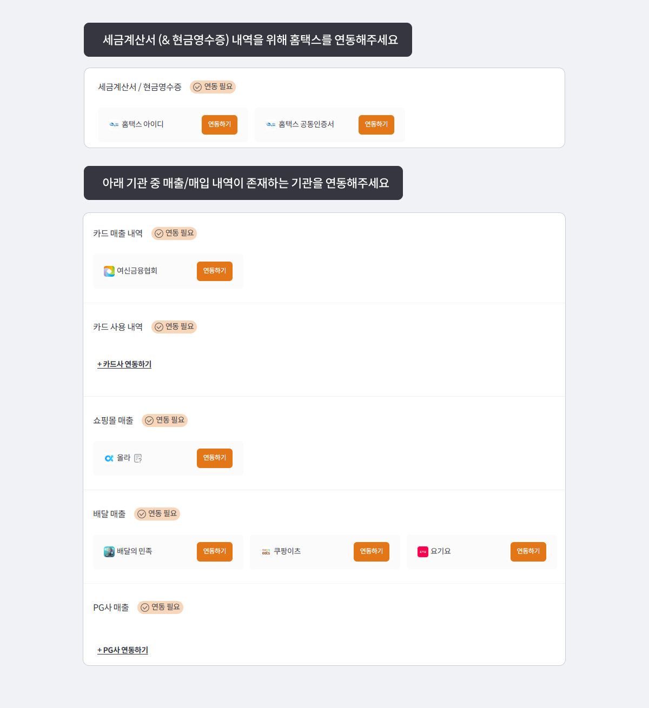

# 대시보드

> 원문: https://support.alfred.kr/21ce8268-560a-80ac-ab85-ddbf8512c1d6

[알프레드 - 올인원 금융 SaaS 경리부터 급여, 세무까지 이제, 알프레드 하나로 해결하세요 https://app.alfred.kr/dashboard](https://app.alfred.kr/dashboard)

핵심 정보를 빠르게 파악하실 수 있도록 홈 메뉴와 대시보드를 제공합니다.  대시보드 에서는 손익, 매출, 인건비 등 주요 재무 지표를 볼 수 있습니다.

### 대시보드 구성

- **매출·매입 현황**
  - [보고서 > 매출/매입 현황] 의 **매출·매입 요약 내역**을 확인 할 수 있습니다

---

- **세금계산서 발행**
  - [경리 > 세금계산서 발행]의 세금계산서 발행 건수 및 매출 내역을 확인 할 수 있습니다.

---

- **월 손익 현황[세무 수임 고객 대상]**
  - [보고서 > 손익 현황] 의 최신 월 손익 현황을 확인 할 수 있습니다.
  - 마지막 업데이트 된 월의 내역이 표시됩니다.

---

- **인건비 현황[세무 수임 고객 대상]**
  - [보고서 > 인건비 현황] 의 최신 월 인원 및 인건비 금액 합계가 표시됩니다.
  - 인건비 현황은 마감된 급여 카드를 기준으로 제공 됩니다.

### 사용 방법

**매출·매입 및 세금계산서 내역 확인 위해**

→ 내역 조회 연동 관리에서 홈택스 및 매출, 매입 발생처를 연동해주세요 (바로가기)

**월 손익 현황 및 인건비 현황 확인을 위해**

→ 비 수임 고객께서는 혜움 세무법인 수임 후 서비스를 받아보실 수 있습니다.

[간편하고 친절한 전문 세무 상담 혜움 전문 세무사의 1:1 맞춤형 케어 https://www.heumtax.com/consulting](https://www.heumtax.com/consulting)

→ 수임 고객인 경우 매월 제공됩니다.

- 월 손익은 월 손익보고시 제공됩니다.
- 인건비 현황은 해당 월 급여카드 마감시 표시됩니다.
