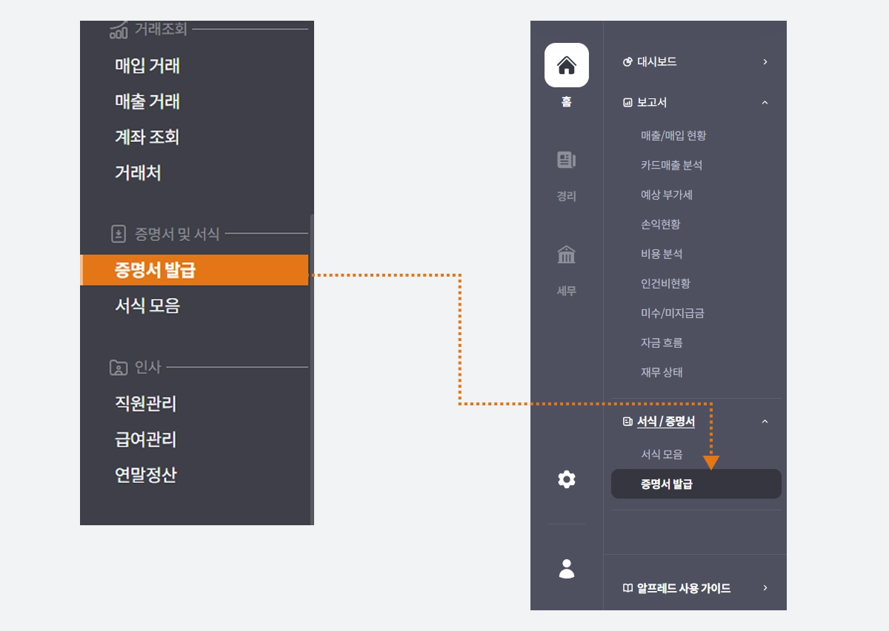
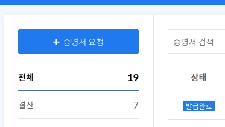
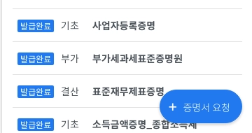
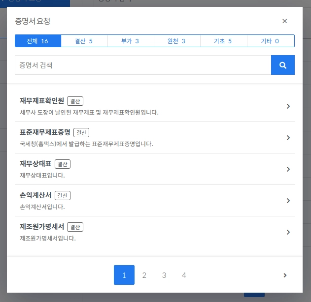
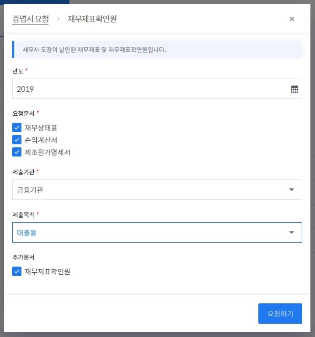
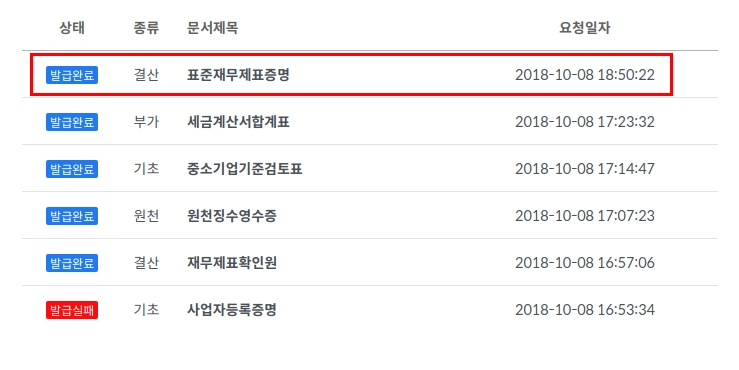
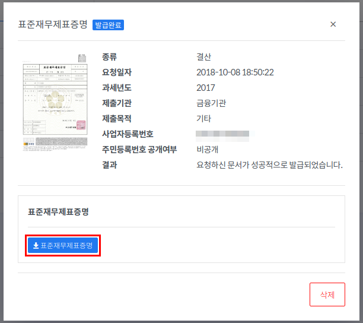

# 증명서 발급

> 원문: https://support.alfred.kr/21fe8268-560a-81d6-9c61-c72e4095e729

[알프레드 - 올인원 금융 SaaS 경리부터 급여, 세무까지 이제, 알프레드 하나로 해결하세요 https://app.alfred.kr/certificate/request-history](https://app.alfred.kr/certificate/request-history)

> **참고 : 제공하는 증명서 리스트**
>
> - 📄 [온라인 발급 증명서 리스트](01-온라인-발급-증명서-리스트.md)

#### 1. 메뉴에서 '[증명서 발급](https://report.heumtax.com/document/certificate/request-history)' 메뉴 클릭

#### 2. '증명서 요청' 버튼 클릭

[PC 버전 - 좌측 상단]

[모바일 버전 - 우측 하단]

#### 3. 발급을 원하는 증명서 선택

#### 4. 상세 내용을 입력한 후, 하단의 '요청하기' 버튼 클릭

(요청 후 약 5분 안에 발급됩니다. 요청이 많을 경우 최대 30분까지 소요될 수 있습니다.)

#### 5. 증명서 발급 리스트 화면에서 요청한 증명서 선택

(`발급완료` 된 증명서만 다운로드 가능합니다.)

#### 6. 상세 내용 창에서 하단의 버튼을 누르면 증명서가 다운로드 됩니다.

## 하위 페이지

- [온라인 발급 증명서 리스트](01-온라인-발급-증명서-리스트.md)
