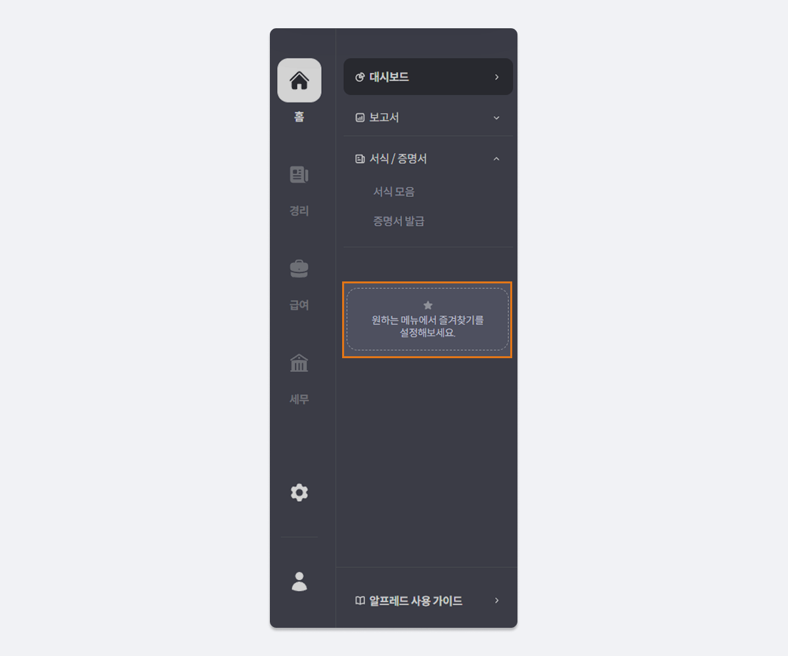
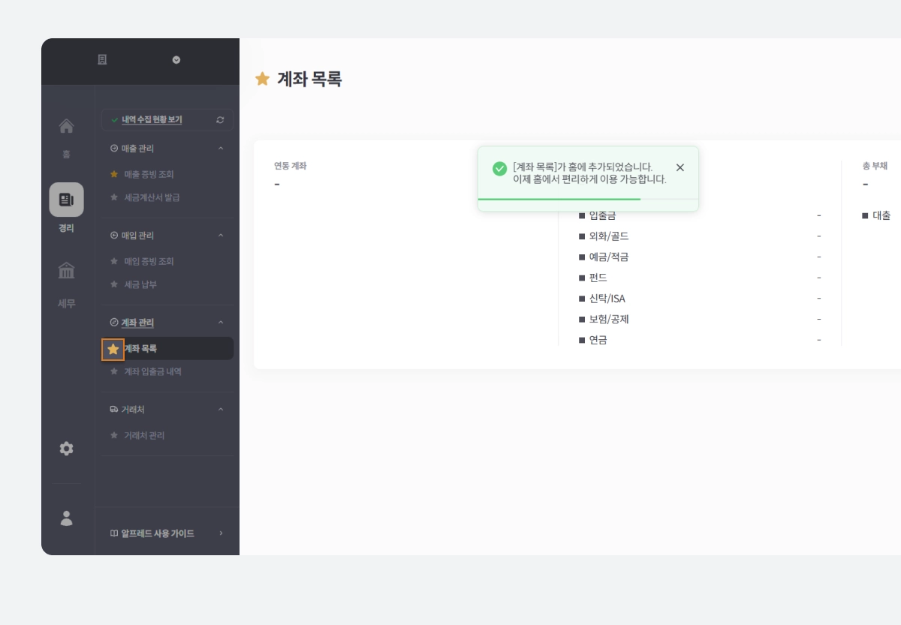
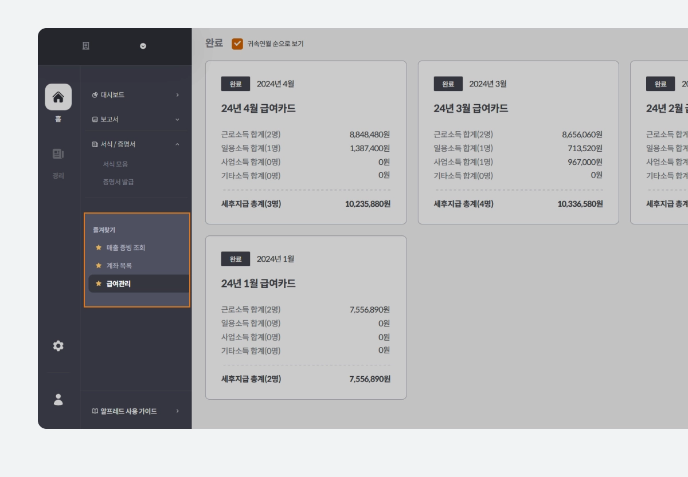

# 즐겨찾기

> 원문: https://support.alfred.kr/24ee8268-560a-802c-a241-c587a2f1bc6c

> **알프레드 즐겨찾기 기능**
>
> 자주 활용하는 메뉴들을 즐겨찾기 하면 **홈** 에서 바로 해당 메뉴를 확인하고 기능을 사용할 수 있습니다.

### 즐겨찾기 위치

- 즐겨찾기는 홈 메뉴에 위치하며 즐겨찾기 메뉴 추가시 서식/증명서 하단에 나타납니다

### 즐겨찾기 설정 방법

- 즐겨찾기에 메뉴를 추가하려면 메뉴 좌축 별 () 모양 버튼을 클릭해주세요
- 즐겨찾기 추가성공시 메뉴가 홈에 추가 되었다는 안내 메세지가 나타납니다.

- 즐겨찾기가 완료되면 **홈 메뉴 > 즐겨찾기** 에 메뉴들이 표시되며 메뉴를 찾아가지 않아도  홈 에서 바로 기능을 사용할 수 있습니다.
- 즐겨찾기에 추가된 메뉴들의 순서는 추가된 순서대로 상단부터 나타납니다.
- 즐겨찾기를 해지하고 싶다면 홈, 혹은 해당 메뉴가 보이는 어디서든 다시 한번 메뉴 옆 별표 모양을 눌러주세요
