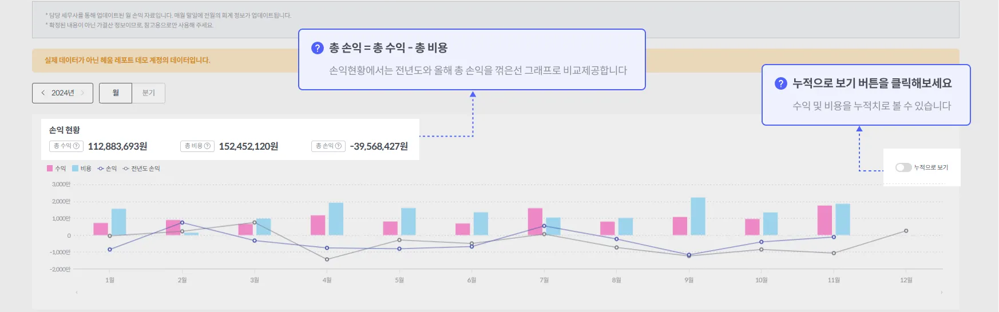
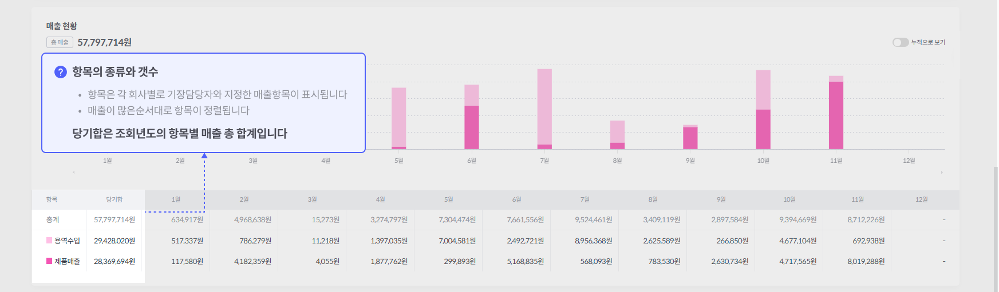
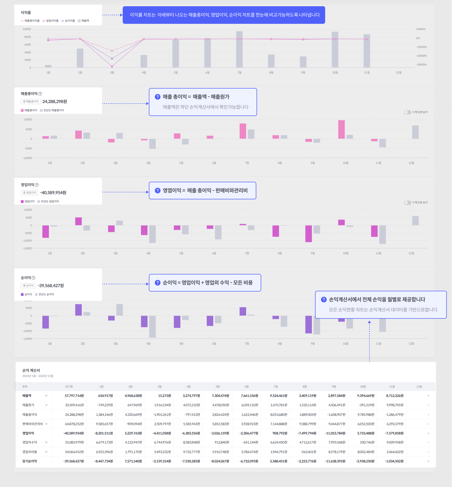
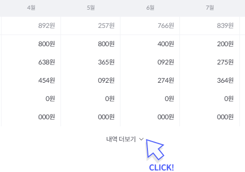

# 손익 계산서

> 원문: https://support.alfred.kr/21fe8268-560a-81e4-ba92-ed9449828161

[알프레드 - 올인원 금융 SaaS 경리부터 급여, 세무까지 이제, 알프레드 하나로 해결하세요 https://app.alfred.kr/settlement-reports/profit-loss](https://app.alfred.kr/settlement-reports/profit-loss)

#### 손익계산서 살펴보기

- **손익현황** : **`총 수익`** 및 **`총 비용`**을 통한 **`총 손익`**관련 데이터를 보고서로 제공합니다.
  - **총 수익** : **`매출액(영업수익) + 영업외수익`**
  - **총 비용** : 모든 비용을 합산한 값 (매출원가, 판매관리비, 영업외비용, 법인세 등)
  - **총 손익** : **`수익 - 비용`** 값으로 당기순이익을 나타냄

---

- **매출현황 :** 기업이 어떤 매출 항목으로 수입을 얻었는지 매출 항목들을 비교, 총합으로 분석 제공합니다.

---

- **이익률**
  - **매출총이익** : 매출액에서 매출원가를 제외한 상품/제품 판매 이익입니다.
  - **영업이익** : 매출총이익에서 판매관리비를 제외한 이익입니다.
  - **순이익** : (영업이익+영업외이익) 에서 모든 비용을 제외한 회사의 세후 이익입니다.

#### FAQ

- **손익계산서에서 0원으로 나오는 항목은 왜 0원으로 나오나요?**
  손익현황은 월 결산 자료를 기반으로 생성됩니다. 결산 시 담당자가 항목을 0원, 혹은 항목에 값을 넣지 않은 경우에 0원으로 표시됩니다

- **손익계산서는  언제 업데이트되나요?**
  기장 담당자가 월손익 결산을 완료하는 시점에 보고서 업데이트를 해주면,  업데이트 됩니다.

- **매출항목이 매우 많은경우는 어떻게 확인가능한가요?**

  

  상위 5개 매출항목이 표 및 그래프에 표시됩니다. 표에서 ‘내역 더보기’를 클릭하시면 전체 매출항목 데이터를 확인할 수 있습니다.
