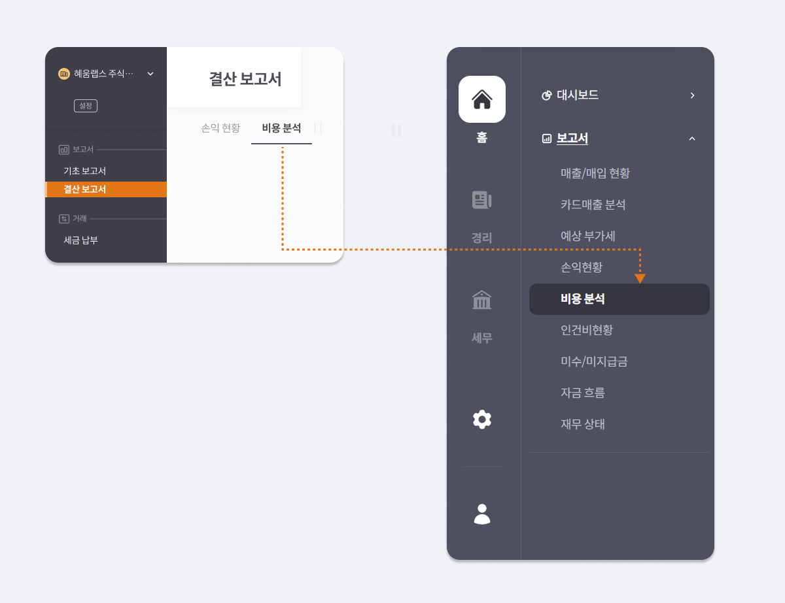
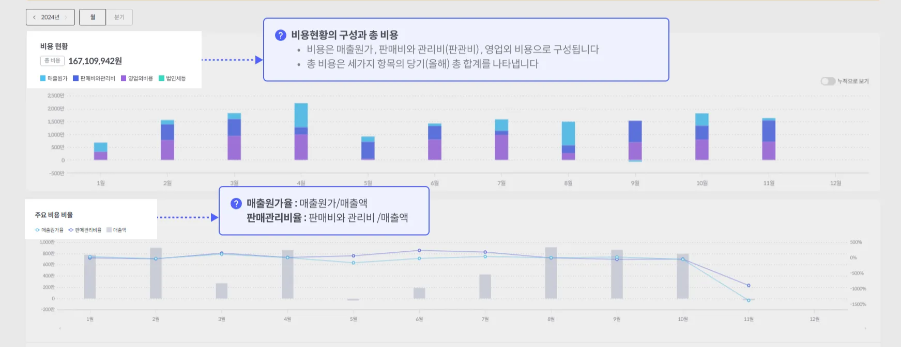
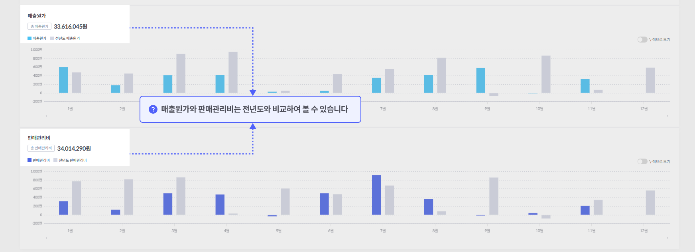
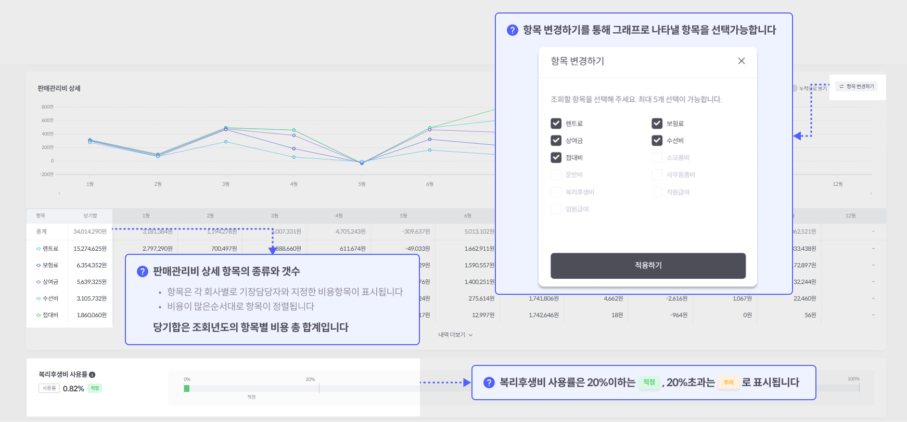
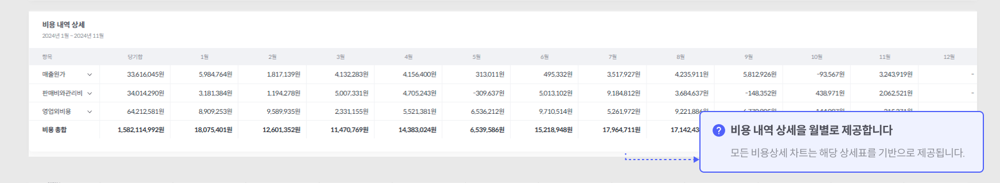

# 비용 분석 보고서

> 원문: https://support.alfred.kr/21fe8268-560a-8136-9f74-fb18684a0127

#### 비용 분석 보고서 바로가기

[알프레드 - 올인원 금융 SaaS 경리부터 급여, 세무까지 이제, 알프레드 하나로 해결하세요 https://app.alfred.kr/settlement-reports/cost-details](https://app.alfred.kr/settlement-reports/cost-details)

#### 비용 분석 보고서 살펴보기

- **비용 현황 :** 비용은 **매출원가**, **판매비와관리비**, **영업외비용, 법인세(개인사업자는 소득세)**로 구성됩니다.
- **주요 비용 비율 :매출원가**, **판매비와관리비**의 총합 및 매출액대비 비율을 나타냅니다.

---

- **매출원가 :** 기업이 상품 및 서비스를 제작하는데 들인 총 비용(원가)입니다.
- **판매비와관리비 :** 상품, 서비스의 판매 및 기업의 유지를 위해 발생한 비용입니다.

---

- **판매관리비 상세 :** 세부 비용 항목별 당기 사용내역을 확인할 수 있습니다.
  - 판매관리비 상세 차트에는 비용이 많은 순으로 5개 항목이 최초 노출됩니다.
  - 우측상단 [항목 변경하기] 버튼을 클릭하여 조회를 원하는 항목을 선택할 수 있습니다.
- **복리후생비 사용률 :** 인건비 대비 복리후생비용이 적정수준인지 확인할 수 있습니다.
  - 복리후생비 사용률 계산 : 복리후생비/인건비(%)

---

- **비용내역 상세 :** 비용 항목들의 당기(올해) 상세내역을 제공합니다.

#### FAQ

- **왜 복리후생비 사용률은 20%를 넘지 말아야하나요?**
  복리후생비 사용률이 20%를 초과할 경우, 담당 세무서에서 소명을 요청하거나 조사 대상이 될 수 있습니다. 단, 이 수치는 절대적이지 않으며 기업별, 담당 세무서별 등 특성에 따라 차이가 있을 수 있습니다.

- **비용분석 언제 업데이트되나요?**
  기장 담당자가 월손익 결산을 완료하는 시점에 보고서 업데이트를 해주면, 업데이트 됩니다.
