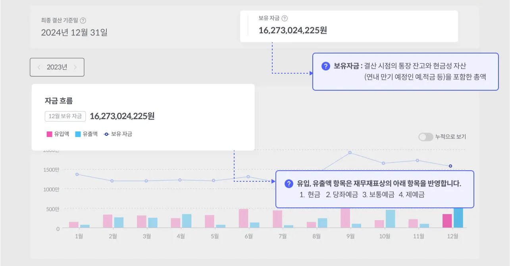
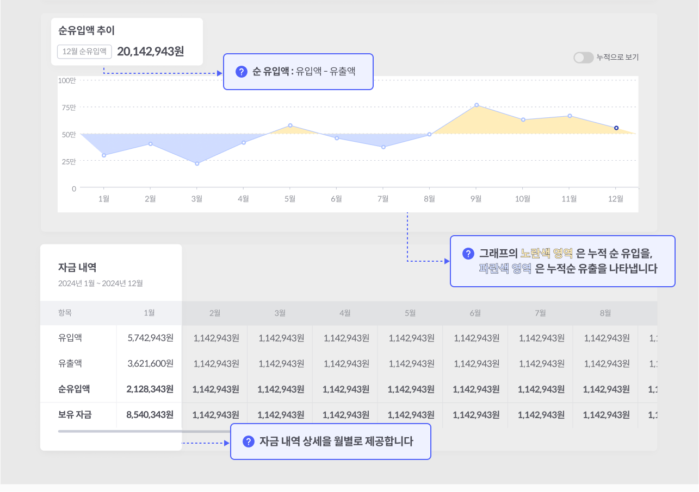

# 자금 흐름 보고서

> 원문: https://support.alfred.kr/21fe8268-560a-81e3-9f07-ca2a22d6cdf1

### 자금흐름 바로가기

[알프레드 - 올인원 금융 SaaS 경리부터 급여, 세무까지 이제, 알프레드 하나로 해결하세요 https://app.alfred.kr/settlement-reports/cash-flow](https://app.alfred.kr/settlement-reports/cash-flow)

### 자금흐름 살펴보기

- **보유자금** : 최종결산일을 기준으로 보유한 현금성자산과 연내 만기되는 자산을 총합한 금액
- **자금흐름 :** 유입, 유출된 금액과 해당 월의 최종 보유자금을 연 단위 차트로 확인할 수 있습니다.

- **순유입액 추이** : [유입액-유출액] 금액으로 순유입액, 혹은 순유출액을 파악할 수 있습니다. 
  파란색 영역은 순유출을, 노란색 영역은 순유입을 나타냅니다.

- **자금내역 :** 유입, 유출, 순유입액의 상세내역을 표로 제공합니다.

---

### FAQ

- **자금내역은 계좌조회 메뉴에서 확인 가능한 총 자산과 동일한가요?**
  서로 다른 내역을 보여줍니다. 자금내역은 세무처리가 완료된 재무제표상의 내역을 기반으로하며, 계좌조회 메뉴에서 확인되는 금액은 연동한 계좌를 기반으로 하기에 금액이 동일하지 않습니다.

- **순유입액 추이에서 색칠된 면적은 어떤 의미일까요?**
  노란색 면적은 순유입을, 파란색 면적은 순유출을 나타내어 시각적으로 올해 (현재까지) 자금이 유입 중인지, 유출 중인지 알기 쉽게합니다. 예를들어 순유출 면적이 순유입면적보다 넓어보인다 = 현재 기업에 들어오는 돈 보다 나가는돈이 많은 상황이다 와 같이 ‘자금흐름’을 쉽게 확인하도록 도와줍니다.

- **내부적으로 파악하고 있는 자금과 차이가 있는것 같아요.**
  자금흐름은 결산처리한 재무재표(재무상태표)에 기록된 항목중 통상 ‘자금’으로 간주되는 아래 항목들을 기준으로 합니다. (**대상항목 :현금, 당좌예금,  보통예금, 제예금**)  자금흐름의 데이터는 세무결산처리된 내역을 기반으로하여 신뢰할 수 있는 데이터입니다.

- **자금흐름은 언제 업데이트 되나요?**
  기장 담당자가 결산을 완료하는 시점에 보고서 업데이트를 해주면 업데이트 됩니다. 
(월 결산 프리미엄고객 대상)
