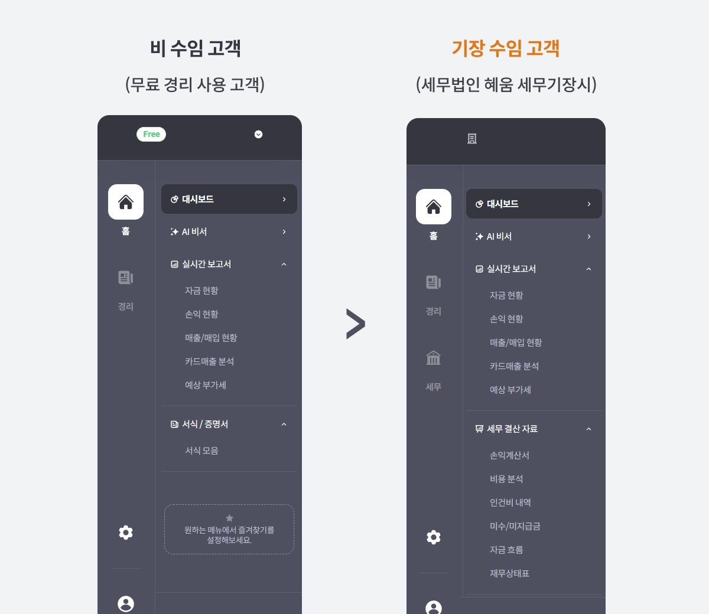

# 알프레드 홈

> 원문: https://support.alfred.kr/21ee8268-560a-803c-af9c-cc1f17e2a413

### 대시보드

 — 대시보드

### 증명서 & 서식

 — 증명서 발급

 — 서식(리스트)

### 즐겨찾기

 — 즐겨찾기

---

### 보고서

**실시간 보고서**

연동된 매출·매입 데이터 기반 제공

 — 매출/매입 현황 보고서

 — 알프레드 홈

 — 예상 부가세 보고서

 — 자금 현황

**세무 결산 자료**

결산된 ERP데이터 기반 제공

 — 손익 계산서

 — 비용 분석 보고서

 — 인건비현황 보고서

**결산 프리미엄 수임 고객 대상 제공**

 — 미수/미지급금 보고서

 — 자금 흐름 보고서

 — 재무상태 보고서

**엑셀 다운로드 기능**

세무 결산 자료를 엑셀 파일로 제공

 — 세무 결산 자료 엑셀 다운로드

---

- 결산 보고서와 급여 보고서는 세무기장 수임시 제공됩니다.
- 사용중인 플랜 (세무 기장 수임 여부)에 따라 확인 가능한 보고서 차이를 확인해보세요

## 하위 페이지

- [대시보드](01-대시보드.md)
- [증명서 발급](02-증명서-발급/README.md)
- [서식(리스트)](03-서식-리스트/README.md)
- [즐겨찾기](04-즐겨찾기.md)
- [매출/매입 현황 보고서](05-매출-매입-현황-보고서.md)
- [예상 부가세 보고서](06-예상-부가세-보고서.md)
- [자금 현황](07-자금-현황/README.md)
- [손익 계산서](08-손익-계산서.md)
- [비용 분석 보고서](09-비용-분석-보고서.md)
- [인건비현황 보고서](10-인건비현황-보고서/README.md)
- [미수/미지급금 보고서](11-미수-미지급금-보고서.md)
- [자금 흐름 보고서](12-자금-흐름-보고서.md)
- [재무상태 보고서](13-재무상태-보고서.md)
- [세무 결산 자료 엑셀 다운로드](14-세무-결산-자료-엑셀-다운로드.md)
