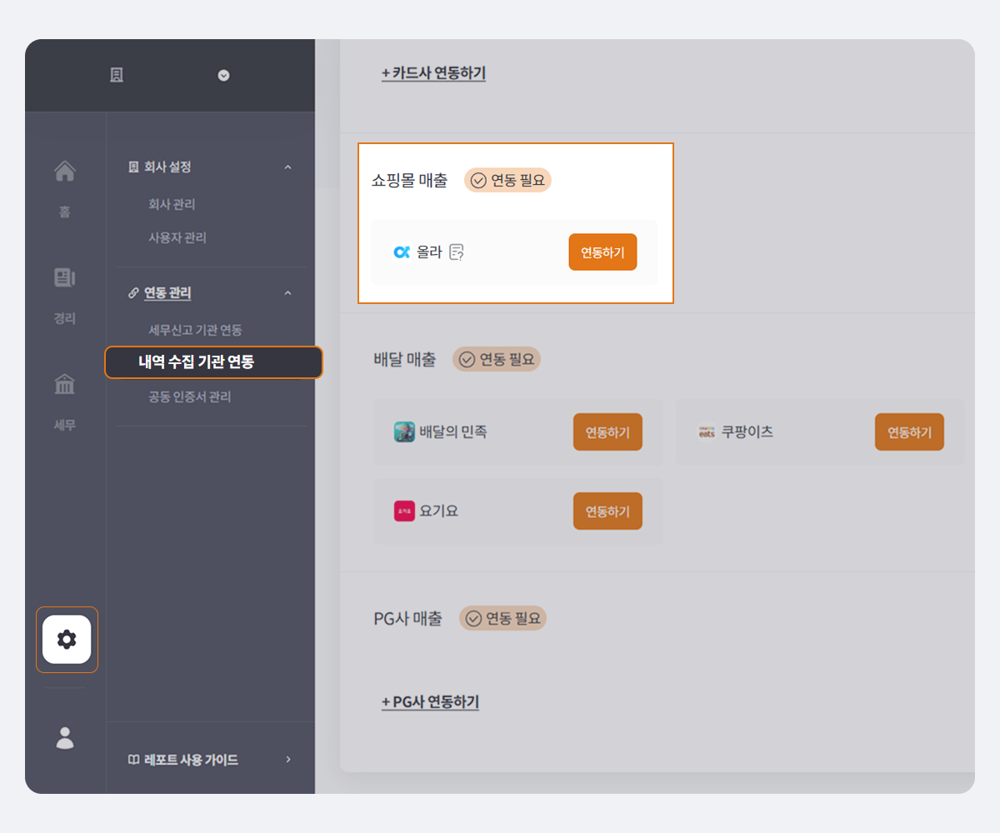
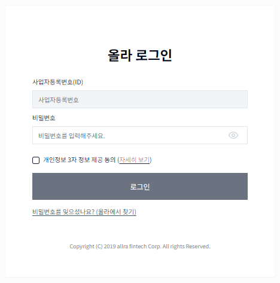
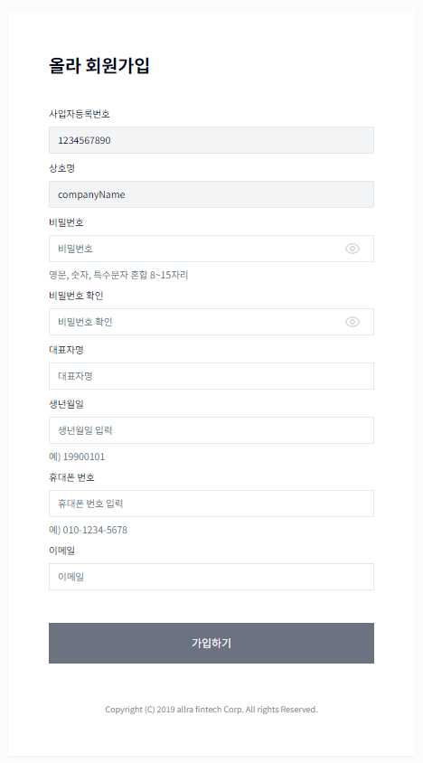
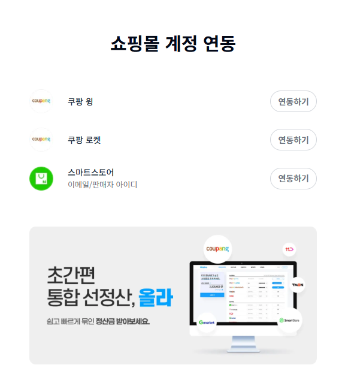
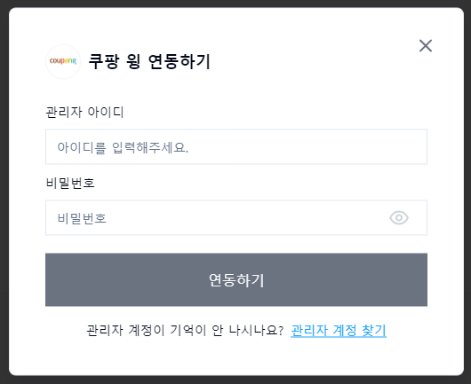
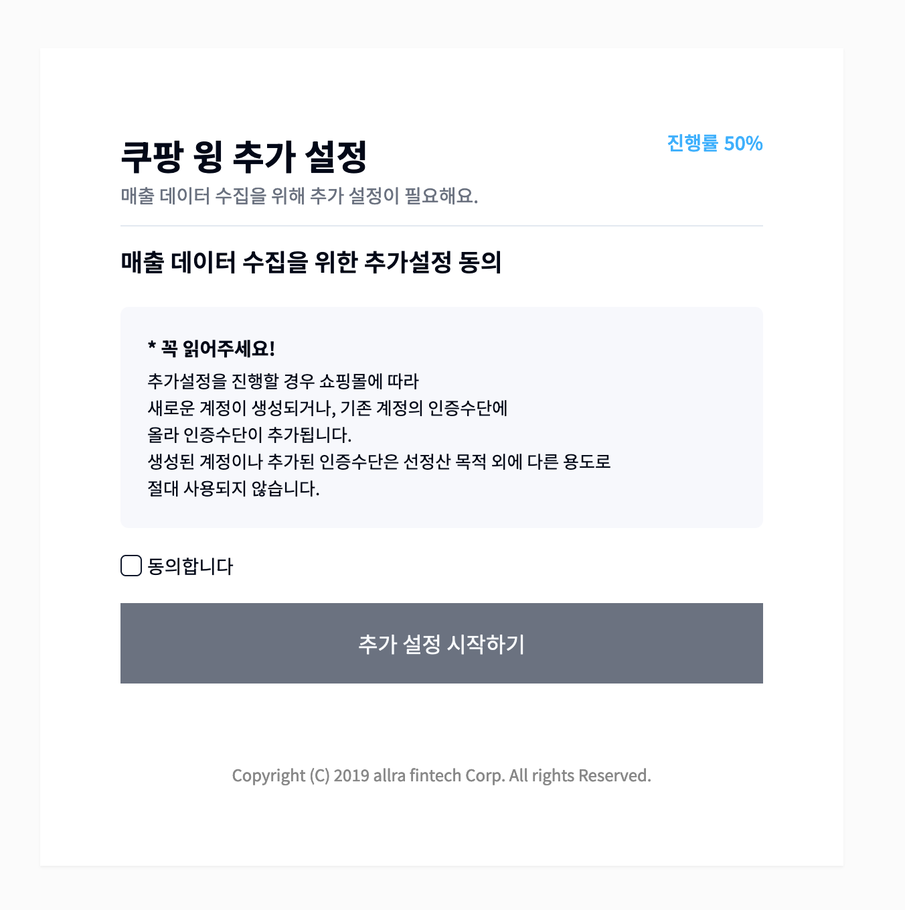
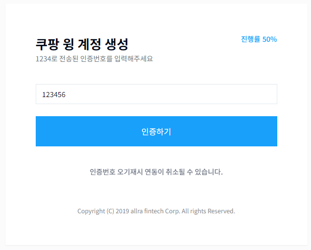
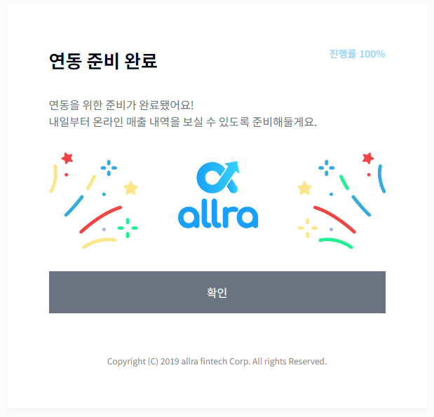
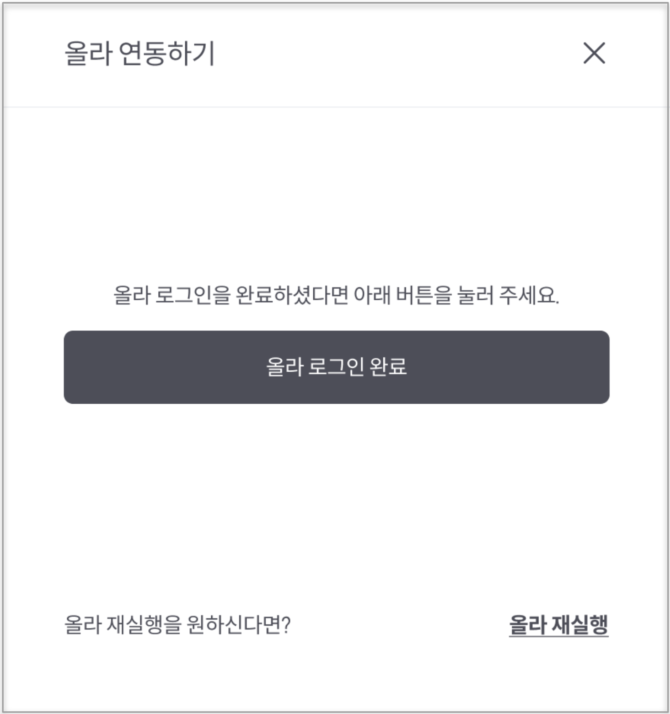
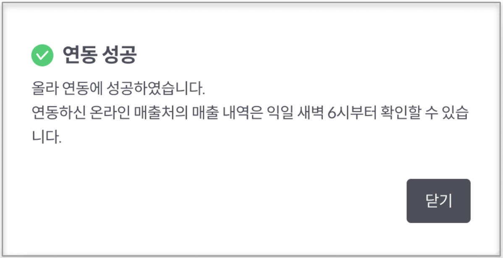

# 올라(쇼핑몰 매출) 연동하기

> 원문: https://support.alfred.kr/21fe8268-560a-811a-9c76-d695d34c7547

## 올라 연동하기

---

1. **내역 수집 기관연동 > 매출/매입내역조회> 올라 연동하기 버튼을 선택해주세요.**

  

**2. 약 3초 뒤에 새 탭으로 ‘올라 서비스’ 화면이 노출됩니다.**

기존에 올라 회원일 경우에는 ‘로그인’ 화면이, 회원이 아닐 경우에는 ‘회원가입’ 화면이 보입니다.

> a. 원하는 쇼핑몰 [연동하기] 클릭
>
> 현재 아래 3개의 쇼핑몰 계정만 연동 가능하며, 지속 확장 예정입니다 (2024.12)
>
> 
>
> b. 쇼핑몰 계 정보 입력 후 [연동하기] 클릭
>
> 
>
> c. 추가설정 동의 후 [추가 설정 시작하기] 클릭
>
> 
>
> d. 인증번호 입력 후 [연동하기] 클릭
>
> 
>
> e. 연동 준비 완료!
>
> 

1. **올라 서비스 화면에서 회원가입/로그인을 완료한 후에, 알프레드 화면으로 돌아와서 
  [올라 로그인 완료] 버튼을 선택합니다.**

1. **올라 연동이 진행되며, 연동 성공 시 연동 성공 팝업이 노출되며, 익일 6시부터 [매출거래 - 온라인 매출]에서 ‘온라인 매출 내역’을 조회할 수 있습니다.**

  

  - 최초 연동시 최근 1개월 데이터 부터 연동됩니다.

## FAQ

---

#### ‘올라’는 무슨 서비스인가요?

- 온라인 쇼핑몰을 운영하는 사업자들의 매출에 대해 ‘선정산’을 해주는 서비스입니다. **단 선정산 서비스사용과 무관하게 알프레드 연동만을 위해 사용할 수도 있습니다.**

#### 올라 연동하면, 무엇을 할 수 있나요?

- 알프레드 에서 온라인 매출 내역을 조회할 수 있습니다.
  - 현재는 ‘쿠팡 윙, 쿠팡 로켓, 스마트 스토어’에 대해서 조회 가능하며, 지속적으로 확장하고자 합니다 (2024.07).

#### 연동을 위해서 무엇이 필요한가요?

- 올라([https://www.allra.co.kr/about](https://www.allra.co.kr/about)) 서비스에 가입을 해야 합니다.
  - 알프레드 에서 ‘올라 연동’ 시에 “올라 서비스 가입”도 함께 진행할 수 있습니다.
- 온라인 매출처(ex. 네이버 스토어, 쿠팡 윙 등)의 계정 정보를 올라 서비스에 등록해야 합니다.
  - 올라 서비스에 매출처 정보를 등록하지 않으면 ‘온라인 매출 내역’을 불러올 수 없습니다.
