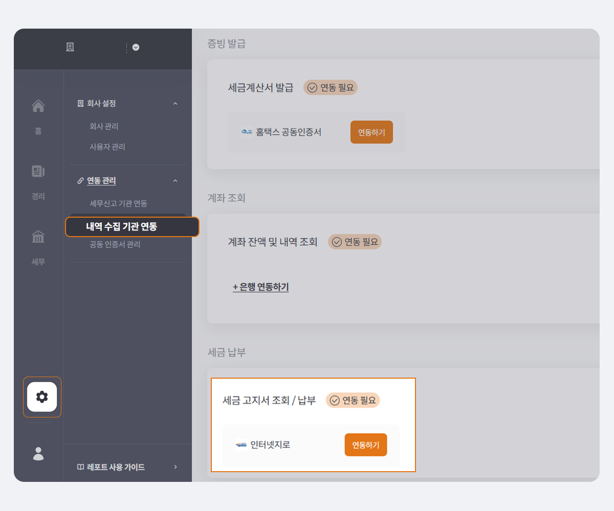
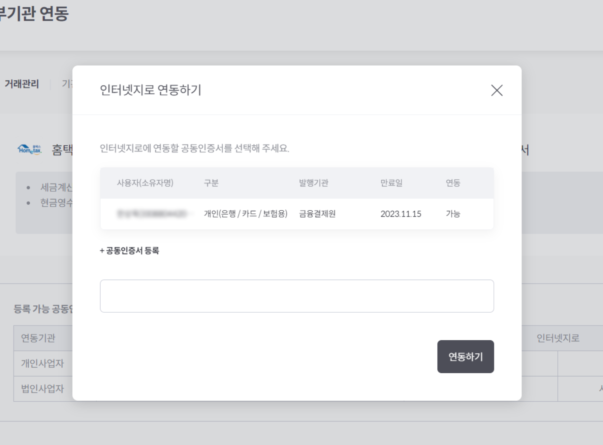
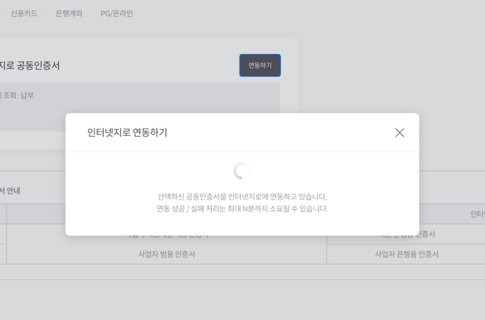
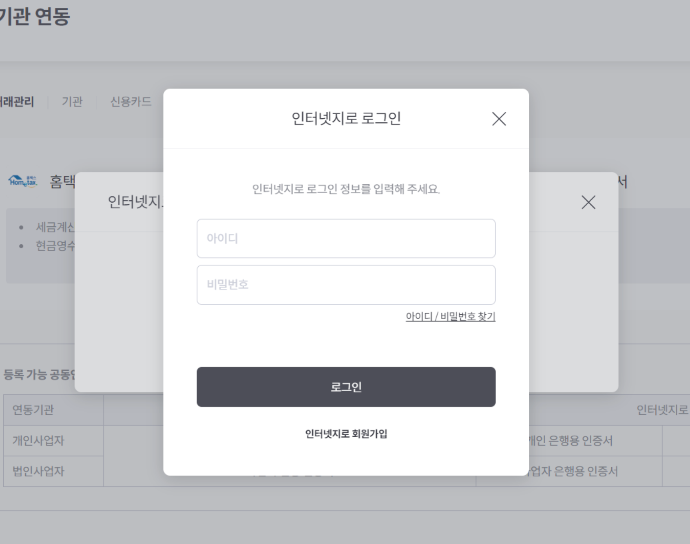
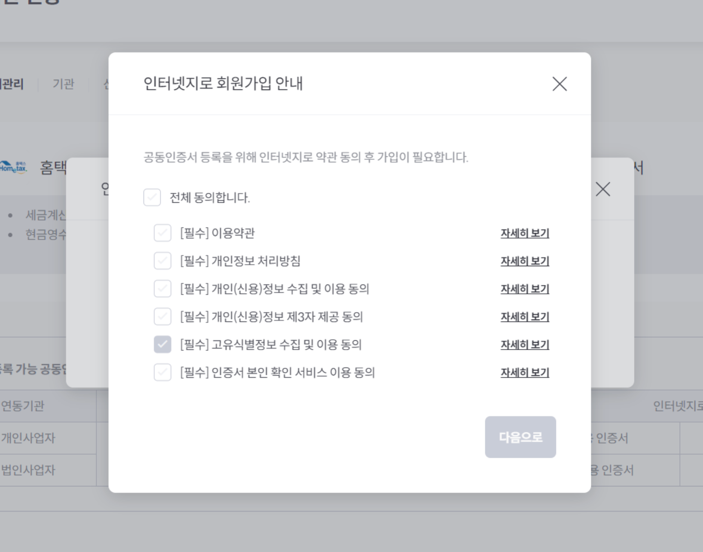
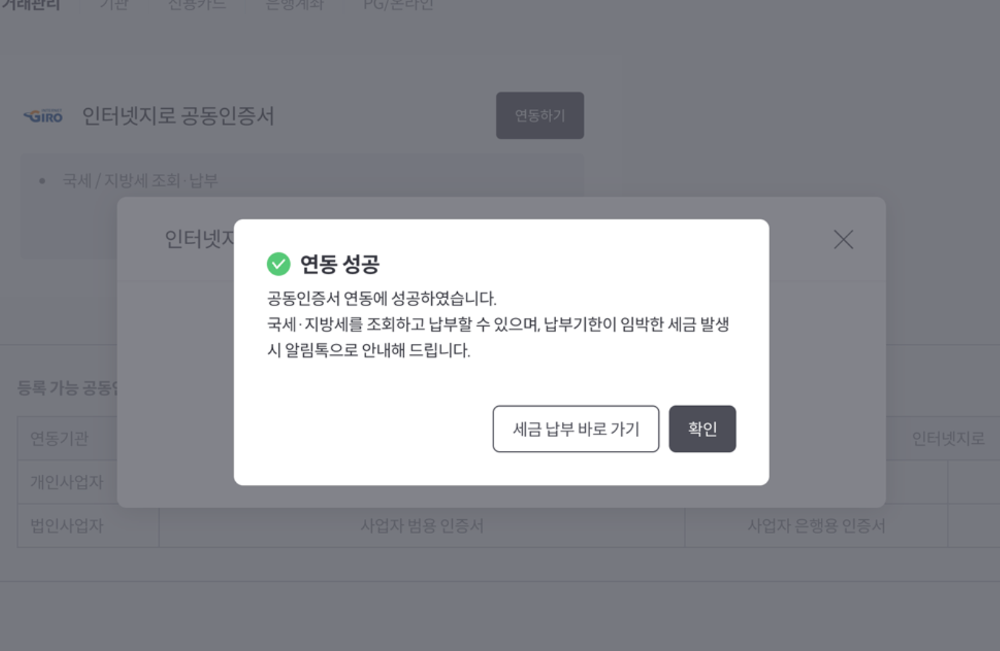
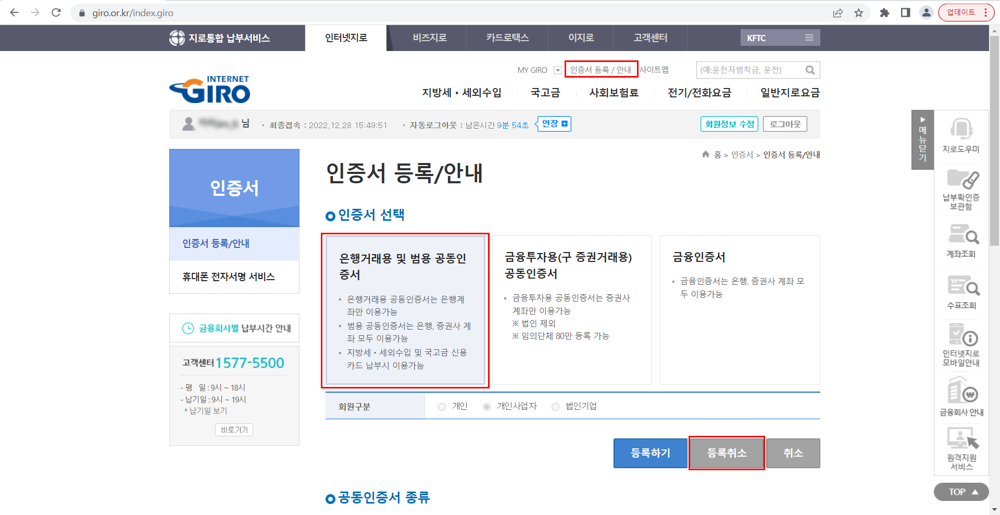

# 인터넷지로 연동하기

> 원문: https://support.alfred.kr/21fe8268-560a-81c5-b8c9-f85b8ada4dd2

## 인터넷지로 연동하기

---

1. 내역 수집 기관 연동 >세금납부 > 인터넷지로 연동하기 버튼을 선택해주세요.

2. 연동할 **공동인증서를 선택**하여 비밀번호를 입력 후 **연동하기**를 선택해주세요. 연동 항목에서 `가능` 이라고 노출되는 인증서만 연동이 가능합니다.

3. 비밀번호 일치 시 해당 인증서로 연동을 시도합니다.

3-1. 인터넷지로 로그인 팝업 발생 시 (개인사업자 해당)

- 로그인 팝업은 **금융결제원(yessign)에서 발급하지 않은 공동인증서를 등록 시 1회에 한정하여 발생**합니다. 팝업에서 `인터넷지로 아이디와 비밀번호`를 입력해주세요.

3-2. 인터넷지로 회원가입 팝업 발생 시(미가입 한 개인사업자, 법인 해당)

- 등록하신 **인증서를 통하여 인터넷지로 회원정보가 없을 시, 인터넷지로 간편 회원가입 프로세스가 최초 1회 발생**합니다. (법인사업자: 법인 범용 인증서 등록경우)
- 약관 동의 후 아이디 및 비밀번호, 납부결과를 받을 이메일 주소, 전화번호를 입력해주세요.

4. 연동에 성공 시 아래와 같은 팝업이 노출됩니다. `세금 납부 바로 가기` 버튼을 통해 세금조회 및 납부가 가능합니다.

> 연동 완료 후 세금 납부 메뉴 우측 상단 ‘**내역 업데이트**’를 클릭하여야 납부 가능 세금을 조회 할 수 있습니다.

## FAQ

---

#### 인터넷지로 연동은 무엇인가요?

- 연동을 통해 사업자에게 부과된 국세 및 지방세를 조회하고 납부까지 가능합니다.

#### 연동을 위해서 무엇이 필요한가요?

- 공동인증서가 준비 혹은 등록되어있어야 합니다.
  - 개인사업자: 개인 대표자 명의의 은행용 혹은 범용 공동인증서
  - 법인사업자: 법인 명의의 은행용 혹은 범용 공동인증서

#### 인터넷지로 회원가입 안내 팝업이 발생해요.

- (←클릭) 인터넷지로에 가입되어야 세금 조회 및 납부가 가능합니다. 레포트에서 인터넷지로 회원가입을 진행할 수 있습니다.
  - 회원가입 정보인 이메일, 전화번호, 아이디 및 비밀번호를 설정합니다.
  - 이메일의 경우 납부 결과를 전달 받을 이메일 주소를 입력해주세요.
  - 전화번호는 휴대전화번호 혹은 유선 전화번호 모두 입력이 가능합니다.
  - 아이디, 비밀번호는 혜움에서 저장하지 않습니다.
  - 인터넷지로 회원정보 변경이 필요 시 인터넷지로 홈페이지에서 변경이 가능합니다.
- (←클릭) 저는 왜 회원가입 팝업이 뜨지 않나요?
  - 이미 가입되신 경우 발생하지 않습니다.
  - 개인사업자의 경우 금융결제원(Yessign)에서 발급한 은행, 범용이 아닌경우 인터넷지로에 직접 가입하셔야 합니다. ([인터넷지로 회원가입 안내](https://support.alfred.kr/18ba8aa1-3d78-4eeb-8bb8-e8710b2af1b7))
  - 법인 사업자의 경우 법인 은행, 범용 인증서가 아닌 경우 레포트에서 가입이 불가합니다.
- (←클릭) 회원가입이 정상적으로 진행되지 않아요.
  - 회원탈퇴 시 익일 00시 부터 회원가입이 가능합니다.
  - 사업자 번호, 법인 등록번호가 올바르지 않으면 가입이 불가능합니다.

#### 해당 인증서는 등록할 수 없는 인증서라고 팝업이 발생해요.

- (←클릭) 등록하려는 사업자와 일치한 정보의 인증서인지 확인해주세요.
  - 개인사업자: 현재 로그인 한 사업자 대표명의의 인증서인지 확인해주세요. 은행용 혹은 범용 인증서인지 다시 한번 확인해주세요. (세금계산서 발급용 인증서는 등록이 불가합니다.)
  - 법인사업자: 현재 로그인 한 법인 명의의 인증서인지 확인해주세요. 은행용 혹은 범용 인증서인지 다시 한번 확인해주세요.

#### 다른 인터넷지로 계정에 연동된 공동인증서라고 팝업이 발생해요.

- 등록하시려는 인증서가 다른 사업장의 인터넷지로에 등록된 인증서인지 확인해주세요.
  - (←클릭) 해결방법
    1. **인터넷지로에서 다른 사업장 아이디로 로그인** 후, `인증서 등록/ 안내` 메뉴에 접근해서 인증서를 해제해야합니다. `등록취소` 후에 다시 레포트에서 공동인증서 연동하기를 시도해주세요.

      

    1. 다른 대표자 명의의 인증서를 등록해주세요.
