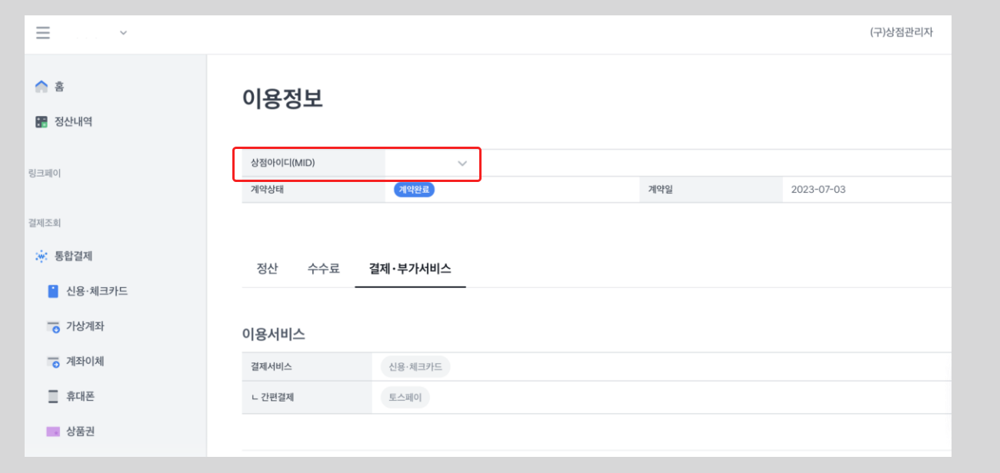
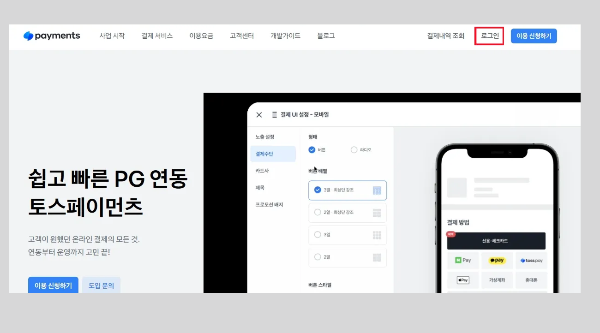
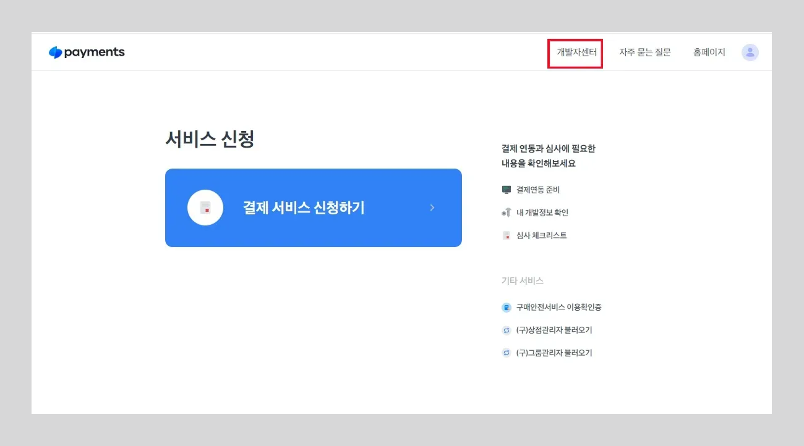
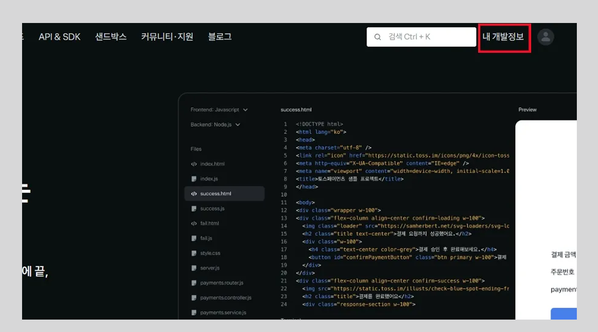
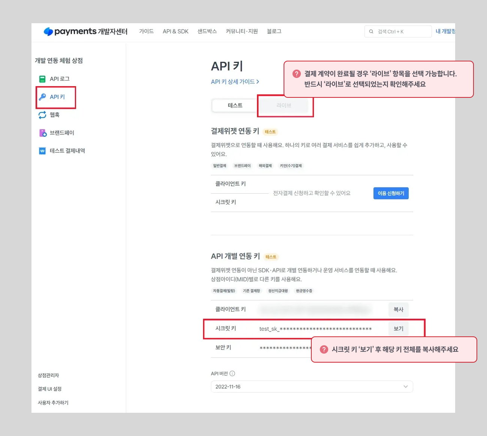
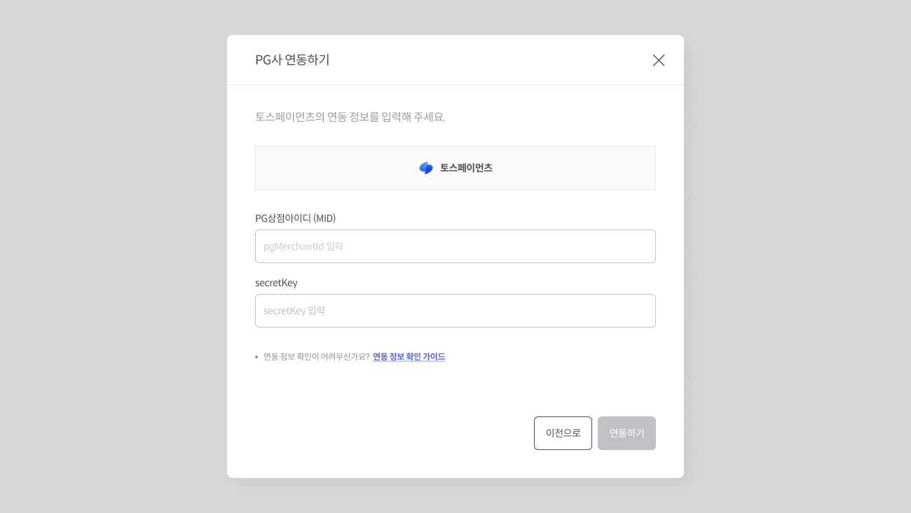

# 토스페이먼츠

> 원문: https://support.alfred.kr/21fe8268-560a-81bd-abc5-cc42abec580d

> **필요정보**
>
> - **상점아이디 (MID)**
>
> - **secretKey**

#### MID 확인방법

- 토스페이먼츠 상점관리자 (관리자페이지) 에 접속합니.다
- 계약·운영 메뉴의 ‘**이용정보**’를 클릭합니다.
- 보유한 상점아이디 (MID)를 확인 할 수 있습니다.

  

  - 여러 개의 MID가 있는 경우 각 MID별로 연동해야 합니다,.

#### 시크릿키 확인방법

- **토스페이먼츠 홈페이지에서 로그인 합니다.**

  [https://www.tosspayments.com](https://www.tosspayments.com)

  

1. **로그인 후 화면 우측 상단의`개발자센터`를 클릭합니다.**

  

- **개발자센터 우측 상단의`내개발정보`**를 **클릭합니다.**

  

1. **화면 좌측 메뉴 > API키 > 라이브 모드 >`시크릿키`를 복사합니다.**
  - 반드시 테스트가 아닌 ‘라이브’로 선택되어있는지 확인해주세요

  

1. **토스페이먼츠 연동화면에서 상점아이디 (MID) 및 복사한 시크릿키를 입력합니다.**

