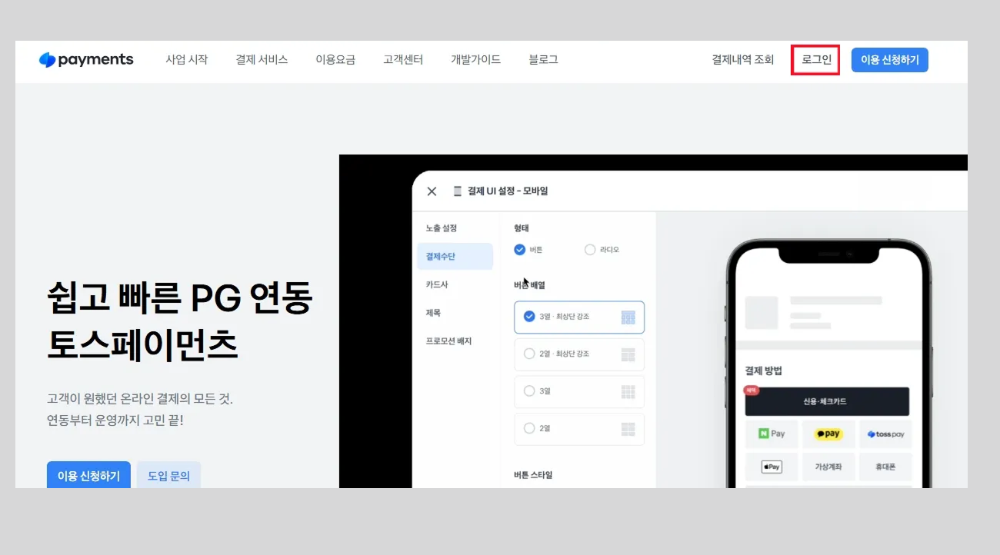
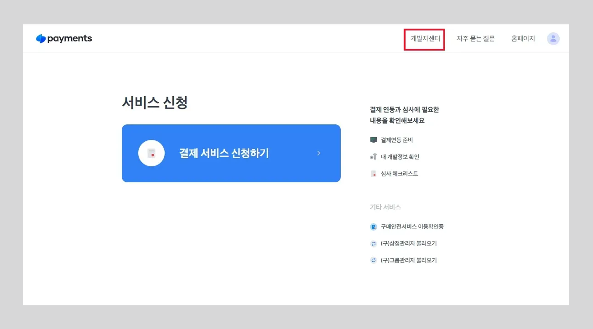
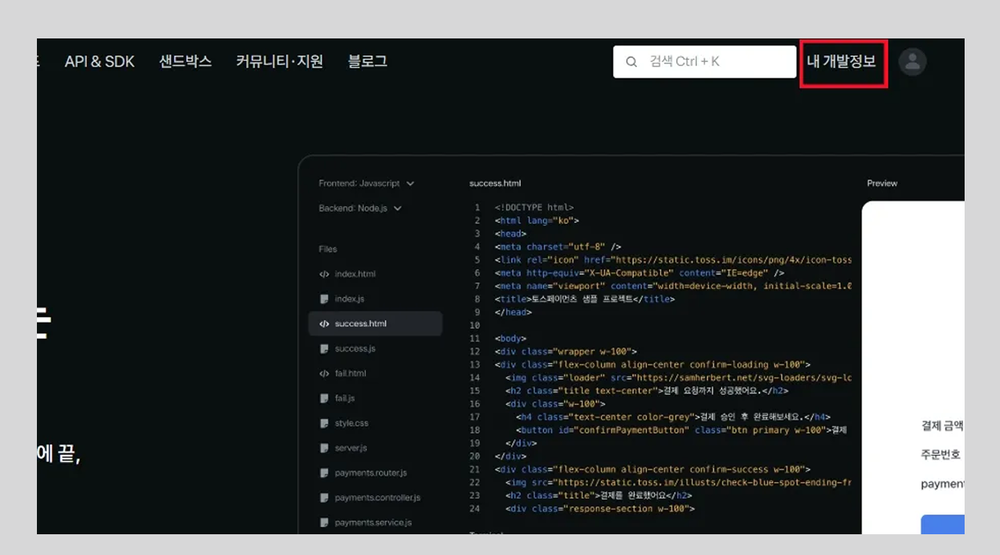
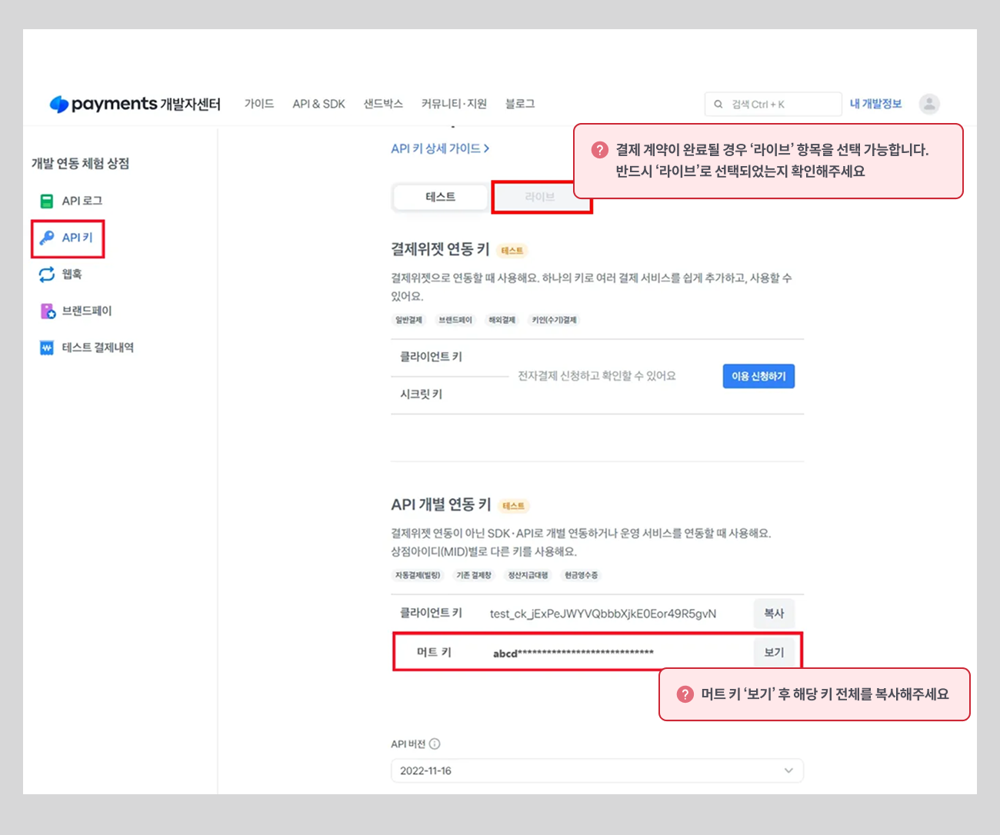
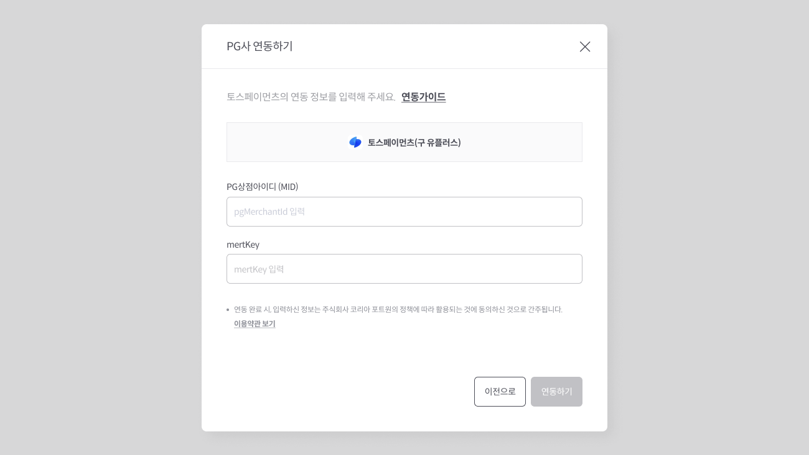

# 토스페이먼츠 (구 유플러스)

> 원문: https://support.alfred.kr/21fe8268-560a-8164-a9a0-d1043aefe868

> **필요정보**
>
> - **mertKey**
>
> - **상점아이디 (MID)**

- **토스페이먼츠 홈페이지에서 로그인 합니다.**

  [https://www.tosspayments.com](https://www.tosspayments.com)

  

1. **로그인 후 화면 우측 상단의`개발자센터`를 클릭합니다.**

  

- **개발자센터 우측 상단의`내개발정보`**를 **클릭합니다.**

  

1. **화면 좌측 메뉴 > API키 > 라이브 모드 >`머트 키`를 복사합니다.**
  - 반드시 테스트가 아닌 ‘라이브’로 선택되어있는지 확인해주세요

    

1. **토스페이먼츠(구 유플러스) 연동화면에서 상점아이디 (MID) 및 복사한 머트키를 입력합니다.**

  
